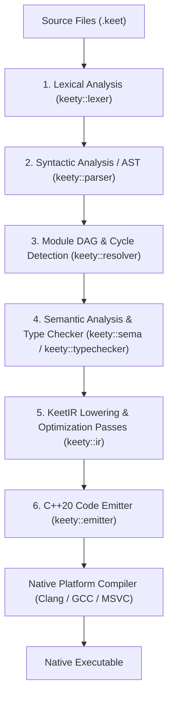

# Keety — The KeetScript AOT Compiler & Toolchain

[](#)
[](#prerequisites)
[](#license)
[](https://github.com/paweljjar/keety/actions/workflows/ci.yml)

**Keety** (`keety` v0.2.0) is the official ahead-of-time (AOT) compiler and toolchain driver for the **KeetScript** programming language (`.keet`).

KeetScript bridges the gap between high-level scripting ergonomics and raw system-level performance. Featuring a clean, expressive syntax inspired by Python and TypeScript, `keety` compiles `.keet` source files into idiomatic, self-contained standard C++20 (`.cpp` / `.hpp`) and invokes your native platform toolchain (Clang, GCC, or MSVC) to produce standalone native binaries.

---

## Key Features

- **Zero-Overhead Native Compilation:** Compiles directly to modern C++20 primitives (`std::variant`, `std::vector`, RAII stack values, and thread-pool futures) without garbage collection pauses or virtual dispatch overhead.
- **Predictable Value Semantics & Safe `mut` Borrowing:** Collections (`array<T>`, `map<K, V>`) and objects use deterministic deep-copy value semantics by default, paired with a static `mut` borrow checker that prevents aliasing hazards at compile time and promotes read-only parameters to `const T&` in KeetIR.
- **First-Class Union Types & Flow Narrowing:** Algebraic union types (`int | string | null`) with canonical normalization and control-flow type narrowing (`typeof(x) == "int"`, `x != null`) guarded by a mutation watcher.
- **Ergonomic Error Recovery (`zonk`):** Handle fallible operations inline with fallback expressions (`expr zonk fallback`) or scoped recovery blocks (`expr zonk (err) { ... }`).
- **Strict Soundness Guarantees:** Mandatory explicit type annotations on declarations, zero implicit numeric/truthy coercion, strict no-shadowing enforcement, and deterministic 64-bit two's-complement arithmetic.
- **Native Desktop GUI & Multi-Target UI:** Build reactive `.kml` Single-File Components that compile to zero-dependency native desktop OS windows (Cocoa on macOS, Win32 on Windows, X11 on Linux) with sub-millisecond software rasterization, HiDPI Retina support, and zero Electron/WebView bloat. Also targets Web VDOM LiveView and ANSI terminals.
- **6-Stage Optimizing Pipeline:** Includes Tarjan SCC circular dependency detection, topological module initialization, liveness analysis, automatic last-use `std::move` insertion, and recursive union boxing.
- **IDE-Grade Diagnostics & Tooling:** Rich, colored, multi-line terminal diagnostics in the style of Rust and Elm, with source spans, Levenshtein "Did you mean?" suggestions and Quick Fix hints; machine-readable JSON output (`--json-diagnostics`); and an official Visual Studio Code extension.

---

## Getting Started

### Prerequisites

- **CMake** 3.20 or newer
- **C++20 Compiler** on `PATH`, required both for building the `keety` compiler itself and for `keety build` / `keety run` (the generated code and runtime target C++20):
    - Clang 14+, GCC 11+, or MSVC 19.30+ (`clang++`, `g++`, or `cl.exe`)

### Building from Source

```bash
# Configure the build
cmake -B build -DCMAKE_BUILD_TYPE=Release

# Build the compiler, unit/conformance tests, and benchmarks
cmake --build build -j
```

The compiled binaries will be located at `./build/src/keety` and `./build/src/kattery`.

#### CMake Configuration Options

| Option | Default | Description |
| :--- | :--- | :--- |
| `KEETY_BUILD_TESTS` | `ON` | Build unit and conformance test suites (`keety_unit_tests`) |
| `KEETY_BUILD_BENCHMARKS` | `ON` | Build reference C++ vs. KeetScript benchmarks (`keety_benchmarks`) |
| `KEETY_ENABLE_WERROR` | `OFF` | Treat compiler warnings as errors (`-Werror` / `/WX`) |
| `KEETY_ENABLE_CLANG_TIDY` | `OFF` | Run `clang-tidy` static analysis during compilation |

---

## Quick Start

Create a file named `hello.keet`:

```keet
import io;

fn safeDivide(a: int, b: int): int {
    return (a / b) zonk -1;
}

fn describe(val: int | string | null): string {
    if (typeof(val) == "int") {
        return `number: ${val.toString()}`;
    } elif (typeof(val) == "string") {
        return `text: "${val}"`;
    } else {
        return "empty";
    }
}

fn swap<T>(mut x: T, mut y: T): void {
    let temp: T = x;
    x = y;
    y = temp;
}

fn main(): int {
    let x: int = 10;
    let y: int = 20;
    swap(mut x, mut y);

    io.println(`x = ${x.toString()}, y = ${y.toString()}`);
    io.println(`10 / 0 fallback = ${safeDivide(10, 0).toString()}`);
    io.println(describe("KeetScript"));
    return 0;
}
```

Validate, run, or compile it to a standalone binary:

```bash
# Type-check and validate semantics without code generation
./build/src/keety check hello.keet

# Compile and immediately execute
./build/src/keety run hello.keet

# Compile to a native executable
./build/src/keety build hello.keet -o ./bin

# Inspect the generated C++20 source or KeetIR
./build/src/keety emit hello.keet --cpp
./build/src/keety emit hello.keet --ir
```

---

## CLI Usage

```text
Usage: keety <command> [options] <file.keet>

Commands:
  check <file>                         Fast IDE-grade semantic and type validation
  emit <file> (--cpp|--hpp|--ast|--ir) Emit generated C++ or intermediate representations
  build <file>                         Compile KeetScript source into a native binary
  run <file> [-- args]                 Compile and immediately execute the target binary
  test [--benchmarks|--conformance]    Run performance benchmarks or conformance test suite
  version                              Display keety version information
  help                                 Display this help message

Options:
  -o, --output-dir <dir>               Target output directory for emitted sources or binaries
  --cxx <compiler>                     Explicit native C++ compiler binary (clang++, g++, cl.exe)
  -O, --opt <0|1|2|3|s|z>              Optimization level (default: 3)
  --wrapv                              Enforce two's-complement overflow semantics
  -v, --verbose                        Enable verbose diagnostics and phase timings
  --no-color                           Disable ANSI color escape sequences in output
  --diagnostic-format <human|json>     Diagnostics as rich, colored, multi-line Rust/Elm-style
                                       messages with Quick Fix suggestions (human, default),
                                       or as a machine-readable JSON array (json)
  --json-diagnostics                   Shorthand for --diagnostic-format=json
  -h, --help                           Display usage documentation
  -V, --version                        Display version number
```

You can also override the runtime headers location via the `KEETY_RUNTIME_DIR` environment variable if running `keety` outside the build tree.

---

## Package Management with Kattery

KeetScript features a clean separation between compilation and package management:
- **`keety`** runs and compiles programs directly, resolving dependencies from `keet_modules/`.
- **`kattery`** is the official package and workspace manager (like `npm` or `cargo`).

Project metadata and dependencies are declared in **`pedigree.json`**, with locked, reproducible dependencies recorded in **`pedigree.lock`**.

### Common Commands:

```bash
# Scaffold a new project with pedigree.json and .gitignore
kattery init

# Add a Git or local dependency
kattery add mathx git+https://github.com/keetscript/mathx.git#v1.0.0
kattery add shared-utils path:../shared-utils

# Remove an installed dependency
kattery remove mathx

# Install or restore locked dependencies (CI-friendly)
kattery install --frozen

# Execute custom scripts defined in pedigree.json
kattery run start

# Compile entry point using keety wrapper
kattery build

# Execute test suite
kattery test
```

For full command options, monorepo workspaces, manifest schema, and package authoring guidelines, see [Kattery Documentation](documentation/kattery/README.md).

---

## Compiler Architecture

`keety` is structured as a deterministic, 6-stage feed-forward compilation pipeline:



1. **Lexer (`keety::lexer`):** UTF-8 maximal-munch tokenizer with context-sensitive disambiguation for blank identifiers (`_`), generic `<TypeArgs>`, nested closing brackets (`>>`), and recursive `${...}` template string interpolation.
2. **Parser (`keety::parser`):** Recursive descent + Pratt expression parser producing a strongly typed AST with exact `SourceSpan` tracking.
3. **Module Resolver (`keety::resolver`):** Resolves standard library (`crypto`, `fs`, `http`, `io`, `json`, `math`, `net`, `sys`, `test`, `time`, `ui`), `keet_modules/`, and relative `.keet` / `.kml` imports into a dependency graph, detects cycles via Tarjan's SCC algorithm, and computes topological initialization order.
4. **Semantic Analyzer & Type Checker (`keety::sema`, `keety::typechecker`):** Enforces strict no-shadowing, exported `const`-view rules, union algebra normalization, flow-sensitive type narrowing with mutation invalidation, and the 5 `mut` borrow-checking rules.
5. **KeetIR & Optimization Passes (`keety::ir`):** Lowers the AST into basic-block intermediate representation and runs static optimization passes:
    - *Const-Ref Promotion:* Promotes unmutated by-value parameters to `const T&`.
    - *Liveness Analysis & Move Insertion:* Automatically wraps dead-after-use local variables in `std::move(...)`.
    - *Recursive Boxing:* Wraps self-referential union variants in value-semantic `keet::deep_copy_ptr<T>`.
    - *Pipeline Reserve:* Pre-allocates vector capacity for chained `.map()` / `.filter()` functional pipelines.
6. **C++20 Emitter & Toolchain Driver (`keety::emitter`, `keety::driver`):** Emits clean `.hpp` and `.cpp` files and invokes the host C++ compiler.

---

## Standard Library

KeetScript ships with a header-only C++20 runtime (`runtime/keet/`) and 11 built-in standard library packages (`crypto`, `fs`, `http`, `io`, `json`, `math`, `net`, `sys`, `test`, `time`, `ui`).

Every standard library package can be imported in any of four ways:

```keet
import crypto;
import "fs";
from http import app;
from "io" import print;
```

| Module | Import | Capabilities |
| :--- | :--- | :--- |
| **`crypto`** | `import crypto;` | Hashing (SHA-256/512, SHA3, BLAKE3), HMAC, AEAD (AES-256-GCM, ChaCha20-Poly1305), CSPRNG, Base64/Hex, Code 128 barcodes & QR codes |
| **`fs`** | `import fs;` | File I/O (`readText`, `readLines`, `writeText`, `appendText`), path manipulation, and directory traversal |
| **`http`** | `import http;` | Non-blocking HTTP/1.1 & RFC 6455 WebSocket server, radix router, middleware pipeline, schema validation, and `.kml` Reactive UI serving (`serveUi`) |
| **`io`** | `import io;` | Console output (`print`, `println`, `eprint`, `eprintln`), ANSI colors, and standard input (`readLine`, `readAll`) |
| **`json`** | `import json;` | RFC 8259 JSON validation, dot-path queries (`getString`, `getInt`, `getBool`, `*Or`), collection parsers, immutable builders, and polymorphic `stringify` |
| **`math`** | `import math;` | Constants (`PI`, `E`, `TAU`), trigonometry, logarithms, rounding, clamping utilities, and PRNG |
| **`net`** | `import net;` | RFC 3986 URL & query parsing, DNS/IP utilities, HTTP/1.1 & HTTPS client (`get`, `postJson`, `request`, `download`), and handle-based TCP/UDP sockets |
| **`sys`** | `import sys;` | Command-line arguments (`args`), environment variables (`getEnv`, `getEnvOr`, `setEnv`, `unsetEnv`, `hasEnv`), process exit, and platform metadata |
| **`test`** | `import test;` | Unit testing suites (`suite`), test cases (`case`), deep equality assertions (`assertEq`), and exception assertions (`assertZonks`) |
| **`time`** | `import time;` | Monotonic high-resolution timers (`nowNs`, `nowMs`), wall-clock timestamps, calendar formatting, and thread sleep (`sleepMs`) |
| **`ui`** | `import ui;` | Compile-time reactive UI engine for `.kml` Single-File Components (`$state`, `$derived`, `$effect`), Native Desktop OS Windows (Cocoa/Win32/X11), Web VDOM LiveView, TUI, and Headless backends |

---

## Testing & Benchmarks

### Running Unit & Conformance Tests

The test suite uses Catch2 and covers all compiler stages, runtime primitives, positive semantic conformance (`tests/conformance/positive/`), and negative diagnostic verification (`E1000`–`E4000` in `tests/conformance/negative/`).

```bash
# Run via CTest
ctest --test-dir build --output-on-failure

# Or run directly via the keety CLI driver
./build/src/keety test --conformance
```

### Running Performance Benchmarks

The benchmark suite compares generated KeetScript against idiomatic handwritten C++20 across four workloads (numeric vector pipeline, hash map / union variant lookup, string ingestion, and async task concurrency):

```bash
./build/src/keety test --benchmarks
# Or invoke the benchmark runner binary directly:
./build/benchmarks/keety_benchmarks
```

---

## Editor Support (VS Code & Antigravity IDE)

An official Visual Studio Code and Antigravity IDE extension is included in [`tools/vscode-keetscript/`](tools/vscode-keetscript/README.md), providing:
- **Native In-Memory Language Server (`keet-lsp`):**
  - **Go to Definition (`F12`):** Direct navigation across local variables, functions, classes, imports, and child `.kml` components
  - **Find All References (`Shift+F12`):** Workspace-wide symbol reference search respecting lexical scopes
  - **Rename Symbol (`F2`):** Safe, scope-aware identifier renaming
  - **Signature Help (`Cmd+Shift+Space`):** Active parameter highlighting for calls and constructors
  - **Outline & Document Symbols:** Hierarchical symbol trees for classes, methods, functions, and KML component runes/props
  - **Document Formatting:** Canonical AST-driven formatter
- Full TextMate syntax highlighting for `.keet` and `.kml` files
- Live background diagnostics (`keety check --json-diagnostics` & `keet-lsp`)
- 1-click Quick Fixes for typos, missing imports, and missing semicolons
- Trigger-assisted autocompletion and hover documentation for standard library modules, KML layout tags, and reactive runes
- Editor title bar **Run** and **Build** buttons

To install locally into VS Code:

```bash
./tools/vscode-keetscript/scripts/install-local.sh
```

---

## Repository Structure

```text
keety/
├── CMakeLists.txt              # Top-level CMake build configuration
├── include/keety/              # Public compiler headers (lexer, parser, sema, ir, emitter, driver)
├── src/                        # Compiler implementation and CLI entrypoint
├── runtime/keet/               # Header-only C++20 runtime & standard library implementation
├── tests/
│   ├── unit/                   # Component unit tests (Lexer, Parser, TypeChecker, IR, Emitter)
│   └── conformance/            # Language conformance suites (positive & negative E1000-E4000)
├── benchmarks/                 # Reference performance benchmarks (.keet vs. handwritten C++20)
├── tools/vscode-keetscript/    # Official Visual Studio Code language extension
└── documentation/              # Formal language, compiler, stdlib, and test specifications
```

---

## Documentation

Detailed specifications and roadmaps are available across the repository:

- [Keety Project Roadmap](ROADMAP.md) — Strategic engineering roadmap, release milestones, and feature backlog.
- [The KeetScript Language Specification](documentation/The%20KeetScript%20Language%20Specification.md) — Complete EBNF grammar, type system, memory model, and execution semantics.
- [Keety Compiler Architecture Specification](documentation/Keety%20Compiler%20Architecture%20Specification.md) — Deep dive into the 6-stage pipeline, KeetIR optimization passes, and C++20 emission templates.
- [KeetScript Language Server Protocol Specification](documentation/KeetScript%20Language%20Server%20Protocol%20Specification.md) — In-memory analysis engine, JSON-RPC protocol transport, editor capabilities, and `.kml` tooling architecture.
- [KeetScript Conformance Test Suite and Benchmark Specification](documentation/KeetScript%20Conformance%20Test%20Suite%20and%20Benchmark%20Specification.md) — Validation test cases and benchmark methodology.
- **Standard Library Reference:**
    - [`crypto` — Cryptography, AEAD & Barcodes/QR](documentation/stdlib/crypto.md)
    - [`fs` — File System](documentation/stdlib/fs.md)
    - [`http` — HTTP/1.1, WebSockets & Reactive UI Server](documentation/stdlib/http.md)
    - [`io` — Input / Output](documentation/stdlib/io.md)
    - [`json` — JSON Parsing & Serialization](documentation/stdlib/json.md)
    - [`math` — Mathematical Functions](documentation/stdlib/math.md)
    - [`net` — Networking, HTTP Client & Sockets](documentation/stdlib/net.md)
    - [`sys` — System & Process](documentation/stdlib/sys.md)
    - [`test` — Unit Testing & Assertions](documentation/stdlib/test.md)
    - [`time` — Clocks & Durations](documentation/stdlib/time.md)
    - [`ui` — Reactive UI Engine & `.kml` Components](documentation/stdlib/ui.md)

---

## License

Distributed under the MIT License. See [`LICENSE`](LICENSE.md) for details.