# Keety Project Roadmap

This document outlines the strategic engineering roadmap and feature backlog for **KeetScript**, the **`keety`** ahead-of-time (AOT) compiler toolchain, the **`kattery`** package manager, and the developer tooling ecosystem.

The roadmap is structured into three main categories:
1. **[Shipped (A)](#a-shipped)** — Production-ready features implemented, tested, and released.
2. **[To Do (B)](#b-to-do)** — Active backlog organized by implementation horizon:
   - **[Near-Term (B1)](#b1-near-term)**
   - **[Mid-Term (B2)](#b2-mid-term)**
   - **[Long-Term (B3)](#b3-long-term)**
3. **[Under Consideration (C)](#c-under-consideration)** — Exploratory features and long-range architectural proposals.

---

## 🗺️ Roadmap Architecture

```mermaid
flowchart TD
    subgraph A["Category A: Shipped"]
        A1["6-Stage AOT Compiler Pipeline"]
        A2["Soundness & Mut Borrow Checker"]
        A3["Standard Library (crypto, fs, http, io, json, math, net, sys, test, time, ui)"]
        A4["Package Manager (kattery)"]
        A5["Language Server Protocol (keet-lsp)"]
        A6["VS Code Extension"]
        A7["Testing Framework (keety test)"]
        A8["Source Line Mapping (#line)"]
        A9["HTTP Server & WebSockets (http)"]
        A10["Code Formatter (keety fmt)"]
        A11["Static Linter (keety lint)"]
        A12["Reactive UI Engine (ui & .kml)"]
    end

    subgraph B["Category B: To Do"]
        subgraph B1["B1: Near-Term"]
            B1_1["Svelte-Like Reactive UI Engine (std::ui)"]
        end
        subgraph B2["B2: Mid-Term"]
            B2_1["Advanced LSP Refactoring"]
            B2_2["Debug Adapter Protocol (keet-dap)"]
        end
        subgraph B3["B3: Long-Term"]
            B3_1["CSP Concurrency (chan & select)"]
            B3_2["Memory Alloc Tracing"]
            B3_3["Foreign Function Interface (FFI)"]
            B3_4["Centralized Package Registry"]
        end
    end

    subgraph C["Category C: Under Consideration"]
        C1["Host Embedding API (libkeety)"]
        C2["Direct LLVM IR Backend"]
        C3["Spec Freeze & LTS Policy"]
        C4["WASM In-Browser Playground"]
    end

    A --> B1 --> B2 --> B3 -.-> C
```



---

## A. Shipped

Production-ready components fully implemented, verified with comprehensive unit, integration, and language conformance test suites, and merged into `main`:

### 1. AOT Compilation Pipeline
- **6-Stage Feed-Forward Architecture:**
  - `keety::lexer`: UTF-8 maximal-munch tokenizer with context-sensitive disambiguation for blank identifiers (`_`), generic `<TypeArgs>`, template literals with recursive `${...}` interpolation, and closing brackets (`>>`).
  - `keety::parser`: Top-down Recursive Descent + Pratt expression parser producing a strongly typed AST with exact `SourceSpan` tracking.
  - `keety::resolver`: Module dependency DAG, Tarjan's SCC circular dependency detection, and post-order topological sort for deterministic module initialization.
  - `keety::sema` & `keety::typechecker`: Mandatory explicit typing, zero implicit coercion, union algebra canonical normalization, control-flow type narrowing with mutation watching, and the 5 strict `mut` borrow-checking rules.
  - `keety::ir`: Control Flow Graph (CFG) lowering with static liveness analysis, automatic last-use `std::move` insertion, const-reference parameter promotion, and self-referential recursive variant boxing (`keet::deep_copy_ptr<T>`).
  - `keety::emitter`: Clean C++20 emission (`.hpp` and `.cpp`) and native toolchain coordination (Clang, GCC, MSVC).

### 2. Language Soundness & Safety Guarantees
- Value semantics by default for collections (`array<T>`, `map<K, V>`) and classes.
- Compile-time prevention of duplicate `mut` aliasing ($f(\text{mut } x, \text{mut } x)$ rejected).
- Deterministic 64-bit two's-complement arithmetic overflow semantics (`--wrapv`).
- Zero-cost `zonk` error recovery expressions and scoped recovery blocks.

### 3. Core Standard Library (`runtime/keet/`)
- **`io`**: Console output (`print`, `println`, `eprint`, `eprintln`) and input stream readers (`readLine`, `readAll`).
- **`fs`**: File I/O (`readText`, `readLines`, `writeText`, `appendText`), directory traversal, and path operations.
- **`sys`**: CLI arguments (`args`), environment variables (`getEnv`, `setEnv`), process exit, and platform metadata.
- **`math`**: Floating-point operations, trigonometry, constants (`PI`, `E`, `TAU`), and clamping functions.
- **`time`**: High-resolution monotonic timers (`nowNs`, `nowMs`), sleep (`sleepMs`), and wall-clock timestamps.
- **`json`**: RFC 8259 parser, dot-path queries, immutable builders, and polymorphic stringification.
- **`net`**: RFC 3986 URL parser, DNS lookups, TCP/UDP sockets, and HTTP/1.1 client (`get`, `postJson`, `download`).
- **`http`**: Non-blocking HTTP/1.1 and RFC 6455 WebSocket server (`app()`, `createServer()`), radix tree routing with `:param` and `*wildcard`, middleware pipeline (`use`, `next`), standard middlewares (`cors`, `jsonParser`, `urlencoded`, `logger`, `staticDir`, `recover`), declarative schema validation (`schema`, `validate`), bidirectional WebSockets (`WebSocket`), and Reactive UI serving (`serveUi`).
- **`crypto`**: Hashing (SHA-256, SHA-512, SHA3-256, SHA3-512, BLAKE3, streaming `Hasher`), message authentication (HMAC-SHA256, HMAC-SHA512, streaming `Hmac`), authenticated symmetric encryption (AES-256-GCM, ChaCha20-Poly1305), CSPRNG (`randomBytes`, `randomHex`, `randomInt`, `randomUuid`, `timingSafeEqual`), encodings (Hex, RFC 4648 Base64, URL-safe Base64), and symbology (Code 128 1D barcode and ISO/IEC 18004 2D QR Code encoders, decoders, SVG & ASCII block renderers).
- **`test`**: Built-in test runner, suites (`suite`), test cases (`case`), deep equality assertions (`assertEq`), and exception assertions (`assertZonks`).
- **`ui`**: Compile-time reactive UI engine for `.kml` Single-File Components (`$state`, `$derived`, `$effect`), scene graph nodes, Flexbox layout solver, TUI backend, Web VDOM & WebSocket LiveView backend, and Headless test harness.

### 4. Package Manager (`kattery`)
- Project manifest (`pedigree.json`) and reproducible lockfile (`pedigree.lock`).
- Remote Git (`git+https://...`) and local path (`path:...`) dependency management with hoisting.
- Monorepo workspace discovery and package link management in `keet_modules/`.
- Cross-platform custom script execution (`kattery run <script>`).
- Starter scaffolding (`kattery init`) with starter code and automated `.gitignore`.

### 5. Language Server Protocol (`keet-lsp`)
- Native JSON-RPC stdio transport with in-memory document synchronization (`textDocument/didOpen`, `didChange`, `didClose`).
- Live background diagnostics (`textDocument/publishDiagnostics`) with line/column squiggles and error codes.
- Go-to-Definition (`textDocument/definition`) for local symbols, declarations, and imported modules.
- Rich Markdown Hover (`textDocument/hover`) with function signatures, types, and stdlib documentation.
- Context-Aware Autocompletion (`textDocument/completion`) for keywords, stdlib modules, members, and import paths.
- Hierarchical Document Outline (`textDocument/documentSymbol`) for VS Code breadcrumbs and Outline view.
- Document Formatting (`textDocument/formatting`) powered directly by `keety::fmt`.
- Code Actions & Quick Fixes (`textDocument/codeAction`) delivering 1-click editor fixes for linter diagnostics.

### 6. Visual Studio Code Extension
- Native TextMate syntax highlighting for `.keet` files and `pedigree.json` validation schema.
- Native LSP client integration (`vscode-languageclient`) with automatic `keet-lsp` discovery.
- Graceful automatic fallback to CLI check-on-save mode when `keet-lsp` is unavailable.

### 7. Native Testing Framework (`keety test` & `test`)
- **First-Class Test Execution Engine:**
  - Built-in `keety test` CLI sub-command supporting discovery, filter matching (`--filter`), parallel execution, and test suite isolation.
  - Standard library `test` module (`import test;`) providing suites (`suite`), individual cases (`case`), and execution primitives.
- **Assertion Primitives:**
  - `assertEq(actual, expected)`: Deep value equality comparison with error formatting.
  - `assertNe(actual, expected)`, `assertTrue(cond)`, `assertFalse(cond)`.
  - `assertZonks(fn, expectedError)`: Exception assertion verifying runtime error names.
  - `fail(message)`: Explicit test failure.
- **Reporting & Tooling:**
  - Formatted terminal reporters with pass/fail counts, execution timings, and error traces.
  - Integration with package manager runner (`kattery test`).

### 8. Source-to-Source Line Mapping (`#line`)
- **Emitted C++ Line Directives (`#line`):**
  - Deduplicated `#line <lineno> "<source>.keet"` directives emitted across AST and KeetIR C++ / Header emitters.
  - Originating `.keet` source line reporting for host compiler diagnostics and static assertions (Clang, GCC, MSVC).
- **Debugger Line Tables:**
  - LLDB, GDB, and VS Code native debuggers bind breakpoints, step through statements, and format stack traces directly against `.keet` files.
- **CLI & Toolchain Coordination:**
  - Automatic native debug symbol emission (`-g` / `/Z7`) on debug builds.
  - `--no-line-directives` CLI flag for clean C++ emission and debugging compiler internals.

### 9. HTTP Server & Full-Duplex WebSockets (`http`)
- **Event-Driven Server Engine:**
  - Non-blocking HTTP/1.1 server built on top of work-stealing thread pools and socket descriptors.
  - Express-style fluent routing with radix tree matching (`:id` parameter extraction and `*wildcard` routing).
  - Composable middleware pipeline supporting asynchronous `next([err])` chains and panic recovery (`recover`).
  - Standard middlewares: CORS (`cors`), JSON body parsing (`jsonParser`), URL-encoded parsing (`urlencoded`), request logging (`logger`), and static asset serving (`staticDir`) with ETag and 304 caching.
- **Declarative Schema Validation Engine:**
  - Runtime schema validation engine with type checking, regex patterns, enums, and automatic `400 Bad Request` rejection.
- **RFC 6455 WebSocket Engine:**
  - Protocol upgrade handshake, frame serialization, client frame unmasking, and event-driven bidirectional dispatching (`onMessage`, `onClose`, `onError`).
- **Benchmarked Microservice Performance:**
  - Proven routing throughput exceeding 20,000,000 requests/sec under multi-threaded load.

### 10. Code Formatter (`keety fmt`)
- **Deterministic Canonical Style:**
  - Opinionated AST/CST pretty-printer (inspired by `gofmt` and `rustfmt`).
  - Standardized 4-space indentation, operator padding, brace placement, and trailing commas in multi-line literals.
  - Deterministic import sorting (Standard library $\to$ third-party packages $\to$ local relative imports).
- **LSP Integration:**
  - Wired into `keet-lsp` via `textDocument/formatting`.
  - Instant "Format on Save" in VS Code without external tooling.
- **Verification Mode:**
  - `keety fmt --check` non-zero exit code flag for CI linting gates.

### 11. Static Linter (`keety lint`)
- **Hygiene, Dead Code & Style Analysis:**
  - Detect unused imports (`L001`), unused local variables (`L002`), unused parameters (`L003`), and unreachable statements (`L004`).
  - Flag unmutated `mut` declarations (`L010`) and lexical variable shadowing (`L011`).
  - Detect empty statement blocks (`L022`).
- **Configurable Rules & In-Code Suppressions:**
  - Hierarchical `.keetlint.json` and `pedigree.json` configuration for rule severities and path exclusion patterns.
  - Granular in-code comment suppressions (`// keetlint:disable`, `// keetlint:disable-next-line`, `// keetlint:enable`).
- **CLI Subcommand & Automated Fix Engine:**
  - `keety lint [paths...]` supporting single files, recursive directories, and stdin mode (`-`).
  - `--check` flag for CI exit code enforcement and `--strict` flag for zero-warning policies.
  - `--fix` automated quick fix application in reverse byte offset order for safe file updates.
- **Language Server Protocol (`keet-lsp`):**
  - Live diagnostics (`textDocument/publishDiagnostics`) with rule codes, source tags, and severity levels.
  - Interactive Quick Fix code actions (`textDocument/codeAction`) for 1-click editor fixes.

---

## B. To Do

Active development backlog organized by implementation priority and time horizon.

### B1: Near-Term

High-priority deliverables focusing on declarative user interfaces, compile-time reactivity, and modern terminal/desktop application development.

#### 1. Svelte-Like Compile-Time Reactive UI Engine (`ui` & `.kml`)
- **Zero-Virtual-DOM Compile-Time Reactivity:**
  - Ahead-of-time (AOT) component compilation lowering declarative component templates directly into surgical C++20 imperative update routines, completely eliminating runtime Virtual DOM allocations and diffing overhead.
  - Static dependency analysis during the `keety::sema` and `keety::ir` phases: compiler constructs a fine-grained reactive dependency graph and maps mutations to deterministic dirty-bit masks.
  - Targeted surgical patching: state assignments trigger only the precise layout nodes and text cells associated with the modified state (`if (dirty & 0x01) { label.setText(...); }`).
- **Reactive State Primitives & Runes:**
  - Ergonomic compile-time reactive declarations inspired by Svelte runes (`$state(initial)`, `$derived(expr)`, `$effect(fn)`).
  - Natural assignment reactivity: direct mutable variable assignments (`count += 1;`) automatically lower into state updates and dirty-bit dispatch.
  - Seamless integration with KeetScript's strict `mut` borrow-checker to guarantee memory safety and data-race free reactive state mutations at compile time.
- **Declarative Component Templates & Direct Data Bindings:**
  - Two-way reactive data bindings (`bind:value={text}`, `bind:checked={flag}`) lowering to zero-overhead event listeners and direct setters.
  - Structural control blocks (`#if ... /if`, `#each ... /each`, `#await ... /await`) compiled into lightweight keyed fragment managers with in-place collection updates.
  - Scoped styling, slots, and component composition with zero runtime wrapper overhead.
- **Multi-Target Rendering Backends:**
  - **Terminal User Interface (TUI):** Blazing-fast terminal driver with ANSI/VT100 escape sequences, double-buffered character grid, flexbox-inspired constraint layout engine, box-drawing primitives, and zero-flicker partial cell redraws driven by dirty masks.
  - **Headless Test Driver:** Deterministic, lightweight headless test environment for asserting reactive UI state transitions and verifying component behavior without physical displays.
  - **Pluggable Target Abstraction:** Modular backend interface (`std::ui::backend`) enabling future WASM direct DOM manipulation and native desktop canvas (e.g. Skia/SDL) integrations.
- **Event Handling, Lifecycles & Async Coordination:**
  - Type-safe synthetic event handling with declarative modifiers (`on:click`, `on:keydown`, `on:resize`).
  - Deterministic component lifecycle hooks (`onMount`, `onDestroy`, `beforeUpdate`, `afterUpdate`).
  - Native asynchronous coordination with KeetScript's async runtime for non-blocking I/O and stream-backed live data rendering.

---

### B2: Mid-Term

Tooling enhancements, developer ergonomics, automated code refactoring, and interactive visual debugging.

#### 1. Advanced LSP Refactoring
- **Symbol Rename (`textDocument/rename` & `textDocument/prepareRename`):**
  - Safe, project-wide identifier renaming respecting lexical scopes and module boundaries.
- **Find All References (`textDocument/references`):**
  - Project-wide search for all read/write usages and call sites of a symbol.
- **Compiler Refactoring Code Actions (`textDocument/codeAction`):**
  - Expand existing lint-driven code actions to support AST/compiler refactorings: "Import missing module", "Create function/class stub from unresolved symbol", "Extract local variable".
- **Signature Help (`textDocument/signatureHelp`):**
  - Parameter tooltips and active parameter index highlighting while typing function/method calls.
- **Semantic Tokens (`textDocument/semanticTokens/full`):**
  - Accurate semantic token categorization for types, functions, variables, constants, and keywords.
- **Range Formatting (`textDocument/rangeFormatting`):**
  - Selective formatting for highlighted code ranges.

#### 2. Debug Adapter Protocol (`keet-dap`)
- **Native DAP Server Binary:**
  - Implement a Debug Adapter Protocol server connecting VS Code Debug UI to LLDB/GDB.
- **Interactive Visual Debugging:**
  - Line breakpoints, conditional breakpoints, and exception hit breakpoints in `.keet` files.
  - Step Over, Step Into, Step Out, and Continue controls.
  - Variable inspector: inspect KeetScript scalar values, unfold union variants, explore maps/arrays, and evaluate watch expressions.

---

### B3: Long-Term

Advanced language systems, memory profiling, foreign interoperability, and package ecosystem scaling.

#### 1. CSP Concurrency Primitives
- **Typed Channels (`chan<T>`):**
  - Value-semantic, thread-safe message passing channels (unbuffered and buffered).
  - Channel operations: `ch.send(val)`, `val = ch.recv()`, `ch.close()`.
  - Non-blocking variants: `ch.trySend(val)`, `ch.tryRecv()`.
- **Channel Multiplexing (`select`):**
  - `select` statement for coordinating multiple channel operations with optional `default` timeout branches.
- **Task Spawning:**
  - `spawn fn(...)` construct scheduling lightweight tasks onto a thread-pool work-stealing scheduler.

#### 2. Memory Allocation Tracing
- **Allocation Profiler (`--trace-alloc`):**
  - Compiler flag emitting lightweight instrumentation for tracking dynamic allocations.
  - Detects accidental deep copies, vector geometric resizes, and string reallocations.
  - Emits heap allocation summaries at program exit or outputs trace data for flamegraph analysis.

#### 3. Foreign Function Interface (FFI)
- **`extern "C"` Bindings:**
  - Direct foreign function declarations in KeetScript:
    ```keet
    extern "C" fn sqlite3_open(filename: string, mut db: rawptr): int;
    ```
- **Type Marshaling:**
  - Zero-overhead marshaling between KeetScript strings/arrays and C-compatible raw buffers and null-terminated strings.
- **Dynamic Library Loading:**
  - Runtime dynamic library loader (`sys.loadLibrary("libfoo.so")`) for invoking dynamic symbols without compile-time linkage.

#### 4. Centralized Package Registry
- **Hosted Package Registry for `kattery`:**
  - Centralized index for discovering, versioning, and distributing KeetScript packages.
  - `kattery publish`: CLI command to authenticate, package, and upload packages with cryptographic integrity checks.
  - SemVer resolution and dependency security audit scans.

---

## C. Under Consideration

Exploratory architectural proposals and long-range research topics under evaluation:

#### 1. Host Embedding API (`libkeety`)
- Packaging the compiler and runtime as an embeddable static/shared library (`libkeety`).
- C/C++ host API allowing host applications (e.g. game engines, web servers) to instantiate KeetScript runtimes, bind native functions, and execute `.keet` scripts.

#### 2. Direct LLVM IR Backend
- An optional, direct-to-LLVM IR code generation backend (`keety build --backend=llvm`) bypassing C++ code emission and host toolchain invocation.
- Goal: Sub-millisecond incremental debug compilation speeds while retaining optimal release performance.

#### 3. Specification Freeze & LTS Policy
- Formal language specification freeze for KeetScript 1.0.
- Strict backward compatibility guarantees, semantic versioning policies, and Long Term Support (LTS) release cadence.

#### 4. WebAssembly (WASM) Playground
- Compiling `keety` and the standard library to WebAssembly / WASI.
- Interactive, zero-installation in-browser KeetScript playground with live syntax highlighting, compilation, and execution.

---

## 💡 Submitting Feedback & Proposals

Have feedback or want to champion a feature in Category B or C?
- Review [The KeetScript Language Specification](documentation/The%20KeetScript%20Language%20Specification.md) for architectural guidelines.
- Open an RFC Discussion following the KeetScript Enhancement Proposal (KEP) format.
