# Keety Project Roadmap

This document outlines the strategic engineering roadmap and feature backlog for **KeetScript**, the **`keety`** ahead-of-time (AOT) compiler toolchain, the **`kattery`** package manager, and the developer tooling ecosystem.

The roadmap is structured into three main categories:
1. **[Shipped (A)](#a-shipped)** — Production-ready features implemented, tested, and released.
2. **[To Do (B)](#b-to-do)** — Active backlog organized by implementation horizon:
   - **[Near-Term (B1)](#b1-near-term)**
   - **[Mid-Term (B2)](#b2-mid-term)**
   - **[Long-Term (B3)](#b3-long-term)**
3. **[Under Consideration (C)](#c-under-consideration)** — Exploratory features and long-range architectural proposals.

---

## 🗺️ Roadmap Architecture

```mermaid
flowchart TD
    subgraph A["Category A: Shipped"]
        A1["6-Stage AOT Compiler Pipeline"]
        A2["Soundness & Mut Borrow Checker"]
        A3["Standard Library (crypto, fs, http, io, json, math, net, sys, test, time, ui)"]
        A4["Package Manager (kattery)"]
        A5["Language Server Protocol (keet-lsp)"]
        A6["VS Code Extension"]
        A7["Testing Framework (keety test)"]
        A8["Source Line Mapping (#line)"]
        A9["HTTP Server & WebSockets (http)"]
        A10["Code Formatter (keety fmt)"]
        A11["Static Linter (keety lint)"]
        A12["Reactive UI Engine (ui & .kml)"]
    end

    subgraph B["Category B: To Do"]
        subgraph B1["B1: Near-Term"]
            B1_1["Native Desktop GUI Backend for std::ui / .kml"]
            B1_2["Advanced LSP Refactoring (keet-lsp)"]
            B1_3["Universal Hot Reloading / Live Watcher"]
            B1_4["Incremental Compilation & Build Cache"]
            B1_5["Standard Documentation Tooling (keety doc)"]
            B1_6["SQLite Database Module (std::db)"]
            B1_7["Multi-User Server-Push & Shared Store (std::ui)"]
            B1_8["Input & Scrollable Containers (.kml)"]
            B1_9["Mobile App Build Support (Android & iOS)"]
            B1_10["KeetScript-Native Error Diagnostics"]
        end
        subgraph B2["B2: Mid-Term"]
            B2_1["Debug Adapter Protocol (keet-dap)"]
            B2_2["Foreign Function Interface (FFI)"]
            B2_3["Memory Alloc Tracing & Profiler"]
            B2_4["Pattern Matching (match)"]
            B2_5["Protocols / Interfaces (trait)"]
        end
        subgraph B3["B3: Long-Term"]
            B3_1["CSP Concurrency (chan & select)"]
            B3_2["Centralized Package Registry (kattery)"]
            B3_3["SIMD Primitives (std::simd)"]
            B3_4["Cross-Compilation Toolchain Drivers"]
        end
    end

    subgraph C["Category C: Under Consideration"]
        C1["Host Embedding API (libkeety)"]
        C2["Direct LLVM IR Backend"]
        C3["WebAssembly In-Browser Playground"]
        C4["Self-Hosting Compiler"]
    end

    A --> B1 --> B2 --> B3 -.-> C
```

---

## A. Shipped

Production-ready components fully implemented, verified with comprehensive unit, integration, and language conformance test suites, and merged into `main`:

### 1. AOT Compilation Pipeline
- **6-Stage Feed-Forward Architecture:**
  - `keety::lexer`: UTF-8 maximal-munch tokenizer with context-sensitive disambiguation for blank identifiers (`_`), generic `<TypeArgs>`, template literals with recursive `${...}` interpolation, and closing brackets (`>>`).
  - `keety::parser`: Top-down Recursive Descent + Pratt expression parser producing a strongly typed AST with exact `SourceSpan` tracking.
  - `keety::resolver`: Module dependency DAG, Tarjan's SCC circular dependency detection, and post-order topological sort for deterministic module initialization.
  - `keety::sema` & `keety::typechecker`: Mandatory explicit typing, zero implicit coercion, union algebra canonical normalization, control-flow type narrowing with mutation watching, and the 5 strict `mut` borrow-checking rules.
  - `keety::ir`: Control Flow Graph (CFG) lowering with static liveness analysis, automatic last-use `std::move` insertion, const-reference parameter promotion, and self-referential recursive variant boxing (`keet::deep_copy_ptr<T>`).
  - `keety::emitter`: Clean C++20 emission (`.hpp` and `.cpp`) and native toolchain coordination (Clang, GCC, MSVC).

### 2. Language Soundness & Safety Guarantees
- Value semantics by default for collections (`array<T>`, `map<K, V>`) and classes.
- Compile-time prevention of duplicate `mut` aliasing ($f(\text{mut } x, \text{mut } x)$ rejected).
- Deterministic 64-bit two's-complement arithmetic overflow semantics (`--wrapv`).
- Zero-cost `zonk` error recovery expressions and scoped recovery blocks.

### 3. Core Standard Library (`runtime/keet/`)
- **`io`**: Console output (`print`, `println`, `eprint`, `eprintln`) and input stream readers (`readLine`, `readAll`).
- **`fs`**: File I/O (`readText`, `readLines`, `writeText`, `appendText`), directory traversal, and path operations.
- **`sys`**: CLI arguments (`args`), environment variables (`getEnv`, `setEnv`), process exit, and platform metadata.
- **`math`**: Floating-point operations, trigonometry, constants (`PI`, `E`, `TAU`), and clamping functions.
- **`time`**: High-resolution monotonic timers (`nowNs`, `nowMs`), sleep (`sleepMs`), and wall-clock timestamps.
- **`json`**: RFC 8259 parser, dot-path queries, immutable builders, and polymorphic stringification.
- **`net`**: RFC 3986 URL parser, DNS lookups, TCP/UDP sockets, and HTTP/1.1 client (`get`, `postJson`, `download`).
- **`http`**: Non-blocking HTTP/1.1 and RFC 6455 WebSocket server (`app()`, `createServer()`), radix tree routing with `:param` and `*wildcard`, middleware pipeline (`use`, `next`), standard middlewares (`cors`, `jsonParser`, `urlencoded`, `logger`, `staticDir`, `recover`), declarative schema validation (`schema`, `validate`), bidirectional WebSockets (`WebSocket`), and Reactive UI serving (`serveUi`).
- **`crypto`**: Hashing (SHA-256, SHA-512, SHA3-256, SHA3-512, BLAKE3, streaming `Hasher`), message authentication (HMAC-SHA256, HMAC-SHA512, streaming `Hmac`), authenticated symmetric encryption (AES-256-GCM, ChaCha20-Poly1305), CSPRNG (`randomBytes`, `randomHex`, `randomInt`, `randomUuid`, `timingSafeEqual`), encodings (Hex, RFC 4648 Base64, URL-safe Base64), and symbology (Code 128 1D barcode and ISO/IEC 18004 2D QR Code encoders, decoders, SVG & ASCII block renderers).
- **`test`**: Built-in test runner, suites (`suite`), test cases (`case`), deep equality assertions (`assertEq`), and exception assertions (`assertZonks`).
- **`ui`**: Compile-time reactive UI engine for `.kml` Single-File Components (`$state`, `$derived`, `$effect`), scene graph nodes, Flexbox layout solver, TUI backend, Web VDOM & WebSocket LiveView backend, and Headless test harness.

### 4. Package Manager (`kattery`)
- Project manifest (`pedigree.json`) and reproducible lockfile (`pedigree.lock`).
- Remote Git (`git+https://...`) and local path (`path:...`) dependency management with hoisting.
- Monorepo workspace discovery and package link management in `keet_modules/`.
- Cross-platform custom script execution (`kattery run <script>`).
- Starter scaffolding (`kattery init`) with starter code and automated `.gitignore`.

### 5. Language Server Protocol (`keet-lsp`)
- Native JSON-RPC stdio transport with in-memory document synchronization (`textDocument/didOpen`, `didChange`, `didClose`).
- Live background diagnostics (`textDocument/publishDiagnostics`) with line/column squiggles and error codes.
- Go-to-Definition (`textDocument/definition`) for local symbols, declarations, and imported modules.
- Rich Markdown Hover (`textDocument/hover`) with function signatures, types, and stdlib documentation.
- Context-Aware Autocompletion (`textDocument/completion`) for keywords, stdlib modules, members, and import paths.
- Hierarchical Document Outline (`textDocument/documentSymbol`) for VS Code breadcrumbs and Outline view.
- Document Formatting (`textDocument/formatting`) powered directly by `keety::fmt`.
- Code Actions & Quick Fixes (`textDocument/codeAction`) delivering 1-click editor fixes for linter diagnostics.

### 6. Visual Studio Code Extension
- Native TextMate syntax highlighting for `.keet` files and `pedigree.json` validation schema.
- Native LSP client integration (`vscode-languageclient`) with automatic `keet-lsp` discovery.
- Graceful automatic fallback to CLI check-on-save mode when `keet-lsp` is unavailable.

### 7. Native Testing Framework (`keety test` & `test`)
- **First-Class Test Execution Engine:**
  - Built-in `keety test` CLI sub-command supporting discovery, filter matching (`--filter`), parallel execution, and test suite isolation.
  - Standard library `test` module (`import test;`) providing suites (`suite`), individual cases (`case`), and execution primitives.
- **Assertion Primitives:**
  - `assertEq(actual, expected)`: Deep value equality comparison with error formatting.
  - `assertNe(actual, expected)`, `assertTrue(cond)`, `assertFalse(cond)`.
  - `assertZonks(fn, expectedError)`: Exception assertion verifying runtime error names.
  - `fail(message)`: Explicit test failure.
- **Reporting & Tooling:**
  - Formatted terminal reporters with pass/fail counts, execution timings, and error traces.
  - Integration with package manager runner (`kattery test`).

### 8. Source-to-Source Line Mapping (`#line`)
- **Emitted C++ Line Directives (`#line`):**
  - Deduplicated `#line <lineno> "<source>.keet"` directives emitted across AST and KeetIR C++ / Header emitters.
  - Originating `.keet` source line reporting for host compiler diagnostics and static assertions (Clang, GCC, MSVC).
- **Debugger Line Tables:**
  - LLDB, GDB, and VS Code native debuggers bind breakpoints, step through statements, and format stack traces directly against `.keet` files.
- **CLI & Toolchain Coordination:**
  - Automatic native debug symbol emission (`-g` / `/Z7`) on debug builds.
  - `--no-line-directives` CLI flag for clean C++ emission and debugging compiler internals.

### 9. HTTP Server & Full-Duplex WebSockets (`http`)
- **Event-Driven Server Engine:**
  - Non-blocking HTTP/1.1 server built on top of work-stealing thread pools and socket descriptors.
  - Express-style fluent routing with radix tree matching (`:id` parameter extraction and `*wildcard` routing).
  - Composable middleware pipeline supporting asynchronous `next([err])` chains and panic recovery (`recover`).
  - Standard middlewares: CORS (`cors`), JSON body parsing (`jsonParser`), URL-encoded parsing (`urlencoded`), request logging (`logger`), and static asset serving (`staticDir`) with ETag and 304 caching.
- **Declarative Schema Validation Engine:**
  - Runtime schema validation engine with type checking, regex patterns, enums, and automatic `400 Bad Request` rejection.
- **RFC 6455 WebSocket Engine:**
  - Protocol upgrade handshake, frame serialization, client frame unmasking, and event-driven bidirectional dispatching (`onMessage`, `onClose`, `onError`).
- **Benchmarked Microservice Performance:**
  - Proven routing throughput exceeding 20,000,000 requests/sec under multi-threaded load.

### 10. Code Formatter (`keety fmt`)
- **Deterministic Canonical Style:**
  - Opinionated AST/CST pretty-printer (inspired by `gofmt` and `rustfmt`).
  - Standardized 4-space indentation, operator padding, brace placement, and trailing commas in multi-line literals.
  - Deterministic import sorting (Standard library $\to$ third-party packages $\to$ local relative imports).
- **LSP Integration:**
  - Wired into `keet-lsp` via `textDocument/formatting`.
  - Instant "Format on Save" in VS Code without external tooling.
- **Verification Mode:**
  - `keety fmt --check` non-zero exit code flag for CI linting gates.

### 11. Static Linter (`keety lint`)
- **Hygiene, Dead Code & Style Analysis:**
  - Detect unused imports (`L001`), unused local variables (`L002`), unused parameters (`L003`), and unreachable statements (`L004`).
  - Flag unmutated `mut` declarations (`L010`) and lexical variable shadowing (`L011`).
  - Detect empty statement blocks (`L022`).
- **Configurable Rules & In-Code Suppressions:**
  - Hierarchical `.keetlint.json` and `pedigree.json` configuration for rule severities and path exclusion patterns.
  - Granular in-code comment suppressions (`// keetlint:disable`, `// keetlint:disable-next-line`, `// keetlint:enable`).
- **CLI Subcommand & Automated Fix Engine:**
  - `keety lint [paths...]` supporting single files, recursive directories, and stdin mode (`-`).
  - `--check` flag for CI exit code enforcement and `--strict` flag for zero-warning policies.
  - `--fix` automated quick fix application in reverse byte offset order for safe file updates.
- **Language Server Protocol (`keet-lsp`):**
  - Live diagnostics (`textDocument/publishDiagnostics`) with rule codes, source tags, and severity levels.
  - Interactive Quick Fix code actions (`textDocument/codeAction`) for 1-click editor fixes.

---

## B. To Do

Active development backlog organized by implementation priority and time horizon.

### B1: Near-Term

- **Native Desktop GUI Backend for `std::ui` / `.kml`**
  - Native cross-platform desktop windowing and scene graph rendering (macOS, Linux, Windows) without browser or Electron runtime overhead.
  - Direct integration of the existing Flexbox layout solver and reactive dirty-mask updates with a native 2D canvas driver (e.g. Skia / Metal / DirectX).
  - First-class synthetic and native window, pointer, and keyboard event dispatching (`on:click`, `on:keydown`, resize, window state).

- **Advanced LSP Refactoring (`keet-lsp`)**
  - Find All References (`textDocument/references`) and project-wide Symbol Rename (`textDocument/rename` & `textDocument/prepareRename`) with lexical scope awareness.
  - Signature Help (`textDocument/signatureHelp`) displaying parameter signatures and active parameter index during call invocation.
  - Semantic Tokens (`textDocument/semanticTokens/full`) providing compiler-backed token categorization and semantic highlighting.
  - Range Formatting (`textDocument/rangeFormatting`) for selective code formatting.

- **Universal KeetScript Hot Reloading / Live Watcher**
  - General-purpose development watch mode (`keety watch` / `keety run --watch`) for continuous compilation and live code reloading across any KeetScript program (CLI tools, HTTP servers, and UI applications).
  - State preservation across reloads using module-level state persistence and hot module replacement (HMR) triggers without restarting the host process.

- **Incremental Compilation & Build Cache (`keety build`)**
  - Dependency-aware hashing of AST, IR, and emitted C++ artifacts to bypass recompilation of unchanged `.keet` modules.
  - Drastic reduction of compilation cycle latency in medium to large workspaces and monorepos.

- **Standard Documentation Tooling (`keety doc`)**
  - CLI documentation generator extracting doc-comments (`///`) into searchable Markdown and static HTML sites (similar to `cargo doc` / `godoc`).
  - Cross-module symbol linking, dead reference verification, and seamless integration with `keet-lsp` hover tooltips.

- **SQLite Database Module (`std::db`)**
  - Standard library SQLite C-runtime wrapper (`runtime/keet/db.hpp` / `import db;`) providing database handle lifecycle (`db.open`), transactions, and command execution (`conn.exec`).
  - Prepared statements with typed parameter binding (`stmt.bind`) and step iteration (`stmt.step`).
  - Foundational storage layer for standalone stateful web/desktop applications (e.g. Discord-like chat apps, user session auth, persistence), paving the way for future pure-KeetScript embedded storage engines (`std::store`).

- **Multi-User Server-Push & Shared Reactive Store (`std::ui`)**
  - Multi-session WebSocket broadcast engine (`backend.broadcastPatch()`) pushing incremental VDOM patches to all connected clients without client-initiated poll/click triggers.
  - Reactive shared event bus and application stores (`chatStore.onMessage(...)`) for real-time collaboration and multi-user synchronization.

- **Interactive Form Inputs & Scroll Containers (`.kml`)**
  - Native `<input>` and `<textarea>` components with two-way text binding (`$bind.value={...}`) and key shortcut handling (`@keydown.enter={...}`).
  - Scrollable container layouts (`overflow-y: auto`) with programmatic auto-scroll anchors for live message streams and dynamic feeds.
  - Dynamic collection rendering loops (`{#for item in items; key=item.id}`) optimized for append-heavy stream updates and surgical DOM diffing.

- **Mobile Application Build Support (Android & iOS)**
  - Native cross-compilation pipeline targeting iOS (`aarch64-apple-ios`, `aarch64-apple-ios-sim`) and Android (`aarch64-linux-android`, `x86_64-linux-android`).
  - Command-line packaging toolchain (`keety build --platform=ios|android`) producing Android `.apk`/`.aab` bundles and iOS `.app`/`.ipa` archives.
  - Mobile runtime lifecycle binding (Android `NativeActivity` / JNI bridge and iOS `UIApplicationDelegate` / `UIWindow`).
  - Touch input & multi-touch gestures, screen orientation, DPI display scaling, and safe area insets integration with `std::ui` and `.kml`.
  - One-command deployment and log streaming to connected mobile devices and simulators/emulators (`keety run --target=ios|android`).

- **KeetScript-Native Error Diagnostics & Backend Compiler Error Remapping**
  - Comprehensive front-end validation ensuring 100% of user errors are caught at sema/typecheck phase to eliminate unexpected C++ backend failures.
  - Diagnostic remapping layer translating raw host C++ compiler and linker diagnostics back to originating `.keet` source lines, symbols, and spans via `#line` maps.
  - Consistent KeetScript error formatting (source squiggles, error codes, actionable fix suggestions) while suppressing internal C++ STL templates and macro backtraces.
  - Elimination of the generic `"Run with '--verbose-cpp' or '--verbose' to view raw backend compiler backtrace"` prompt during standard compile failures.

---

### B2: Mid-Term

- **Debug Adapter Protocol (`keet-dap`)**
  - Dedicated DAP server binary bridging VS Code and editor debuggers to underlying LLDB/GDB debug engines.
  - Interactive debugging with line breakpoints, step-in/step-out, watch expressions, and variable inspection mapped back to `.keet` types and union variants.

- **Foreign Function Interface (FFI)**
  - Direct C ABI declarations (`extern "C" fn ...`), `rawptr` type support, and zero-copy string/buffer type marshaling.
  - Dynamic shared library loading at runtime (`sys.loadLibrary("libfoo.so")`) with dynamic symbol resolution.

- **Memory Allocation Tracing & Profiler (`--trace-alloc`)**
  - Runtime and compile-time allocation instrumentation to track heap allocations, vector capacity resizes, and inadvertent deep value copies.
  - Summary reports on program termination and flamegraph trace exports for memory optimization.

- **Pattern Matching with Exhaustiveness Checking (`match`)**
  - Exhaustive `match` construct supporting scalar constants, union variants, tuple and struct destructuring, and conditional `when` guards.
  - Strict compile-time validation ensuring all possible variant branches are accounted for without silent unhandled cases.

- **Protocols / Interfaces (`protocol` / `trait`)**
  - Lightweight behavioral contracts defining method requirements without requiring class inheritance hierarchies.
  - Support for compile-time generic constraints and static polymorphism.

---

### B3: Long-Term

- **CSP Concurrency Primitives (`chan<T>`, `select`, `spawn`)**
  - Value-semantic, typed communication channels (buffered and unbuffered) with `send`, `recv`, and `close`.
  - Channel multiplexing via `select` statements with configurable timeout and default fallback branches.
  - Thread-pool work-stealing scheduler for `spawn fn(...)`, statically verified by the borrow-checker to prevent data races.

- **Centralized Package Registry (`kattery registry`)**
  - Centralized index for publishing, indexing, and distributing versioned KeetScript packages.
  - `kattery publish` CLI workflow with package signing, cryptographic checksum verification, SemVer constraint resolution, and dependency security vulnerability scanning.

- **SIMD Primitives & Vectorization (`std::simd`)**
  - Portable hardware vector types (`f32x4`, `i32x8`, etc.) lowering to native SSE, AVX, or ARM NEON vector instructions for high-throughput math, audio, and graphics pipelines.

- **Cross-Compilation Toolchain Drivers**
  - Turnkey cross-compilation support via `keety build --target=<triple>` (e.g., targeting Linux or Windows from macOS) without manual toolchain configuration.

---

### C: Under Consideration

- **Host Embedding API (`libkeety`)**
  - C/C++ embedding API distributing `keety` as a static or dynamic library for integration into native hosts (game engines, runtime plugin hosts, or application frameworks).

- **Direct LLVM IR Backend**
  - Native LLVM IR code generator bypassing C++ code emission to achieve sub-millisecond incremental debug compilation speeds.

- **WebAssembly In-Browser Playground**
  - Compiling the compiler and standard library to WebAssembly / WASI to provide a zero-install interactive browser playground.

- **Self-Hosting Compiler**
  - Re-implementing the Keety compiler frontend, parser, and semantic analyzer natively in KeetScript.

---

## 💡 Submitting Feedback & Proposals

Have feedback or want to champion a feature in Category B or C?
- Review [The KeetScript Language Specification](documentation/The%20KeetScript%20Language%20Specification.md) for architectural guidelines.
- Open an RFC Discussion following the KeetScript Enhancement Proposal (KEP) format.
