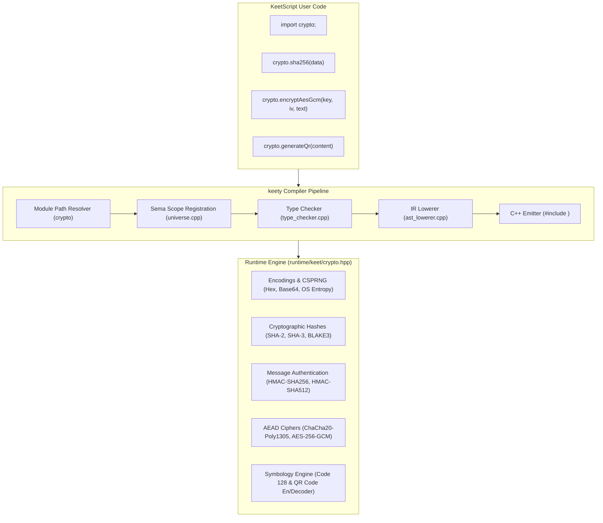

# KeetScript Cryptography & Symbology Implementation Plan (`std::crypto`)

This document establishes the architecture, specification, standard library API, and phased roadmap for the official **KeetScript Cryptography & Symbology Standard Library Module** (`import crypto;` or `import std.crypto;`).

---

## 1. Executive Summary & Design Principles

The `std::crypto` standard library module provides high-performance, secure, and idiomatic cryptographic primitives and symbology algorithms built natively into the KeetScript toolchain:

1. **Zero External Dependencies:** 
   The runtime implementation (`runtime/keet/crypto.hpp`) is 100% self-contained header-only C++20. Generated binaries do not require linking against OpenSSL, libsodium, or OS development packages.
2. **String-First Binary Ergonomics:**
   All cryptographic operations accept and return KeetScript `string` values, handling binary payloads cleanly and offering default hex or base64 conversions.
3. **Built-in Encoding Primitives:**
   Standard data encoding utilities (`toHex`, `fromHex`, `toBase64`, `fromBase64`, `toBase64Url`, `fromBase64Url`) live directly within `crypto`.
4. **Structured Authenticated Encryption (AEAD):**
   Symmetric authenticated encryption routines (AES-256-GCM and ChaCha20-Poly1305) return strongly typed `EncryptedPayload` objects containing the ciphertext, 16-byte authentication tag, initialization vector (IV/nonce), and optional additional authenticated data (AAD).
5. **Side-Channel Hardening:**
   Constant-time execution paths for equality checks (`crypto.timingSafeEqual`) and symmetric stream ciphers to resist cache-timing and side-channel attacks.
6. **Native Symbology (1D Barcodes & 2D QR Codes):**
   Full pure-math encoders and decoders for Code 128 barcodes and ISO/IEC 18004 QR codes, returning structured matrix models with SVG and terminal ANSI art renderers.

---

## 2. Architecture Overview



---

## 3. Standard Library API Specification

### 3.1 Encodings & Security Utilities

```keet
// Hexadecimal encoding
let hex: string = crypto.toHex("Hello World");
let raw: string = crypto.fromHex(hex) zonk "invalid hex";

// Base64 & Base64URL
let b64: string = crypto.toBase64("payload");
let dec: string = crypto.fromBase64(b64) zonk "invalid base64";
let urlSafe: string = crypto.toBase64Url("payload");

// Constant-time comparison
let match: bool = crypto.timingSafeEqual(expectedMac, candidateMac);
```

### 3.2 Secure Randomness (CSPRNG)

```keet
// OS-backed cryptographically secure pseudo-random generation
let token: string = crypto.randomHex(16);        // 32 lowercase hex characters
let rawBytes: string = crypto.randomBytes(32);   // 32 raw bytes
let randomPort: int = crypto.randomInt(1024, 65535); // uniform non-biased
let uuid: string = crypto.randomUuid();          // RFC 4122 v4 UUID
```

### 3.3 Cryptographic Hashing & HMAC

```keet
// One-shot hashing (returns lowercase hex)
let h256: string = crypto.sha256("input");
let h512: string = crypto.sha512("input");
let h3: string   = crypto.sha3_256("input");
let b3: string   = crypto.blake3("input");

// Streaming hasher
let hasher: crypto.Hasher = crypto.createHash("sha256");
hasher.update("chunk-1");
hasher.update("chunk-2");
let digestHex: string = hasher.digestHex();

// Message Authentication (HMAC)
let mac: string = crypto.hmacSha256("secret-key", "message");
let mac512: string = crypto.hmacSha512("secret-key", "message");
```

### 3.4 Authenticated Symmetric Encryption (AEAD)

```keet
class EncryptedPayload {
    ciphertext: string,
    tag: string,
    iv: string,
    aad: string,
}

// AES-256-GCM (12-byte IV, 16-byte Tag)
let encAes: crypto.EncryptedPayload = crypto.encryptAesGcm(key, iv, "secret data", "aad");
let decAes: string = crypto.decryptAesGcm(key, iv, encAes.ciphertext, encAes.tag, "aad") zonk "tampered";

// ChaCha20-Poly1305 (12-byte Nonce, 16-byte Tag)
let encCha: crypto.EncryptedPayload = crypto.encryptChaCha20Poly1305(key, nonce, "secret data", "aad");
let decCha: string = crypto.decryptChaCha20Poly1305(key, nonce, encCha.ciphertext, encCha.tag, "aad") zonk "tampered";
```

### 3.5 Symbology (Barcodes & QR Codes)

```keet
// 1D Barcode (Code 128)
let barcodeSvg: string = crypto.encodeCode128Svg("PROD-88492");
let barcodeTxt: string = crypto.encodeCode128Ascii("PROD-88492");
let decodedText: string = crypto.decodeCode128(barcodeTxt) zonk "invalid barcode";

// 2D QR Code (ISO/IEC 18004)
let qr: crypto.QrCode = crypto.generateQr("https://keet.dev", "M");
let qrSvg: string = qr.toSvg(4);
let qrTerminal: string = qr.toAscii(2);

// Decode QR Code matrix back to string
let scannedUrl: string = crypto.decodeQr(qr.matrix) zonk "decode failed";
```

---

## 4. Implementation Hierarchy: Part $\to$ Phase $\to$ Task

---

### Part 1: Encodings, CSPRNG & Security Utilities

#### Phase 1.1: Data Encodings
- [x] **Task 1.1.1: Hexadecimal Encoding & Decoding**
  - Implement `toHex(data: string) -> string` (lowercase hex).
  - Implement `fromHex(hexStr: string) -> string` with validation (rejects invalid hex characters or odd-length inputs with `zonk`-able errors).
- [x] **Task 1.1.2: Base64 & Base64URL**
  - Implement RFC 4648 standard Base64 `toBase64(data: string) -> string` and `fromBase64(b64: string) -> string`.
  - Implement URL-safe Base64 without padding (`toBase64Url`, `fromBase64Url`) for JWT / web tokens.

#### Phase 1.2: Cryptographically Secure Pseudo-Random Number Generation (CSPRNG)
- [x] **Task 1.2.1: OS Entropy Source Abstraction**
  - macOS / iOS / BSD: `arc4random_buf` / `getentropy`.
  - Linux: `getrandom(2)` syscall with graceful fallback to `/dev/urandom`.
  - Windows: `BCryptGenRandom` (`BCRYPT_USE_SYSTEM_PREFERRED_RNG`).
- [x] **Task 1.2.2: Random Generators API**
  - `randomBytes(length: int) -> string`: Raw byte string of size `length`.
  - `randomHex(length: int) -> string`: Hex-encoded random string of length $2 \times \text{length}$.
  - `randomInt(min: int, max: int) -> int`: Uniform non-biased random integer in range $[min, max]$ using rejection sampling.
  - `randomUuid() -> string`: RFC 4122 v4 UUID generator.

#### Phase 1.3: Side-Channel Hardening
- [x] **Task 1.3.1: Constant-Time Comparisons**
  - Implement `timingSafeEqual(a: string, b: string) -> bool` to protect MAC / signature verification against timing attacks.

---

### Part 2: Cryptographic Hashes & Message Authentication

#### Phase 2.1: Modern Cryptographic Hashes
- [x] **Task 2.1.1: SHA-2 Family (SHA-256 & SHA-512)**
  - Pure C++20 standard implementations with big-endian message scheduling and 64-round (256) / 80-round (512) compression.
  - Provide one-shot `sha256(data: string) -> string` and `sha512(data: string) -> string` (hex output).
- [x] **Task 2.1.2: SHA-3 / Keccak (SHA3-256 & SHA3-512)**
  - Implement the Keccak-$f[1600]$ permutation state with sponge construction and domain separation.
  - Expose `sha3_256(data: string)` and `sha3_512(data: string)`.
- [x] **Task 2.1.3: BLAKE3**
  - Implement chunk-based tree-hashing, 7 rounds of permutations, and chaining value compression.
  - Expose `blake3(data: string) -> string` (high-throughput cryptographic hashing).

#### Phase 2.2: Streaming Digest API (`crypto.Hasher`)
- [x] **Task 2.2.1: Incremental Hasher Engine**
  - Define `class Hasher`:
    - `hasher.update(chunk: string) -> void`
    - `hasher.digestHex() -> string`
    - `hasher.digestBytes() -> string`
    - `hasher.reset() -> void`
  - Factory function `createHash(algorithm: string) -> Hasher`.

#### Phase 2.3: Message Authentication Codes (HMAC)
- [x] **Task 2.3.1: RFC 2104 HMAC Implementation**
  - Inner and outer padded hashing (`H((K' ^ opad) || H((K' ^ ipad) || m))`).
  - Implement one-shot `hmacSha256(key: string, message: string) -> string`.
  - Implement one-shot `hmacSha512(key: string, message: string) -> string`.
  - Streaming HMAC class `crypto.Hmac` with `.update()` and `.digestHex()`.

---

### Part 3: Authenticated Symmetric Encryption (AEAD)

#### Phase 3.1: Data Structures & Contracts
- [x] **Task 3.1.1: Encrypted Payload Type**
  - Define standard struct/class:
    ```keet
    class EncryptedPayload {
        ciphertext: string,
        tag: string,
        iv: string,
        aad: string
    }
    ```
  - Serialization helpers (`payload.toCombinedHex()` and `EncryptedPayload.fromCombinedHex()`).

#### Phase 3.2: ChaCha20-Poly1305 (RFC 8439)
- [x] **Task 3.2.1: ChaCha20 Stream Cipher**
  - Quarter-round quarter-state matrix operations in constant-time (no lookup tables, immune to cache attacks).
- [x] **Task 3.2.2: Poly1305 One-Time Authenticator**
  - Clamped key derivation and 130-bit polynomial evaluation ($\text{mod } 2^{130} - 5$).
- [x] **Task 3.2.3: ChaCha20-Poly1305 AEAD Construction**
  - `encryptChaCha20Poly1305(key: string, nonce: string, plaintext: string, aad: string = "") -> EncryptedPayload`.
  - `decryptChaCha20Poly1305(key: string, nonce: string, ciphertext: string, tag: string, aad: string = "") -> string`.

#### Phase 3.3: AES-256-GCM (NIST SP 800-38D)
- [x] **Task 3.3.1: Constant-Time AES-256 Core**
  - Key expansion for 14 rounds; constant-time / bitsliced S-box to prevent cache timing leaks.
- [x] **Task 3.3.2: Galois Counter Mode (GHASH over $\text{GF}(2^{128})$)**
  - Carryless multiplication and authentication tag computation.
- [x] **Task 3.3.3: AES-256-GCM API**
  - `encryptAesGcm(key: string, iv: string, plaintext: string, aad: string = "") -> EncryptedPayload`.
  - `decryptAesGcm(key: string, iv: string, ciphertext: string, tag: string, aad: string = "") -> string`.

---

### Part 4: Symbology & 2D Matrix Codes (QR & Barcodes)

#### Phase 4.1: 1D Barcodes (Code 128)
- [ ] **Task 4.1.1: Code 128 Encoder**
  - Auto-select optimal subset (Code A, B, C) for dense numeric / ASCII compaction.
  - Compute checksum modulo 103 and output bar/space width sequence.
  - Helpers: `encodeCode128Svg(text: string) -> string` and `encodeCode128Ascii(text: string) -> string`.
- [ ] **Task 4.1.2: Code 128 Decoder**
  - 1D scanline reader: parse bar/space ratios, identify start/stop patterns, and decode characters with checksum verification.

#### Phase 4.2: QR Code Encoder (ISO/IEC 18004)
- [ ] **Task 4.2.1: QR Bitstream & Error Correction**
  - Mode encoding: Numeric, Alphanumeric, Byte (UTF-8).
  - Version auto-selection (Versions 1 through 40) based on payload size and EC level (L: 7%, M: 15%, Q: 25%, H: 30%).
  - Reed-Solomon codeword generator over $\text{GF}(256)$ with primitive polynomial $x^8 + x^4 + x^3 + x^2 + 1$.
- [ ] **Task 4.2.2: Masking & Matrix Layout**
  - Finder patterns, separators, timing patterns, alignment patterns, and dark module placement.
  - Evaluate 8 standard penalty masks to choose the optimal mask pattern.
- [ ] **Task 4.2.3: QR Exporter API**
  - Define `class QrCode`:
    - `matrix: array<array<bool>>`
    - `size: int`
    - `toSvg(margin: int = 4) -> string`
    - `toAscii(margin: int = 2) -> string` (compact terminal unicode block elements `█`, `▀`, `▄`).
  - Function: `generateQr(text: string, ecLevel: string = "M") -> QrCode`.

#### Phase 4.3: QR Code Decoder (Software Matrix Scanner)
- [ ] **Task 4.3.1: Grid & Module Extraction**
  - From a 2D boolean grid / bitmap, locate the 3 finder patterns, measure grid cell pitch, and sample alignment patterns.
- [ ] **Task 4.3.2: QR De-masking & Reed-Solomon Decoding**
  - Read format info, extract data codewords, apply Berlekamp-Massey / Euclidean algorithm to correct bit errors, and unpack payload.
  - Function: `decodeQr(matrix: array<array<bool>>) -> string`.

---

### Part 5: Compiler Pipeline & Toolchain Integration

#### Phase 5.1: Semantic Model & Universe Symbol Registration
- [ ] **Task 5.1.1: Universe Definitions**
  - In `src/sema/universe.cpp`, add `populateCryptoModuleScope()`.
  - Register types: `Hasher`, `Hmac`, `EncryptedPayload`, `QrCode`.
  - Register all crypto, encoding, and symbology functions with strongly typed signatures.
- [ ] **Task 5.1.2: Module Path Resolution**
  - Confirm `"crypto"`, `"std.crypto"`, `"keet.crypto"` canonical mapping in `src/resolver/module_path_resolver.cpp`.

#### Phase 5.2: Typechecker & Diagnostics
- [ ] **Task 5.2.1: Type Checking for `crypto.*` Members**
  - Verify parameter counts, types, and return types in `src/typechecker/type_checker.cpp`.
  - Check `zonk` safety on fallible operations (`fromHex`, `fromBase64`, `decrypt*`, `decodeQr`, `decodeCode128`).

#### Phase 5.3: IR Lowering & C++ Emission
- [ ] **Task 5.3.1: AST Lowering**
  - Wire module symbols and object methods in `src/ir/ast_lowerer.cpp`.
- [ ] **Task 5.3.2: C++ Code Emission**
  - In `src/emitter/cpp_emitter.cpp`, ensure `#include <keet/crypto.hpp>` is emitted when `crypto` is imported.
  - Emit calls to `keet::crypto::...`.

#### Phase 5.4: LSP Integration
- [ ] **Task 5.4.1: Autocomplete & Hover Docs**
  - Update `src/lsp/analyzer.cpp` with hover descriptions, parameter hints, and code completion items for all `crypto` APIs.

---

### Part 6: Conformance & Test Suite

#### Phase 6.1: Cryptographic Test Vectors (RFC & NIST)
- [ ] **Task 6.1.1: Hash & HMAC Vectors**
  - NIST CAVP test vectors for SHA-256 and SHA-512.
  - RFC 2104 / RFC 4231 test vectors for HMAC.
  - Official BLAKE3 and SHA-3 / Keccak test vectors.
- [ ] **Task 6.1.2: AEAD Encryption Vectors**
  - RFC 8439 test vectors for ChaCha20-Poly1305.
  - NIST SP 800-38D test vectors for AES-256-GCM.

#### Phase 6.2: Encodings, CSPRNG & Symbology Tests
- [ ] **Task 6.2.1: Base64 & Hex Roundtrips**
  - Roundtrip binary-to-string-to-binary tests.
  - Edge cases: empty string, unpadded base64, invalid hex characters.
- [ ] **Task 6.2.2: QR & Barcode Roundtrips**
  - Encode string $\to$ generate QR matrix $\to$ decode QR matrix $\to$ assert original string matches.
  - Validate SVG output generation and terminal ASCII rendering.

#### Phase 6.3: End-to-End KeetScript Programs
- [ ] **Task 6.3.1: Integration Tests**
  - Add end-to-end integration tests in `tests/` compiling `.keet` scripts using `import "crypto"` through `keety build` and verifying native execution.
