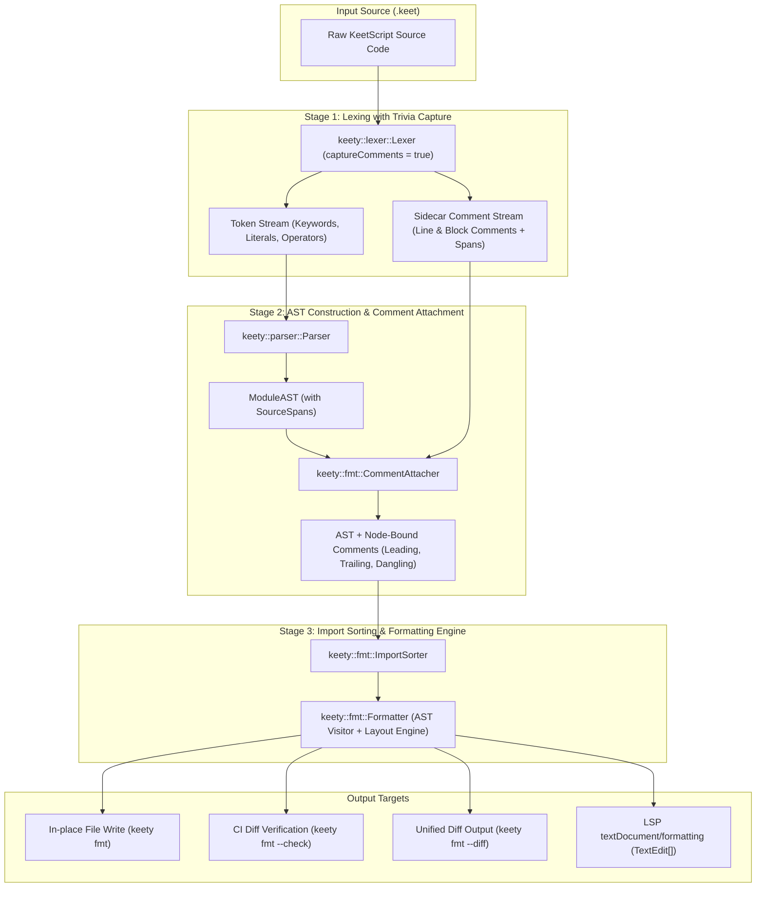

# Code Formatter (`keety fmt`) Implementation Plan

This document specifies the technical architecture, canonical formatting rules, component design, and staged execution plan for the **KeetScript Code Formatter (`keety fmt`)** (Near-Term Backlog item **B1.1** in [`ROADMAP.md`](file:///Users/pawel/CLionProjects/keety/ROADMAP.md#L156-L166)).

---

## 1. Executive Summary & Design Goals

The primary goal of `keety fmt` is to establish an **opinionated, deterministic, canonical source code format** for the KeetScript programming language—following the philosophy of `gofmt` and `rustfmt`:

1. **Deterministic Canonical Style:** There is exactly one blessed way to format KeetScript code. Zero debates over tabs vs. spaces, brace placement, or operator padding.
2. **Lossless Comment & Semantics Preservation:** All line (`//`) and block (`/* ... */`) comments, template string interpolations, and developer annotations must be preserved with precise alignment. Formatted code must produce an identical Abstract Syntax Tree (AST).
3. **Idempotency Guarantee:** Formatting already-formatted code produces identical bytes:
   $$\text{fmt}(\text{fmt}(\text{code})) \equiv \text{fmt}(\text{code})$$
4. **First-Class Toolchain Integration:**
   - **CLI:** `keety fmt` for batch in-place formatting, `--check` for CI gate enforcement (exiting non-zero on diff), and `--diff` for previewing changes.
   - **LSP:** Instant `textDocument/formatting` support in `keet-lsp` for editor "Format on Save" in VS Code and other LSP clients.

---

## 2. End-to-End Architecture



---

## 3. Comment Attachment Model

KeetScript's parser produces an AST where nodes retain `SourceSpan` (start and end byte offsets). Because comments and blank line counts are discarded during standard compilation, the formatter uses a **Sidecar Comment Stream + AST Span Attachment** strategy:

### 3.1 Comment Categorization

Each comment from the lexical stream is classified relative to the surrounding AST nodes:

1. **Leading Comment:** Precedes a statement, declaration, or expression on its own line (or immediately above the node):
   ```keet
   // Leading comment for computeSum
   fn computeSum(a: int, b: int): int {
       return a + b;
   }
   ```
2. **Trailing Comment:** Appears on the same line following a token/node:
   ```keet
   let threshold: int = 100; // Trailing inline explanation
   ```
3. **Dangling Comment:** Located inside an otherwise empty container or between syntactic delimiters where no child node exists:
   ```keet
   fn handleSignal(): void {
       // Dangling comment inside empty block
   }
   ```

### 3.2 Attachment Algorithm

```
For each comment C in CommentStream:
    1. Find AST node N such that N.span begins immediately after C.span on the next line -> Attach as Leading to N.
    2. Else, find AST node N such that N.span ends on the same line before C.span -> Attach as Trailing to N.
    3. Else, find innermost enclosing AST block/container B enclosing C.span -> Attach as Dangling to B.
```

---

## 4. Canonical Style Specification

### 4.1 Indentation & Spacing
- **Indentation:** Exactly 4 spaces per nesting level. Tab characters (`\t`) are converted or rejected.
- **Line Endings:** Canonical LF (`\n`). CRLF is normalized on output.
- **Maximum Line Width:** Soft target of 100 columns. When statements or argument lists exceed 100 columns, they break cleanly across multiple lines.
- **Trailing Whitespace:** Automatically stripped from all lines.
- **Final Newline:** Exactly one newline character at end-of-file.

### 4.2 Bracing Style (One True Brace Style / 1TBS)
- Opening brace `{` is placed on the **same line** as the declaration or control flow header with one preceding space.
- Closing brace `}` matches the indentation level of the initiating keyword/header.
- `else`, `elif`, and `zonk` recovery blocks cuddle with the preceding `}`:
  ```keet
  if (count > 0) {
      process(count);
  } elif (count == 0) {
      idle();
  } else {
      zonk(InvalidCount);
  }
  ```

### 4.3 Operator Padding
- **Binary operators:** Single space on both sides (`+`, `-`, `*`, `/`, `%`, `==`, `!=`, `<`, `<=`, `>`, `>=`, `&&`, `||`, `=`, `+=`, etc.):
  ```keet
  let result: int = (x * 2) + offset;
  ```
- **Unary operators:** Zero space between operator and operand (`!flag`, `-value`, `mut target`):
  ```keet
  if (!isValid) {
      swap(mut first, mut second);
  }
  ```
- **Punctuation:**
  - Comma `,` and semicolon `;`: No space before, one space after.
  - Colon `:` in type annotations: No space before, one space after (`var: int`).
  - Generics: No spaces inside angle brackets (`array<string>`, `map<string, int>`).
  - Parentheses & Brackets: No interior padding (`fn(a, b)`, `[1, 2, 3]`).

### 4.4 Multi-Line Literals & Trailing Commas
When an argument list, parameter list, array literal, or map literal wraps across lines:
- Every element sits on its own indented line (+4 spaces).
- The final element **must** have a trailing comma `,` (minimizing git diff noise).
- Closing delimiter `)` or `]` aligns with the initiating statement indentation:
  ```keet
  let endpoints: array<string> = [
      "/api/v1/users",
      "/api/v1/projects",
      "/api/v1/health",
  ];
  ```

### 4.5 Deterministic Import Sorting
The module import section at the head of every `.keet` file is automatically organized into **three distinct tiers**, separated by a single blank line, and sorted alphabetically within each tier:

```keet
// 1. Standard Library Modules (alphabetical)
import fs;
import io;
import net.http;
import time;

// 2. Third-Party Dependencies (from pedigree.json / git modules)
import "github.com/keet-community/uuid";
import "github.com/keet-community/zlib";

// 3. Local Relative Modules (alphabetical)
import "../core/types";
import "./helpers";
```

### 4.6 Vertical Whitespace
- Exactly **one** blank line between function declarations, class declarations, and type definitions at the module level.
- Maximum of **one** consecutive blank line within function bodies (multiple consecutive empty lines collapsed into one).
- No blank lines immediately following an opening brace `{` or preceding a closing brace `}`.

---

## 5. Detailed Component Design

### 5.1 Lexer Extension (`keety::lexer`)

Extend [`include/keety/lexer/lexer.hpp`](file:///Users/pawel/CLionProjects/keety/include/keety/lexer/lexer.hpp) and [`src/lexer/lexer.cpp`](file:///Users/pawel/CLionProjects/keety/src/lexer/lexer.cpp):

```cpp
namespace keety::lexer {

enum class CommentKind : uint8_t {
    Line,   // `// ...`
    Block   // `/* ... */`
};

struct Comment {
    CommentKind kind;
    diag::SourceSpan span;
    std::string text;
};

// Lexer configuration
struct LexerOptions {
    bool captureComments{false};
};

// In Lexer class:
void setCaptureComments(bool capture) noexcept;
[[nodiscard]] const std::vector<Comment>& getCapturedComments() const noexcept;

} // namespace keety::lexer
```

### 5.2 Formatter Engine (`keety::fmt`)

New directory and headers:
- `include/keety/fmt/formatter.hpp`
- `include/keety/fmt/formatter_options.hpp`
- `include/keety/fmt/comment_attacher.hpp`
- `include/keety/fmt/import_sorter.hpp`
- `src/fmt/formatter.cpp`
- `src/fmt/comment_attacher.cpp`
- `src/fmt/import_sorter.cpp`

```cpp
namespace keety::fmt {

struct FormatterOptions {
    uint32_t indentWidth{4};
    uint32_t maxLineWidth{100};
    bool sortImports{true};
    bool insertTrailingCommas{true};
};

class Formatter {
public:
    explicit Formatter(FormatterOptions options = {});

    /// Formats an entire KeetScript source file string into canonical formatted code.
    [[nodiscard]] std::string format(
        std::string_view source,
        std::string_view filename = "<input>",
        diag::DiagnosticEmitter* emitter = nullptr
    );

    /// Generates unified diff between original and formatted source.
    [[nodiscard]] static std::string generateDiff(
        std::string_view original,
        std::string_view formatted,
        std::string_view filepath
    );
};

} // namespace keety::fmt
```

### 5.3 CLI Driver Integration (`keety fmt`)

Extend [`include/keety/driver/cli_driver.hpp`](file:///Users/pawel/CLionProjects/keety/include/keety/driver/cli_driver.hpp) and [`src/driver/cli_driver.cpp`](file:///Users/pawel/CLionProjects/keety/src/driver/cli_driver.cpp):

- **Command:** `CliCommand::Fmt` (`keety fmt [paths...]`)
- **Flags:**
  - `--check`: Runs verification mode without writing files. Exits `0` if formatted, `1` if unformatted files found (with names printed to stderr).
  - `--diff`: Displays unified diffs of proposed changes.
  - `-w`, `--write`: Overwrite files in place (enabled by default when file arguments are passed).
  - `-` or standard input pipe: Reads from `stdin`, outputs formatted code to `stdout`.
  - `-r`, `--recursive`: Recursively formats `.keet` files in given directories (default behavior for directories).

### 5.4 LSP Integration (`keet-lsp`)

Extend [`src/lsp/server.cpp`](file:///Users/pawel/CLionProjects/keety/src/lsp/server.cpp) and [`src/lsp/analyzer.cpp`](file:///Users/pawel/CLionProjects/keety/src/lsp/analyzer.cpp):

- Advertise `documentFormattingProvider: true` in `initialize` response capabilities.
- Handle `textDocument/formatting`:
  1. Retrieve active document source buffer by URI.
  2. Invoke `keety::fmt::Formatter::format(source)`.
  3. If unchanged, return empty array `[]`.
  4. If changed, return single full-document replacement edit or minimal edits:
     ```json
     [
       {
         "range": {
           "start": {"line": 0, "character": 0},
           "end": {"line": endLine, "character": endChar}
         },
         "newText": "<formatted code>"
       }
     ]
     ```

---

## 6. Staged Implementation Roadmap

| Phase | Milestone / Deliverables | Success Verification |
| :---: | :--- | :--- |
| **Phase 1** | **Lexer Comment & Trivia Capture**<br>• Add `Comment` capture to `keety::lexer::Lexer`<br>• Implement `CommentAttacher` mapping comments to AST node spans | Unit tests in `tests/fmt/comment_attachment_test.cpp` verifying comments bind to correct AST nodes |
| **Phase 2** | **Core Pretty-Printer (`keety::fmt`)**<br>• AST Pretty-Printer visitor covering all declarations, statements, expressions, and types<br>• 4-space indent, 1TBS braces, operator padding, multi-line list breaking<br>• Deterministic `ImportSorter` | Golden tests formatting 20+ diverse `.keet` samples, validating idempotency: `fmt(fmt(x)) == fmt(x)` |
| **Phase 3** | **CLI Subcommand (`keety fmt`)**<br>• CLI arg parser in `CliDriver` for `keety fmt`<br>• `--check`, `--diff`, `--write`, and `stdin/stdout`<br>• Recursive directory traversal | Integration tests checking exit codes `0` and `1` on CI test files |
| **Phase 4** | **LSP `textDocument/formatting`**<br>• Server capability registration<br>• RPC dispatch to formatter engine<br>• Format on Save in VS Code extension | Verified via automated LSP JSON-RPC test client in `tests/lsp/` |
| **Phase 5** | **Repository-Wide Verification & Conformance**<br>• Run `keety fmt --check` across all existing tests in `tests/conformance/`<br>• Verify 100% test pass rate with zero AST semantic regressions | All 100+ conformance tests pass identically before and after formatting |

---

## 7. Definition of Done (DoD)

- [x] All KeetScript syntax forms (enums, classes, generics, closures, match/switch, zonk blocks, template strings) format cleanly and deterministically.
- [x] Idempotency test suite passes for 100% of tested sources.
- [x] Comments (single-line, multi-line, doc-comments) are 100% preserved in place without duplication or loss.
- [x] `keety fmt --check` succeeds on formatted files and fails with non-zero exit code on unformatted files.
- [x] `textDocument/formatting` works seamlessly in `keet-lsp`.
- [x] All existing compiler and runtime conformance tests pass with 100% test coverage.
