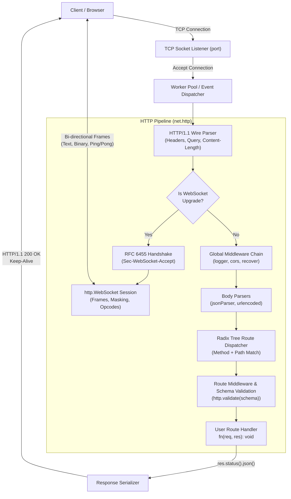

# KeetScript HTTP Server (`std::net::http`) Implementation Plan

> **Architectural Specification & Implementation Plan**  
> **Status:** Draft / Approved for Implementation  
> **Target Submodule:** `net.http` (`import net.http;` or `from "net" import http;`)  
> **Design Pattern:** Node.js `http` & Express.js event-driven, pipeline-based mental model  

---

## 1. Executive Summary & Design Goals

The goal of this initiative is to deliver a production-ready, highly ergonomic, compiled HTTP/1.1 and WebSocket server engine inside KeetScript's standard library under `net.http`.

### Core Architectural Pillars
1. **Express Ergonomics with Compiled Speed:**  
   Simple, declarative routing (`app.get()`, `app.post()`), fluent response generation (`res.status(200).json(...)`), and composable middleware chaining via `next()`.
2. **Zero External C++ Dependencies:**  
   Implemented entirely within Keety's runtime using platform standard networking (Winsock2 on Windows, POSIX Sockets on macOS/Linux), leveraging Keet's existing `keet::json` and `keet::crypto` engines.
3. **Comprehensive Protocol Support:**  
   Full coverage for all HTTP methods (`GET`, `POST`, `PUT`, `DELETE`, `PATCH`, `HEAD`, `OPTIONS`, `ALL`), CORS handling, static file streaming with caching, schema validation with automatic 400 Bad Request formatting, and WebSockets (RFC 6455).
4. **Safety & Robustness:**  
   Automatic panic/error recovery middleware, connection limits, keep-alive timeout management, and graceful server shutdown.

---

## 2. Architecture & Request Pipeline



---

## 3. Detailed Hierarchical Implementation Plan

The implementation is broken down into **5 Parts**, each structured strictly into **Phases $\to$ Tasks $\to$ Subtasks**.

```
Part 1: Core HTTP Engine & Protocol Parser
├── Phase 1.1: HTTP/1.1 Wire Protocol Parser & Message Models
│   ├── Task 1.1.1: Request Line & Header Parsing
│   ├── Task 1.1.2: Body Streaming & Chunked Transfer Decoding
│   └── Task 1.1.3: HTTP Response Formatter & Status Serialization
└── Phase 1.2: Server Socket Lifecycle & Concurrency Engine
    ├── Task 1.2.1: TCP Listener & Non-blocking Socket Management
    └── Task 1.2.2: Connection Pooling, Keep-Alive & Worker Pool

Part 2: Routing Engine & Express-Style Pipeline
├── Phase 2.1: Radix Tree Router & Parameter Extraction
│   ├── Task 2.1.1: Radix Tree Path Storage & Segment Matching
│   └── Task 2.1.2: HTTP Method Matrix & Dispatch Resolution
└── Phase 2.2: Express-Style Middleware Pipeline & next() Chain
    ├── Task 2.2.1: Middleware Pipeline Architecture
    └── Task 2.2.2: http.Request & http.Response Fluent API

Part 3: Standard Middleware Suite & Schema Validation
├── Phase 3.1: Standard Middleware Ecosystem
│   ├── Task 3.1.1: CORS Middleware (http.cors)
│   ├── Task 3.1.2: Body Parsers (jsonParser, urlencoded, raw)
│   └── Task 3.1.3: Operational Middlewares (logger, staticDir, recover)
└── Phase 3.2: Declarative Schema Validation Engine
    ├── Task 3.2.1: Schema Definition & Constraint Rules
    └── Task 3.2.2: Validation Interceptor & 400 Bad Request Formatter

Part 4: WebSockets (RFC 6455)
├── Phase 4.1: WebSocket Upgrade Handshake
│   ├── Task 4.1.1: Upgrade Detection & Header Validation
│   └── Task 4.1.2: Cryptographic Handshake Computation (SHA-1 + Base64)
└── Phase 4.2: WebSocket Framing Engine & Client Abstraction
    ├── Task 4.2.1: Frame Serialization & Client Masking
    └── Task 4.2.2: http.WebSocket API & Event Dispatcher

Part 5: KeetScript Compiler & Submodule Integration (net.http)
├── Phase 5.1: Compiler Semantic Registration & Native Bindings
│   ├── Task 5.1.1: Universe Scope & Submodule Symbol Registration
│   └── Task 5.1.2: Header & C++ Emitter Integration
└── Phase 5.2: Verification, Conformance, Benchmarks & Documentation
    ├── Task 5.2.1: Conformance Test Suite & Integration Tests
    └── Task 5.2.2: Performance Benchmarking & Documentation
```

---

### Part 1: Core HTTP Engine & Protocol Parser

#### Phase 1.1: HTTP/1.1 Wire Protocol Parser & Message Models
- **Task 1.1.1: Request Line & Header Parsing**
  - **Subtask 1.1.1.1:** Parse HTTP request line: decode method token (`GET`, `POST`, etc.), target URI, and HTTP protocol version (`HTTP/1.0`, `HTTP/1.1`).
  - **Subtask 1.1.1.2:** Implement case-insensitive header map (`Content-Type`, `Authorization`, etc.) with support for multi-line folded headers and comma-separated header lists.
  - **Subtask 1.1.1.3:** Implement URL decoder and query string parser splitting `?key=val&flag` into key-value map with percent-decoding (`%20` $\to$ space, `+` $\to$ space).
- **Task 1.1.2: Body Streaming & Chunked Transfer Decoding**
  - **Subtask 1.1.2.1:** Implement fixed-length body reader bounded by `Content-Length`.
  - **Subtask 1.1.2.2:** Implement RFC 9112 Chunked Transfer-Encoding de-chunker with hex chunk size parser and chunk trailer handling.
  - **Subtask 1.1.2.3:** Add payload guardrails: maximum header size limit (e.g. 64KB) and maximum body limit (e.g. 10MB) returning `413 Payload Too Large`.
- **Task 1.1.3: HTTP Response Formatter & Status Serialization**
  - **Subtask 1.1.3.1:** Create RFC 9110 status code lookup table (100–599) mapping numeric codes to standard reason phrases (`200 OK`, `400 Bad Request`, `404 Not Found`, etc.).
  - **Subtask 1.1.3.2:** Build high-performance header serializer automatically injecting `Server`, `Date` (RFC 1123 format), `Content-Length`, and `Connection`.
  - **Subtask 1.1.3.3:** Implement chunked response stream serializer for dynamic/streaming responses.

#### Phase 1.2: Server Socket Lifecycle & Concurrency Engine
- **Task 1.2.1: TCP Listener & Non-blocking Socket Management**
  - **Subtask 1.2.1.1:** Configure socket options: `SO_REUSEADDR`, `SO_REUSEPORT` (where supported), `TCP_NODELAY` (disabling Nagle's algorithm for low HTTP latency).
  - **Subtask 1.2.1.2:** Implement cross-platform socket multiplexing using `poll()` on POSIX and `WSAPoll()` on Windows.
- **Task 1.2.2: Connection Pooling, Keep-Alive & Worker Pool**
  - **Subtask 1.2.2.1:** Implement HTTP/1.1 persistent connection loop (`Connection: keep-alive` with configurable idle timeout, default 5s).
  - **Subtask 1.2.2.2:** Build worker thread-pool architecture allowing incoming connections to be accepted and served concurrently without blocking the main event loop.
  - **Subtask 1.2.2.3:** Implement graceful shutdown: `server.close()` stops listening for new connections and waits for in-flight requests to complete with a drain timeout.

---

### Part 2: Routing Engine & Express-Style Pipeline

#### Phase 2.1: Radix Tree Router & Parameter Extraction
- **Task 2.1.1: Radix Tree Path Storage & Segment Matching**
  - **Subtask 2.1.1.1:** Construct Radix Tree / Trie node structure indexing static path segments (`/api/v1/users`).
  - **Subtask 2.1.1.2:** Support dynamic named parameter segments: `/users/:id` or `/orgs/:orgId/teams/:teamId` populated into `req.params`.
  - **Subtask 2.1.1.3:** Support wildcard and trailing catch-all segments: `/static/*` or `*` for custom 404 handlers.
- **Task 2.1.2: HTTP Method Matrix & Dispatch Resolution**
  - **Subtask 2.1.2.1:** Provide dedicated registration methods: `app.get()`, `app.post()`, `app.put()`, `app.delete()`, `app.patch()`, `app.head()`, `app.options()`.
  - **Subtask 2.1.2.2:** Implement `app.all(path, handler)` matching any HTTP method on that route.
  - **Subtask 2.1.2.3:** Automatic `405 Method Not Allowed` with `Allow` response header when a route matches a different HTTP verb.

#### Phase 2.2: Express-Style Middleware Pipeline & `next()` Chain
- **Task 2.2.1: Middleware Pipeline Architecture**
  - **Subtask 2.2.1.1:** Implement `app.use(middleware)` supporting global middlewares, path-prefix scoped middlewares (`app.use("/api", auth)`), and route-level middlewares.
  - **Subtask 2.2.1.2:** Design the `next()` function mechanism: calling `next()` advances to the next handler in the chain; omitting `next()` terminates the pipeline.
  - **Subtask 2.2.1.3:** Implement error-handling middleware signature: catching unhandled exceptions and routing them to custom error handlers.
- **Task 2.2.2: `http.Request` & `http.Response` Fluent API**
  - **Subtask 2.2.2.1:** `http.Request` fields: `method`, `url`, `path`, `protocol`, `ip`, `params`, `query`, `headers`, `body`, `header(name)`.
  - **Subtask 2.2.2.2:** `http.Response` fluent methods: `res.status(code)`, `res.setHeader(name, val)`, `res.send(str)`, `res.json(obj)`, `res.html(str)`, `res.redirect(url, code)`.
  - **Subtask 2.2.2.3:** Cookie management: `res.cookie(name, value, options)` and `req.cookies` parsing with `HttpOnly`, `Secure`, `SameSite`, and `Expires`.

---

### Part 3: Standard Middleware Suite & Schema Validation

#### Phase 3.1: Standard Middleware Ecosystem
- **Task 3.1.1: CORS Middleware (`http.cors`)**
  - **Subtask 3.1.1.1:** Configurable CORS options: `origin` (wildcard `*` or specific origins), `methods`, `allowedHeaders`, `exposedHeaders`, `credentials`, `maxAge`.
  - **Subtask 3.1.1.2:** Intercept HTTP `OPTIONS` pre-flight requests and respond immediately with `204 No Content` and appropriate CORS headers.
- **Task 3.1.2: Body Parsers (`jsonParser`, `urlencodedParser`, `rawParser`)**
  - **Subtask 3.1.2.1:** `http.jsonParser()`: verifies `Content-Type: application/json`, parses body via `keet::json`, and sets `req.json()`.
  - **Subtask 3.1.2.2:** `http.urlencodedParser()`: parses `application/x-www-form-urlencoded` payloads into key-value pairs.
  - **Subtask 3.1.2.3:** `http.rawParser()`: preserves raw binary byte buffer for file uploads or webhook signature verification.
- **Task 3.1.3: Operational Middlewares (`logger`, `staticDir`, `recover`)**
  - **Subtask 3.1.3.1:** `http.logger()`: colorized request logger printing timestamp, method, path, HTTP status, and response latency.
  - **Subtask 3.1.3.2:** `http.staticDir(mountPath, diskDir)`: static file server with MIME-type detection, `Last-Modified`, `ETag`, and `304 Not Modified` caching.
  - **Subtask 3.1.3.3:** `http.recover()`: wraps request execution in exception handlers to prevent uncaught panics from crashing the HTTP server.

#### Phase 3.2: Declarative Schema Validation Engine
- **Task 3.2.1: Schema Definition & Constraint Rules**
  - **Subtask 3.2.1.1:** Implement `http.schema()` DSL validating `body`, `query`, and `params`.
  - **Subtask 3.2.1.2:** Type checking support for `string`, `int`, `float`, `bool`, `array`, `object`.
  - **Subtask 3.2.1.3:** Built-in constraint checks: `required`, `min`, `max`, `pattern` (regex), `enum`, and default value fallback.
- **Task 3.2.2: Validation Interceptor & 400 Bad Request Formatter**
  - **Subtask 3.2.2.1:** Middleware interceptor `http.validate(schema)` aborting invalid requests with `400 Bad Request`.
  - **Subtask 3.2.2.2:** Emit structured, machine-readable validation error messages:
    ```json
    { "error": "ValidationError", "field": "body.email", "message": "Field 'email' is required" }
    ```
  - **Subtask 3.2.2.3:** Inject validated and sanitized data into request context for downstream handlers.

---

### Part 4: WebSockets (RFC 6455)

#### Phase 4.1: WebSocket Upgrade Handshake
- **Task 4.1.1: Upgrade Detection & Header Validation**
  - **Subtask 4.1.1.1:** Verify `GET` method with `Upgrade: websocket` and `Connection: Upgrade` headers.
  - **Subtask 4.1.1.2:** Validate `Sec-WebSocket-Version: 13` and extract `Sec-WebSocket-Key` (16-byte base64 nonce).
- **Task 4.1.2: Cryptographic Handshake Computation**
  - **Subtask 4.1.2.1:** Concatenate `Sec-WebSocket-Key` with RFC 6455 GUID (`258EAFA5-E914-47DA-95CA-C5AB0DC85B11`).
  - **Subtask 4.1.2.2:** Compute SHA-1 digest and Base64 encode the result via `crypto.sha1()` and `crypto.toBase64()`.
  - **Subtask 4.1.2.3:** Send HTTP `101 Switching Protocols` handshake response and transition socket into WebSocket frame mode.

#### Phase 4.2: WebSocket Framing Engine & Client Abstraction
- **Task 4.2.1: Frame Serialization & Client Masking**
  - **Subtask 4.2.1.1:** Parse 2-to-10 byte frame header, extract FIN bit, opcode, payload length, and 4-byte client masking key.
  - **Subtask 4.2.1.2:** Perform XOR unmasking of client frames: `payload[i] ^ mask[i % 4]`.
  - **Subtask 4.2.1.3:** Handle all RFC 6455 opcodes: Text (`0x1`), Binary (`0x2`), Close (`0x8`), Ping (`0x9`), Pong (`0xA`).
  - **Subtask 4.2.1.4:** Automatic Pong response transmission upon receipt of Ping frame.
- **Task 4.2.2: `http.WebSocket` API & Event Dispatcher**
  - **Subtask 4.2.2.1:** Implement event listeners: `ws.onMessage(fn(string))`, `ws.onBinary(fn(bytes))`, `ws.onClose(fn(code, reason))`.
  - **Subtask 4.2.2.2:** Implement transmission methods: `ws.send(text)`, `ws.sendBinary(bytes)`, `ws.close(code, reason)`.
  - **Subtask 4.2.2.3:** Integrate route-level WebSocket binding: `app.ws("/path", fn(ws): void)`.

---

### Part 5: KeetScript Compiler & Submodule Integration (`net.http`)

#### Phase 5.1: Compiler Semantic Registration & Native Bindings [x]
- **Task 5.1.1: Universe Scope & Submodule Symbol Registration** [x]
  - **Subtask 5.1.1.1:** Register `net.http` submodule in `src/sema/universe.cpp` and `src/resolver/module_path_resolver.cpp`. [x]
  - **Subtask 5.1.1.2:** Expose standard types and functions to KeetScript type checker: `http.app()`, `http.createServer()`, `http.Request`, `http.Response`, `http.WebSocket`, `http.cors()`, `http.jsonParser()`, `http.validate()`. [x]
- **Task 5.1.2: Header & C++ Emitter Integration** [x]
  - **Subtask 5.1.2.1:** Include `keet/net.hpp` and declare `keet::net::http` namespace in generated code. [x]
  - **Subtask 5.1.2.2:** Ensure clean emission of lambda handlers and callback chains without dangling references. [x]

#### Phase 5.2: Verification, Conformance, Benchmarks & Documentation
- **Task 5.2.1: Conformance Test Suite & Integration Tests**
  - **Subtask 5.2.1.1:** End-to-end tests for all HTTP methods (`GET`, `POST`, `PUT`, `DELETE`, `PATCH`, `HEAD`, `OPTIONS`).
  - **Subtask 5.2.1.2:** Unit tests for path parameters, query parameters, and route precedence.
  - **Subtask 5.2.1.3:** Tests for middleware sequencing, `next()` continuation, and short-circuiting.
  - **Subtask 5.2.1.4:** Tests for CORS headers, pre-flight requests, and schema validation rejections.
  - **Subtask 5.2.1.5:** End-to-end WebSocket connection, bi-directional text message exchange, ping/pong, and closure.
- **Task 5.2.2: Performance Benchmarking & Documentation**
  - **Subtask 5.2.2.1:** Benchmark requests/second, memory consumption, and latency under concurrent load.
  - **Subtask 5.2.2.2:** Create comprehensive guide in `documentation/HTTP_SERVER_GUIDE.md` with complete examples.
  - **Subtask 5.2.2.3:** Update `ROADMAP.md` Category B1 marking progress.

---

## 4. Verification & Testing Matrix

| Test Category | Target Component | Verification Criteria |
| :--- | :--- | :--- |
| **HTTP Parser** | `HttpParser` | Validates request line, headers, chunked bodies, and malformed request rejection (`400 Bad Request`). |
| **Router** | `RadixRouter` | Validates exact, parameterized (`:id`), and wildcard paths, 404 generation, and 405 Method Not Allowed. |
| **Middleware** | `MiddlewareChain` | Verifies execution order, `next()` propagation, error handlers, and recovery from panics. |
| **CORS** | `http.cors()` | Asserts correct CORS headers on standard requests and automatic handling of `OPTIONS` pre-flights. |
| **Validation** | `http.validate()` | Verifies invalid payloads return `400 Bad Request` with field names; valid payloads pass to route handler. |
| **WebSockets** | `http.WebSocket` | Verifies RFC 6455 handshake, frame masking/unmasking, text messaging, ping/pong, and clean closure. |
| **Concurrency** | `HttpServer` | Verifies keep-alive reuse, multi-client concurrent throughput, and clean shutdown on `server.close()`. |

---

## 5. Success Criteria

- [ ] `import net.http;` successfully resolves and compiles in KeetScript programs.
- [ ] Express-style routes (`app.get()`, `app.post()`, `app.put()`, `app.delete()`, `app.all()`) match and extract `:params` and `?query` accurately.
- [ ] Middlewares execute sequentially via `next()` callbacks and allow early response termination.
- [ ] Built-in CORS middleware handles simple and pre-flight `OPTIONS` requests automatically.
- [ ] Built-in body parsers decode JSON and url-encoded payloads into typed KeetScript structures.
- [ ] Schema validation rejects invalid input with descriptive `400 Bad Request` JSON responses.
- [ ] WebSocket endpoints (`app.ws()`) successfully upgrade and exchange bi-directional masked frames with standard clients (browser `WebSocket`, `curl --websocket`, or test clients).
- [ ] 100% test pass rate across all existing and new conformance tests in `ctest`.
- [ ] Zero memory leaks and graceful shutdown on `SIGINT` / `server.close()`.
