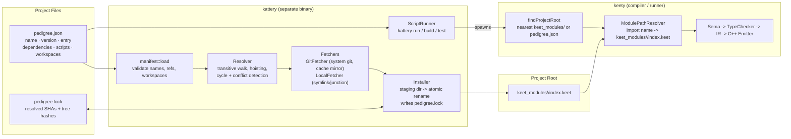

# KeetScript Tooling: `kattery` Package Manager & `pedigree.json` Implementation Plan

## 1. Executive Summary & Architectural Decisions

`kattery` is the KeetScript package manager. It is a **separate executable** from the `keety` compiler/runner, built from the same repository and released together. It adds, removes, and installs third-party KeetScript packages into `keet_modules/`, records project metadata and custom run-scripts in `pedigree.json`, and pins exact versions in `pedigree.lock`.

The ecosystem mapping mirrors the Node.js toolchain:

| Node.js | KeetScript | Role |
|---|---|---|
| `node` | `keety` | Compile & run `.keet` programs |
| `npm` | `kattery` | Add / remove / install packages, run project scripts |
| `package.json` | `pedigree.json` | Project manifest: name, version, entry, dependencies, scripts, workspaces |
| `package-lock.json` | `pedigree.lock` | Deterministic lockfile pinning resolved git commits |
| `node_modules/` | `keet_modules/` | Installed packages (**unchanged**, already supported by `ModulePathResolver`) |

### Core Design Principles
1. **Option A — Strict Separation of `keety` and `kattery`:**
   - `keety` stays **manifest-agnostic**: `keety run file.keet`, `keety build`, `keety check` keep working exactly as today, with or without a `pedigree.json`.
   - `kattery` owns everything about packages: parsing `pedigree.json`, resolving dependencies, fetching sources, writing `keet_modules/` and `pedigree.lock`, and running scripts.
   - **The only contract between the two binaries is the filesystem:** `kattery` populates `keet_modules/<name>/index.keet`; `keety`'s existing resolver imports it as `ModuleKind::Package`.
   - The one required `keety` change is **upward project-root discovery** (see 4.6), so entry files in subdirectories and workspace members find the right `keet_modules/`.
   - `kattery` shells out to `keety` for `build` / `test` / `run` wrappers and never links the compiler pipeline into itself, except for the shared version constant.
2. **Option A — Two Dependency Source Kinds in v1 (Git & Local Path):**
   - **Git:** `"mathx": "git+https://github.com/user/mathx.git#v1.2.0"`. The ref after `#` may be a tag, a branch, or a full/abbreviated commit SHA. Without `#ref`, the remote default branch is used. Supported URL forms: `https://`, `ssh://`, `git@host:path`, `file://`.
   - **Local path:** `"utils": "path:../utils"`. Linked into `keet_modules/` (symlink on POSIX, directory junction on Windows, recursive copy as last-resort fallback).
   - **Out of scope for v1 (documented, not designed):** hosted registry, semver ranges, `kattery publish`, tarball URLs, per-package nested `keet_modules/`.
3. **Option A — Deterministic `pedigree.lock` Pinning Commits:**
   - Every git dependency is pinned to the **full 40-char commit SHA** plus the **git tree hash** (`git rev-parse <sha>^{tree}`) as an integrity check; no extra hashing code required.
   - Local-path dependencies are recorded by relative path only (no SHA, they track the working tree).
   - Entries are sorted lexicographically by package name and serialized with fixed key order and 2-space indentation, so lockfile diffs are minimal and byte-stable across platforms (LF line endings always).
   - `kattery install` is lockfile-first: if `pedigree.lock` satisfies `pedigree.json`, nothing is re-resolved; `--frozen` fails (exit 1) if the lock is stale instead of rewriting it (for CI).
4. **Option A — Flat, Hoisted `keet_modules/` with Conflict Detection:**
   - The existing resolver looks up `keet_modules/<name>` flatly, so installs are flat. Transitive dependencies are hoisted to the project root's `keet_modules/`.
   - If two packages require the **same name at different resolved commits**, installation fails with a clear conflict error (names both requesters and both refs). The user resolves it by pinning one ref in the root `pedigree.json` (a root declaration always wins over transitive ones).
   - Dependency **cycles** are detected during resolution and reported as `A -> B -> C -> A`.
5. **Option A — Monorepo Workspaces in v1:**
   - Root `pedigree.json` declares `"workspaces": ["packages/*", "apps/cli"]` (literal paths and trailing-`*` single-level globs only).
   - Each member is a package with its own `pedigree.json`. Members are linked into the root `keet_modules/<member-name>` so they can `import` each other by name.
   - All external dependencies of all members are resolved together, hoisted to the **root** `keet_modules/`, and pinned by a **single root `pedigree.lock`**.
   - Commands accept `--workspace <name>` / `-w` to target one member (`add`, `remove`, `run`), and `--workspaces` to run a script in every member.
6. **Option A — Zero External C++ Library Dependencies:**
   - **Manifest/lockfile JSON:** reuses the header-only `keet::json` parser/serializer from `runtime/keet/json.hpp`; no new third-party code.
   - **Git:** shells out to the system `git` executable (no libgit2). `kattery` checks `git --version` lazily and reports a clear error (`KAT2001`) if git is missing, only when a git dependency is actually needed.
   - **Process spawning:** a small argv-based `ProcessRunner` (`posix_spawnp` on POSIX, `CreateProcessW` on Windows) with stdout/stderr capture and inherited-stdio mode. No shell string interpolation for git/keety invocations (the compiler's `popen` approach is not reused, to avoid quoting/injection issues with URLs and refs).
   - **Script execution** (`kattery run`) is the one place a shell is intentionally used (`/bin/sh -c` / `cmd /C`), matching npm semantics, with `keet_modules/.bin` not needed (no executables in v1).
   - **Global cache:** `$KATTERY_HOME` (default `~/.kattery`, `%USERPROFILE%\.kattery` on Windows) holds bare git mirrors at `cache/git/<sha1(url)>.git`, so repeat installs and multi-project setups avoid re-cloning.
7. **Strict Tooling Guardrails:**
   - **Conventional command names are primary** (`init`, `add`, `remove`, `install`, `run`). Metaphor aliases are secondary and documented as aliases only (`adopt` → `add`, `release` → `remove`).
   - **Never run package code during install.** There are no lifecycle scripts (`preinstall`, `postinstall`) in v1, so installing a package cannot execute arbitrary code.
   - **Atomic installs:** packages are fetched into `keet_modules/.staging/` and renamed into place; an interrupted install never leaves a half-written package.
   - **Never touch user sources:** `kattery` writes only `pedigree.json`, `pedigree.lock`, `keet_modules/`, and `$KATTERY_HOME`.
   - **Package-name validation:** `^[a-z][a-z0-9_-]{0,63}$` and must not collide with a stdlib module name (`io`, `fs`, `sys`, `math`, `time`, `json`, `net`, ...), since stdlib wins in the resolver and the package would be unreachable.
   - **Version sync:** `kattery --version` prints the same `KEETY_VERSION` as `keety --version`. A `pedigree.json` may declare `"keety": ">=0.1.0"`; `kattery` warns (non-fatal) when the installed `keety` is older.
   - **No trailing `!`** in docs, signatures, or diagnostics; all KeetScript-facing names remain `camelCase`.

---

## 2. End-to-End Tooling Pipeline Architecture



---

## 3. Complete `pedigree.json`, `pedigree.lock` & CLI Specification

### 3.1 `pedigree.json` Manifest Schema

```json
{
  "name": "my-app",
  "version": "0.1.0",
  "description": "A KeetScript app",
  "entry": "src/main.keet",
  "keety": ">=0.1.0",
  "dependencies": {
    "mathx": "git+https://github.com/user/mathx.git#v1.2.0",
    "utils": "path:../utils"
  },
  "devDependencies": {
    "testkit": "git+https://github.com/user/testkit.git#main"
  },
  "scripts": {
    "start": "keety run src/main.keet",
    "test": "keety run tests/all.keet",
    "build": "keety build src/main.keet -o dist/app"
  },
  "workspaces": ["packages/*"]
}
```

| Field | Type | Required | Description |
|---|---|---|---|
| `name` | `string` | Yes | Package name; validated per 1.7 rules. Used as the `keet_modules/` directory name when this project is itself a dependency or workspace member. |
| `version` | `string` | Yes | `MAJOR.MINOR.PATCH` (informational in v1; no range solving). |
| `description` | `string` | No | Free text. |
| `entry` | `string` | No | Application entry `.keet` file used by `kattery run start` default and `kattery build`/`test` wrappers. Libraries expose `index.keet` at the package root by convention. |
| `keety` | `string` | No | Minimum compiler version, `>=X.Y.Z` form only. |
| `dependencies` | `map<string, string>` | No | Package name → source spec (git or path). |
| `devDependencies` | `map<string, string>` | No | Same format; skipped by `kattery install --production`; **not** installed for packages that are themselves dependencies. |
| `scripts` | `map<string, string>` | No | Script name → shell command line. |
| `workspaces` | `array<string>` | No | Member directories (literal or `dir/*`); only honored in the **root** manifest. |

**Source spec grammar**

| Form | Example | Meaning |
|---|---|---|
| `git+<url>[#<ref>]` | `git+https://github.com/u/p.git#v1.0.0` | Git repo; `<ref>` = tag, branch, or commit SHA (≥7 hex chars) |
| `git+<scp-url>[#<ref>]` | `git+git@github.com:u/p.git#main` | SCP-style SSH URL |
| `path:<relative-or-absolute>` | `path:../utils` | Local directory containing a `pedigree.json` or `index.keet` |

Validation errors use stable codes (`KAT1xxx` manifest, `KAT2xxx` fetch/git, `KAT3xxx` resolve/install, `KAT4xxx` scripts/CLI) and always include the file path and JSON path (e.g., `pedigree.json: dependencies.mathx: invalid source spec`).

### 3.2 `pedigree.lock` Schema

```json
{
  "lockVersion": 1,
  "packages": {
    "mathx": {
      "source": "git",
      "url": "https://github.com/user/mathx.git",
      "ref": "v1.2.0",
      "commit": "9fceb02d0ae598e95dc970b74767f19372d61af8",
      "tree": "4b825dc642cb6eb9a060e54bf8d69288fbee4904",
      "dependencies": ["strutil"]
    },
    "utils": {
      "source": "path",
      "path": "../utils",
      "dependencies": []
    }
  }
}
```

- `packages` keys sorted lexicographically; per-package key order fixed as shown; `dependencies` arrays sorted.
- `commit` is always a full SHA; `tree` is verified after checkout (mismatch → `KAT2005`, install aborted).
- Workspace members are **not** listed (they are discovered from the manifest); only external packages are.

### 3.3 CLI Command Specification (`kattery`)

| Command | Aliases | Description | Exit Codes |
|---|---|---|---|
| `kattery init [--name <n>] [--yes]` | | Creates `pedigree.json` in the current directory (name defaults to directory name; scaffolds `entry: "src/main.keet"`, and a `start` script). Refuses to overwrite an existing manifest. | `0` ok, `1` exists/invalid |
| `kattery add <name> <spec> [-D] [-w <member>]` | `adopt` | Adds the dependency (`git+url[#ref]` or `path:dir`; bare `https://…`/`git@…` URLs are accepted and normalized to `git+…`), resolves transitive deps, installs, updates `pedigree.json` + `pedigree.lock`. | `0`, `1` |
| `kattery remove <name> [-w <member>]` | `release`, `rm` | Removes the dependency from the manifest, prunes now-unreachable packages from `keet_modules/`, updates the lockfile. | `0`, `1` |
| `kattery install [--frozen] [--production]` | `i` | Reconciles `keet_modules/` with `pedigree.lock` (resolving and writing the lock when absent or stale; `--frozen` errors instead). Installs workspace links. Idempotent. | `0`, `1` |
| `kattery update [<name>]` | `up` | Re-resolves git refs (branches/default-branch) to the latest commit and rewrites the lock for one or all packages. | `0`, `1` |
| `kattery list [--tree]` | `ls` | Prints installed packages with source and short SHA; `--tree` shows the dependency graph. | `0` |
| `kattery run <script> [-- <args…>]` | `r` | Runs `scripts.<script>` from `pedigree.json` via the OS shell in the manifest's directory, forwarding extra args. With no argument, lists available scripts. Prepends the directory of the `keety` binary to `PATH` so scripts can call `keety` directly. | script's exit code; `127` unknown script |
| `kattery build [<file>] [-- <keety args…>]` | | Thin wrapper: runs `keety build <entry>`; uses `entry` from the manifest when `<file>` is omitted. | `keety`'s exit code |
| `kattery test [-- <keety args…>]` | `t` | Runs `scripts.test` when defined; otherwise error `KAT4003` with a hint. | script's exit code |
| `kattery --version`, `kattery --help` | | Version (identical to `keety`) and usage. | `0` |

Global flags: `--cwd <dir>`, `--verbose` / `-v`, `--no-color`, `--workspaces` (for `run`, `install`).

### 3.4 Workspace Rules

| Rule | Behavior |
|---|---|
| Root detection | `kattery` walks upward from the cwd to the nearest `pedigree.json` that declares `workspaces` and lists the cwd (or an ancestor member) as a member; otherwise the nearest `pedigree.json` is the root. |
| Member discovery | Expand `workspaces` entries (literal, or `dir/*` one level); each match must contain a `pedigree.json`; duplicate member names → `KAT3004`. |
| Linking | Each member is linked at `<root>/keet_modules/<member-name>`. |
| Hoisting | Union of all member deps (and `devDependencies` unless `--production`) is resolved and installed once at the root. Differing refs for the same name across members → conflict error (`KAT3002`). |
| Lockfile | One `<root>/pedigree.lock`. |
| `run` | Runs in the targeted member's directory; `--workspaces` runs the script in every member that defines it (declaration order, stops on first failure unless `--keep-going`). |

---

## 4. Implementation Design

### 4.1 Source Layout & CMake

```
include/keety/pkg/   version-agnostic public headers for the kattery library
src/pkg/             manifest, lockfile, source spec, resolver, installer, fetchers, process, scripts
src/kattery/main.cpp thin CLI entry point
```

- New static library `kattery_core` (`src/pkg/*.cpp`), linking `keety_warnings`; new executable `kattery` (`src/kattery/main.cpp`) linking `kattery_core`.
- `kattery_core` includes `runtime/keet/json.hpp` via the existing runtime include directory; it does **not** link `keety_core`.
- Both executables read the version from the existing project version (`0.1.0` in the root `CMakeLists.txt`) through a shared compile definition so they cannot drift (`KEETY_VERSION_STRING`).
- Root `CMakeLists.txt`/`src/CMakeLists.txt` add the targets; `tests/CMakeLists.txt` adds the new unit test files to `keety_unit_tests` (linking `kattery_core`).
- CI needs no changes beyond the existing build/ctest matrix, since `kattery` builds with the rest of the tree on ubuntu, macos and windows.

### 4.2 Core Types (`keety::pkg`)

| Type | Responsibility |
|---|---|
| `SourceSpec` | Parsed dependency source: `{kind: Git \| Path, url, ref, path}`; `parse(string)` and `toString()` (round-trippable). |
| `Manifest` | Parsed `pedigree.json` (all fields in 3.1); `load(path)`, `save(path)` (preserving key order of unknown fields is **not** required; known fields are written in canonical order). |
| `Lockfile` | Parsed/serialized `pedigree.lock`; canonical sorted writer; `isSatisfiedBy(Manifest)`. |
| `Workspace` | Root + members discovery (`discover(cwd)`), glob expansion, name uniqueness. |
| `DependencyGraph` | Resolved package set with edges; topological order; cycle path reporting; hoisting and conflict detection. |
| `ProcessRunner` | `run(argv, cwd, env, captureOutput) -> {exitCode, stdout, stderr}` |
| `GitClient` | `ensureMirror(url)`, `resolveRef(url, ref) -> sha`, `checkout(url, sha, destDir)`, `treeHash(destDir)`; all via `ProcessRunner`. |
| `Installer` | Staging, atomic placement, link creation, pruning, lockfile write. |
| `ScriptRunner` | Resolves script name, builds shell invocation, injects `PATH`, forwards args and exit code. |
| `Diagnostics` | Stable `KATxxxx` error codes with message + hint formatting. |

### 4.3 Git Fetch Strategy (`GitClient`)

1. Mirror: `git clone --mirror <url> <cache>/<sha1(url)>.git` if absent, otherwise `git -C <mirror> fetch --prune --tags origin` (skipped when the requested ref is already a commit present in the mirror).
2. Resolve ref → SHA with `git -C <mirror> rev-parse --verify <ref>^{commit}` (trying `refs/tags/<ref>`, `refs/heads/<ref>`, then raw SHA). No ref → `HEAD`.
3. Materialize: `git clone --no-checkout <mirror> <staging>/<name>` then `git -C <staging>/<name> checkout --detach <sha>`; delete the `.git` directory afterwards (packages are source snapshots, not repos).
4. Verify `tree` against the lockfile when present; record it when generating the lock.
5. All commands run with `GIT_TERMINAL_PROMPT=0` so CI never hangs on credential prompts.

### 4.4 Resolution & Installation Algorithm

1. Load root manifest (and workspace members). Seed the work queue with declared dependencies (root wins over transitive declarations).
2. For each dependency: reuse the lock entry if the spec still matches; otherwise resolve it (git ref → SHA; path → absolute).
3. Fetch/stage the package, read **its** `pedigree.json` (optional for packages) to enqueue its `dependencies` (never its `devDependencies`).
4. Detect cycles (DFS stack path) and name conflicts (same name, different commit/path) while building the graph.
5. Compute the final hoisted set; compare against the current `keet_modules/` (managed packages are recorded in `keet_modules/.kattery.json`, a tiny state file listing name → commit/path); install missing/changed, prune extraneous **managed** entries, and never delete directories `kattery` did not create.
6. Atomically rename staged packages into `keet_modules/<name>/`; create workspace links; write `pedigree.lock` (skipped with `--frozen`).

### 4.5 Cross-Platform Considerations

- **Windows links:** `std::filesystem::create_directory_symlink` first; on failure (no developer mode / privilege) fall back to a junction (`cmd /C mklink /J`), then to a recursive copy with a `kattery list` marker `(copied)`.
- **Paths:** normalize all stored paths to forward slashes in `pedigree.json` / `pedigree.lock`; convert with `std::filesystem::path` at use sites.
- **`git` discovery:** `PATH` lookup (`where git` on Windows is not needed; `CreateProcessW` + `PATH` search).
- **Line endings:** `.json` and lock files always written with `\n`.
- **Scripts:** `/bin/sh -c` vs `cmd /C`; documented that scripts are shell-specific, as in npm.

### 4.6 `keety` Compiler Changes (Minimal)

- Add `driver::findProjectRoot(const std::filesystem::path& entryFile)` (new small function in `src/driver/`), returning the first of:
  1. the nearest ancestor directory (starting at the entry file's directory) that **contains a `keet_modules/` directory**;
  2. otherwise the nearest ancestor containing `pedigree.json`;
  3. otherwise the entry file's parent directory (**current behavior**, so all existing tests remain unchanged).
- Replace the three `project_root` computations in `cli_driver.cpp` (`execute_check`, `build_binary`, and the verbose/run path around lines 597, 776, 998) with this function; `[verbose]` output already prints the root.
- `ModulePathResolver` itself is **unchanged**; it still takes `projectRoot` and looks in `projectRoot/keet_modules`.
- `keety` never reads `pedigree.json`.

### 4.7 Editor Support

- Add a JSON schema `tools/vscode-keetscript/schemas/pedigree.schema.json` and register it for `pedigree.json` via `contributes.jsonValidation`, giving completion and validation of manifest fields in VS Code.
- Associate `pedigree.lock` with the `json` language.

---

## 5. Phased Implementation Plan

### Phase 1: Foundations, `pedigree.json`/`pedigree.lock` Models & Workspace Discovery
1. Create `include/keety/pkg/` and `src/pkg/`; add `kattery_core` library and `kattery` executable targets (stub `main` printing `--version`/`--help`); wire `KEETY_VERSION_STRING` into both binaries.
2. Implement `Diagnostics` with stable `KAT1xxx`–`KAT4xxx` codes and message/hint formatting.
3. Implement `SourceSpec` parsing/round-tripping and package-name validation (including stdlib-collision check).
4. Implement `Manifest` load/validate/save over `keet::json`, and canonical `Lockfile` read/write with deterministic ordering.
5. Implement `Workspace` discovery: root detection, `dir/*` glob expansion, member loading, duplicate-name detection.
6. Unit tests: `test_pkg_source_spec.cpp`, `test_pkg_manifest.cpp`, `test_pkg_lockfile.cpp`, `test_pkg_workspace.cpp` (temp-dir RAII helper reused from `test_module_path_resolver.cpp`).

### Phase 2: Process Runner, Git Client, Local Fetch & Install Engine
1. Implement `ProcessRunner` (POSIX `posix_spawnp`; Windows `CreateProcessW`) with argv semantics, cwd/env control, output capture and inherited stdio.
2. Implement `GitClient` (mirror cache, ref→SHA resolution, no-checkout clone + detached checkout, `.git` removal, tree hash) with `KATTERY_HOME` handling and `GIT_TERMINAL_PROMPT=0`.
3. Implement local-path fetch with symlink → junction → copy fallback chain.
4. Implement `DependencyGraph` (transitive walk, hoisting, conflict + cycle detection) and `Installer` (staging, atomic rename, `.kattery.json` state file, prune, lock write, `--frozen` check).
5. Unit tests with **local `file://` git repositories created in temp dirs** (no network): `test_pkg_process.cpp`, `test_pkg_git.cpp`, `test_pkg_graph.cpp`, `test_pkg_installer.cpp`.

### Phase 3: CLI Commands — `init`, `add`/`adopt`, `remove`, `install`, `update`, `list`
1. Implement argument parsing and command dispatch in `src/pkg/cli.cpp` (global flags, aliases, `--help` per command).
2. Implement `init`, `add` (including URL normalization and `-D`/`-w`), `remove`, `install` (`--frozen`, `--production`, `--workspaces`), `update`, `list` (`--tree`).
3. Make manifest edits transactional: write `pedigree.json` and `pedigree.lock` only after a fully successful install; roll back `keet_modules/` changes on failure.
4. Integration tests driving `kattery::run(argv)` end-to-end against local git repos: `test_kattery_cli_add_remove.cpp`, `test_kattery_cli_install.cpp`, `test_kattery_workspaces.cpp`.

### Phase 4: `run`/`build`/`test` Wrappers & `keety` Project-Root Discovery
1. Implement `ScriptRunner` and the `run`, `build`, `test` commands (shell invocation, arg forwarding, `PATH` injection of the `keety` directory, exit-code propagation, `--workspaces`, `--keep-going`).
2. Locate the `keety` binary next to `kattery` (same directory), falling back to `PATH`; version-compatibility warning for the manifest `keety` field.
3. Add `driver::findProjectRoot` to `keety` and use it in `cli_driver.cpp`; add `[verbose] Project root` coverage.
4. Tests: `test_driver_project_root.cpp` (nearest `keet_modules/`, `pedigree.json` fallback, entry-dir fallback, workspace-member case), `test_kattery_run.cpp`, and a conformance test importing a package installed via `kattery` through the compiled `keety` pipeline (`import mathx;` from `keet_modules/mathx/index.keet`).

### Phase 5: Docs, VS Code Support & Release Hardening
1. Write `documentation/stdlib`-style docs: `documentation/kattery/README.md` (commands, `pedigree.json`/`pedigree.lock` reference, workspaces, authoring a package, security notes); update the architecture specification and root `README.md` with the `keety`/`kattery` split.
2. VS Code: add `pedigree.schema.json`, `jsonValidation` contribution, `pedigree.lock` language association, and README entries in `tools/vscode-keetscript`.
3. Add a runnable example under `examples/` (or `tests/conformance`) with a sample two-package workspace.
4. Hardening: Windows CI verification of junction/copy fallbacks and path normalization; confirm `.keety_build/` and `keet_modules/` are `.gitignore`d (and add `.gitignore` template output to `kattery init`).
5. Full `ctest` on all three CI platforms; verify `kattery --version == keety --version`.

---

## 6. File Impact Matrix

| File Path | Action | Phase | Description |
|---|---|---|---|
| `CMakeLists.txt` | Modify | 1 | Expose shared `KEETY_VERSION_STRING` definition |
| `src/CMakeLists.txt` | Modify | 1 | Add `kattery_core` library and `kattery` executable |
| `include/keety/pkg/diagnostics.hpp`, `src/pkg/diagnostics.cpp` | Create | 1 | `KATxxxx` codes, formatting |
| `include/keety/pkg/source_spec.hpp`, `src/pkg/source_spec.cpp` | Create | 1 | Git/path spec parsing, name validation |
| `include/keety/pkg/manifest.hpp`, `src/pkg/manifest.cpp` | Create | 1 | `pedigree.json` model |
| `include/keety/pkg/lockfile.hpp`, `src/pkg/lockfile.cpp` | Create | 1 | `pedigree.lock` model, canonical writer |
| `include/keety/pkg/workspace.hpp`, `src/pkg/workspace.cpp` | Create | 1 | Workspace root/member discovery |
| `src/kattery/main.cpp` | Create | 1 | CLI entry point |
| `include/keety/pkg/process.hpp`, `src/pkg/process.cpp` | Create | 2 | Cross-platform argv process runner |
| `include/keety/pkg/git_client.hpp`, `src/pkg/git_client.cpp` | Create | 2 | Mirror cache, ref resolution, checkout |
| `include/keety/pkg/fetcher.hpp`, `src/pkg/fetcher.cpp` | Create | 2 | Git/local fetchers, link fallback chain |
| `include/keety/pkg/graph.hpp`, `src/pkg/graph.cpp` | Create | 2 | Dependency graph, hoisting, conflicts, cycles |
| `include/keety/pkg/installer.hpp`, `src/pkg/installer.cpp` | Create | 2 | Staging, atomic install, prune, lock write |
| `include/keety/pkg/cli.hpp`, `src/pkg/cli.cpp` | Create | 3 | Arg parsing and command dispatch |
| `src/pkg/commands/*.cpp` | Create | 3 | `init`, `add`, `remove`, `install`, `update`, `list` |
| `include/keety/pkg/script_runner.hpp`, `src/pkg/script_runner.cpp` | Create | 4 | `run` / `build` / `test` |
| `include/keety/driver/project_root.hpp`, `src/driver/project_root.cpp` | Create | 4 | Upward project-root discovery for `keety` |
| `src/driver/cli_driver.cpp` | Modify | 4 | Use `findProjectRoot` in check/build/run paths |
| `tests/CMakeLists.txt` | Modify | 1–4 | Register new unit/integration tests; link `kattery_core` |
| `tests/unit/test_pkg_source_spec.cpp`, `test_pkg_manifest.cpp`, `test_pkg_lockfile.cpp`, `test_pkg_workspace.cpp` | Create | 1 | Model tests |
| `tests/unit/test_pkg_process.cpp`, `test_pkg_git.cpp`, `test_pkg_graph.cpp`, `test_pkg_installer.cpp` | Create | 2 | Engine tests (local `file://` git repos) |
| `tests/unit/test_kattery_cli_add_remove.cpp`, `test_kattery_cli_install.cpp`, `test_kattery_workspaces.cpp` | Create | 3 | CLI integration tests |
| `tests/unit/test_driver_project_root.cpp`, `test_kattery_run.cpp` | Create | 4 | Root discovery and script tests |
| `tests/conformance/*` (package import sample) | Create | 4 | `kattery`-installed package consumed by `keety` |
| `documentation/kattery/README.md` | Create | 5 | User documentation |
| `documentation/Keety Compiler Architecture Specification.md`, `README.md` | Modify | 5 | Document the `keety`/`kattery` split |
| `tools/vscode-keetscript/schemas/pedigree.schema.json`, `package.json`, `README.md` | Create/Modify | 5 | Manifest schema validation in VS Code |
| `.gitignore` | Modify | 5 | Ignore `keet_modules/` and `.keety_build/` in examples |

---

## 7. Risks & Open Questions

| Item | Mitigation / Decision needed |
|---|---|
| Windows symlink privileges | Symlink → junction → copy fallback chain (4.5) |
| Version drift between binaries | Single shared `KEETY_VERSION_STRING` + CI check |
| Hoisting conflicts without nested installs | Fail loudly; root declaration wins; revisit nested installs post-v1 |
| Package entry point | v1 convention: `index.keet` at package root; a `main` field is deferred |
| Reproducibility of branch refs | Lock pins SHA; `kattery update` is the only command that moves it |
| Tests requiring `git` | CI runners ship git; tests use local `file://` repos and are skipped with a clear message if `git` is absent |
| `devDependencies` in v1 | Included (cheap, mirrors npm); confirm it is wanted |
