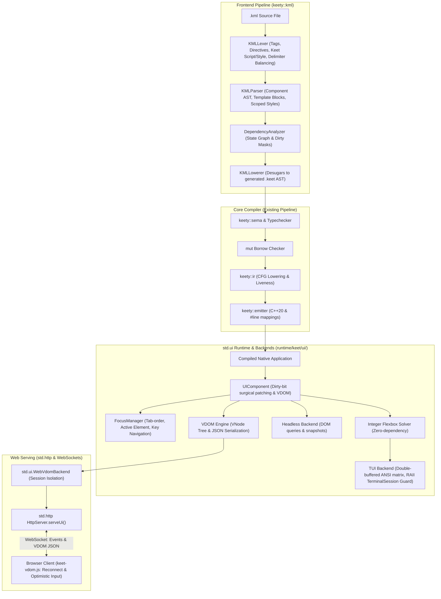
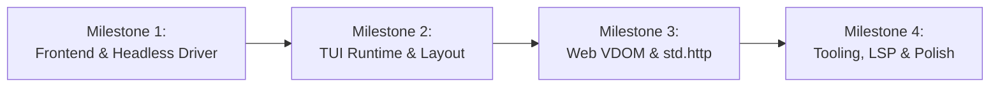

# Implementation Plan: B1_1 Svelte-Like Reactive UI Engine (`std.ui` & `*.kml`)

## 1. Goal Description

Implement milestone **B1_1** from `ROADMAP.md`: an ahead-of-time (AOT) compiled, compile-time reactive UI engine inspired by Svelte runes, authored in dedicated Single-File Components (`*.kml`, Keet Markup Language).

The system lowers declarative templates into surgical C++20 imperative updates with compile-time reactivity, integrates seamlessly with KeetScript's strict `mut` borrow-checker, provides both a blazing-fast Terminal User Interface (TUI) runtime and a remote Web Virtual DOM (VDOM) engine served over WebSockets via `std.http` (or `net.http`), supplies a dual-layer headless test driver, and equips the Keet developer ecosystem (LSP, linter, formatter, VS Code) with first-class `.kml` support.

> [!IMPORTANT]
> **KeetScript Syntax Convention**:
> KeetScript strictly avoids C++-style double-colon (`::`) syntax. All module paths, namespaces, nested types, and enum members use standard dot (`.`) syntax (e.g., `import std.ui;`, `std.http.serveUi(...)`, `Color.Blue`, `BorderStyle.Rounded`). C++20 double colons (`::`) are strictly reserved for internal compiler implementation files (`keety::kml`) and the underlying generated native runtime headers.

For web targets, components render into a lightweight Virtual DOM (VDOM) serialized as JSON. A minimal, zero-dependency client-side JavaScript script (`keet-vdom.js`) receives the VDOM JSON, mounts it to the browser DOM, intercepts user interactions (such as button clicks and input changes), and streams them back to the server over a WebSocket. The server dispatches events to component handlers, executes reactive `$state` updates, and pushes updated VDOM JSON to the client. A built-in `std.http.serveUi` / `app.serveUi()` function handles HTML shell generation, client script delivery, and WebSocket session lifecycles out of the box.

---

## 2. User Review Required

> [!NOTE]
> All foundational architecture decisions were established in the design sessions:
> - **File Format**: `*.kml` SFC with `<script>`, `<template>`, `<style>`.
> - **Props & Component Header**: `component Button(title: string, onClick: fn(): void) { ... }` in `<script>`.
> - **Directives**: Sigils `@` for events (`@click={...}`) and `$` for two-way bindings (`$bind.value={...}`), avoiding `:` due to KeetScript type annotations.
> - **Two-Way Binding Lowering**: Desugared into getter + setter callback to strictly satisfy value semantics and `mut` borrow-checking rules.
> - **Control Flow**: Native KeetScript expressions: `{#if (cond)} ... {:else} ... {/if}` and `{#for (item in items; keyExpr)} ... {/for}`.
> - **Styles**: Component-scoped style definitions in `<style>` with static compile-time extraction.
> - **Universal Element Mapping**: Semantic parity between layout primitives (`<box>`, `<vstack>`, `<hstack>`, `<text>`, `<button>`, `<input>`, `<scroll>`) and standard HTML tags (`<div>`, `<span>`, `<button>`, `<input>`).
> - **Dual Backend Architecture**: 
>   1. **TUI Driver**: ANSI double-buffered grid with self-contained C++20 integer Flexbox constraint solver, keyboard tab-focus manager, and robust RAII terminal session crash protection.
>   2. **Web VDOM Backend**: Server-side VDOM tree generation and JSON serialization communicating with a client browser over RFC 6455 WebSockets with per-connection component state isolation.
> - **Client-Side VDOM Runtime (`keet-vdom.js`)**: A simple, standalone ~120-line vanilla JS script that renders VDOM JSON into a live web page, handles optimistic text input, manages automatic WebSocket reconnection with full state resync, and forwards DOM events over WebSocket to the server.
> - **`std.http` Integration**: Built-in `serveUi` function on `HttpServer` to serve full-stack UI applications (HTML shell, client JS, and WebSocket session bridge) with zero external dependencies.

---

## 3. Architecture Overview



---

## 4. Universal Layout & Element Mapping Model

To guarantee write-once, run-anywhere execution across both the TUI terminal driver and the Web browser VDOM, all tags share an explicit 1:1 cross-compilation mapping:

| Template Tag | TUI Runtime Node | Web VDOM (`keet-vdom.js`) | Default Layout Semantics |
| :--- | :--- | :--- | :--- |
| `<box>` / `<div>` | `BoxNode` | `<div class="keet-box">` | Generic flex container (default `direction: column`) |
| `<vstack>` | `BoxNode` | `<div class="keet-vstack">` | `display: flex; flex-direction: column;` |
| `<hstack>` | `BoxNode` | `<div class="keet-hstack">` | `display: flex; flex-direction: row; align-items: center;` |
| `<text>` / `<span>` / `<p>` | `TextNode` | `<span>` or `<p>` | Inline or block text run with styled glyphs |
| `<button>` | `ButtonNode` | `<button type="button">` | Focusable clickable node; triggers `@click` on Enter/Space in TUI |
| `<input>` | `InputNode` | `<input>` | Focusable editable text buffer with cursor & IME handling |
| `<scroll>` | `ScrollNode` | `<div class="keet-scroll">` | Scrollable viewport with clipping (`overflow: auto`) |
| `<Component>` | Subtree Instance | Nested `VNode` Hierarchy | Encapsulated child component with isolated reactive scope |

---

## 5. Work Breakdown & Detailed Implementation Phases

### Phase 1: `keety::kml` Frontend Lexing, AST & Parsing
*Focus: Tokenizing and parsing `.kml` SFC documents into robust AST representations with high-precision error reporting.*

* **Subtask 1.1: Token Definitions & High-Precision Lexer** (`include/keety/kml/kml_token.hpp`, `src/kml/kml_lexer.cpp`):
  * Define token kinds for SFC delimiters: `<script>`, `</script>`, `<template>`, `</template>`, `<style>`, `</style>`.
  * Define token kinds for template elements, custom component tags (`<[A-Z]\w*>`), self-closing tags (`<box />`), and attribute identifiers.
  * Define directive tokens:
    * Event listeners: `@click`, `@keydown`, `@input`, `@change`, `@submit`, `@resize`.
    * Event modifiers: `@input.debounce(ms)`, `@click.prevent`, `@keydown.enter`.
    * Two-way bindings: `$bind.value`, `$bind.checked`, `$bind={x}`.
  * Define control flow keywords: `{#if}`, `{:else if}`, `{:else}`, `{/if}`, `{#for}`, `{/for}`, `{#await}`, `{:then}`, `{:catch}`, `{/await}`.
  * Implement nested balanced-delimiter tracking for `{expr}` blocks: tracks brace depth `{}`, parentheses `()`, and quotes `""` to prevent premature closure when embedded KeetScript expressions contain closures, object literals, or block expressions.
  * Preserve exact `SourceSpan` (file, start line/col, end line/col, byte offset) for every token.

* **Subtask 1.2: KML AST Data Structures** (`include/keety/kml/kml_ast.hpp`):
  * `KmlScriptBlock`: Script AST, props parameter declaration list, local state runes.
  * `KmlTemplateNode` hierarchy:
    * `KmlElementNode`: Tag name, attributes, directives (`@event`, `$bind`), children list, self-closing flag.
    * `KmlTextNode`: Static text runs and interpolated `{expr}` expressions.
    * `KmlIfBlock`: Condition expression, `then` branch, optional chained `else-if` branches, optional `else` branch.
    * `KmlForBlock`: Item variable name, optional index variable name, iterable expression, and **keyed expression** (`{#for (item, idx in items; key=item.id)}`).
    * `KmlSlotNode`: Default and named `<slot>` projection points.
  * `KmlStyleBlock`: Component-scoped style rules, selectors, and typed property assignments.
  * `KmlDocument`: Top-level SFC holding script, template, and style AST blocks.

* **Subtask 1.3: SFC & Template Parser** (`src/kml/kml_parser.cpp`):
  * Implement top-level SFC grammar parser routing to `<script>`, `<template>`, and `<style>` handlers.
  * Delegate `<script>` blocks to KeetScript's internal parser (`keety::parser`).
  * Implement XML-compliant recursive descent template tree parser with strict closing tag validation and informative mismatched-tag diagnostics.
  * Support keyed `{#for}` syntax variants: `{#for (item in items; item.id)}` and `{#for (item, index in items; key=item.id)}`.

---

### Phase 2: Reactive Dependency Analysis, Style Scoping & AST Lowering
*Focus: AOT compile-time dependency tracking, style extraction, dirty mask synthesis, and desugaring into safe KeetScript C++ AST.*

* **Subtask 2.1: State Rune & Dependency Graph Analyzer** (`include/keety/kml/dependency_analyzer.hpp`, `src/kml/dependency_analyzer.cpp`):
  * Identify `$state(...)`, `$derived(...)`, and `$effect(...)` rune invocations within `<script>`.
  * Scan template expressions for identifier references bound to `$state` or props.
  * Construct a directed dependency graph: `StateVariable -> Set<ExpressionID / DOMNodeID>`.
  * Synthesize deterministic dirty-bit masks:
    * Bit 0 to $N-1$: Props dirty masks (`DIRTY_PROP_0`, etc.).
    * Bit $N$ to $M$: Local state dirty masks (`DIRTY_STATE_0`, etc.).
    * Mask `DIRTY_ALL = 0xFFFFFFFF`.

* **Subtask 2.2: Reactive Props Propagation Protocol**:
  * Parent-to-child reactivity lowering: when a parent component mutates a property passed to a child, synthesize strongly-typed child setters:
    ```keet
    child.setTitle(newTitle, ChildComponent.DIRTY_PROP_title);
    ```
  * Enforce that child component updates are automatically enqueued in the microtask scheduler without violating KeetScript's immutable parameter default or `mut` borrow checks.

* **Subtask 2.3: Component Style Scoping & Lowering**:
  * Scoped class generation: calculate a deterministic component hash (e.g., `kml-7a8f12`) based on the component path.
  * Target-specific style emission:
    * **Web**: Lower `<style>` into a scoped stylesheet (`.btn.kml-7a8f12 { ... }`) served alongside the HTML shell.
    * **TUI**: Pre-resolve typed style rules at compile time into static C++ struct initializers directly attached to node IDs (e.g. `node.style.borderColor = Color.Blue; node.style.borderStyle = BorderStyle.Rounded;`), completely eliminating runtime CSS parsing in the TUI terminal driver.

* **Subtask 2.4: Two-Way Binding & Event Desugaring** (`src/kml/kml_lowerer.cpp`):
  * Desugar `$bind.value={stateVar}` into a getter property `value={stateVar}` and an automatic setter callback `@onValueChange={(val) => { stateVar = val; }}`.
  * Ensure desugared setters strictly satisfy KeetScript `mut` borrow-checker rules without creating illegal aliasing.
  * Desugar event modifier wrappers (e.g. `@input.debounce(150)` $\rightarrow$ runtime debounce wrapper callback).

* **Subtask 2.5: Lowering to `std.ui.Component` Class** (`include/keety/kml/kml_lowerer.hpp`, `src/kml/kml_lowerer.cpp`):
  * Generate a C++-transpilable KeetScript AST class extending `std.ui.Component`.
  * Synthesize lifecycle methods:
    * `constructor(...)`: Initializes props and `$state` fields.
    * `mount()`: Creates initial node tree and registers callbacks with stable IDs.
    * `update(dirtyMask: int)`: Surgical dirty-bit branching that mutates only the dynamic nodes whose dependencies are set in `dirtyMask`.
    * `renderVdom()`: Generates `VNode` tree for Web/Headless serialization.
    * `destroy()`: Unregisters listeners and runs `$effect` cleanup closures.
  * Inject `#line` source spans mapping generated C++ lines directly back to the original `.kml` file.

---

### Phase 3: Toolchain, Module Resolution & CLI Integration
*Focus: Integrating `.kml` into the compiler driver, build system, and command-line toolchain.*

* **Subtask 3.1: Module Path Resolver Extension** (`src/resolver/module_path_resolver.cpp`):
  * Add `.kml` extension probing during module resolution:
    ```keet
    import Counter from "./Counter.kml";
    ```
  * Enable automatic resolution when imported without extension if unambiguous.

* **Subtask 3.2: Compilation Pipeline Driver Wiring** (`src/driver/toolchain_driver.cpp`, `src/driver/cli_driver.cpp`):
  * Intercept `.kml` units before the standard parsing pass.
  * Execute KML frontend lowering stage, yielding an in-memory generated KeetScript AST.
  * Feed the lowered AST into `keety::sema`, the borrow-checker, `keety::ir`, and C++ code emission.
  * Wire `.kml` compilation seamlessly into `keety build`, `keety run`, and `keety test`.

* **Subtask 3.3: CMake & Project Build Setup** (`src/CMakeLists.txt`):
  * Add `src/kml/kml_lexer.cpp`, `src/kml/kml_parser.cpp`, `src/kml/dependency_analyzer.cpp`, and `src/kml/kml_lowerer.cpp` to `keety_core`.

---

### Phase 4: `std.ui` Universal Runtime & Headless Testing Driver
*Focus: Runtime component base classes, microtask scheduler, universal nodes, and headless testing driver.*

* **Subtask 4.1: Primitives, Geometry & Types** (`runtime/keet/ui/geometry.hpp`, `types.hpp`):
  * Define `Point`, `Size`, `Rect`, and `Edges` (padding, margin, border thickness).
  * Define enums using Keet dot-accessible conventions: `Color` (`Color.Default`, `Color.Blue`, `Color.Red`), `BorderStyle` (`BorderStyle.None`, `BorderStyle.Single`, `BorderStyle.Double`, `BorderStyle.Rounded`), `FontStyle` (`FontStyle.Normal`, `FontStyle.Bold`, `FontStyle.Dim`).

* **Subtask 4.2: Universal UI Node Hierarchy** (`runtime/keet/ui/node.hpp`):
  * `UINode` base class: ID, parent/children pointers, layout rect, dirty flags, visibility.
  * Implement nodes: `BoxNode`, `TextNode`, `ButtonNode`, `InputNode`, `StackNode`, `ScrollNode`.
  * Support node attribute sets: classes, style properties, inline text content, and event callback hooks.

* **Subtask 4.3: Component Base & Microtask Scheduler** (`runtime/keet/ui/component.hpp`, `scheduler.hpp`):
  * `Component` base class: props storage, dirty mask, parent/child relationships, event bus.
  * Lifecycle hooks: `onMount()`, `beforeUpdate()`, `afterUpdate()`, `onDestroy()`.
  * Implement batched microtask queue: coalesces multiple synchronous state mutations in a single event-loop turn and triggers a single consolidated `update(dirtyMask)` pass.
  * Provide asynchronous `tick()` utility for testing and manual frame flushing.

* **Subtask 4.4: Headless Test Backend** (`runtime/keet/ui/headless_backend.hpp`):
  * In-memory virtual screen grid and layout tree inspector.
  * Query engine: `find(selector)`, `findByText(text)`, `findById(id)`.
  * Synthetic event simulator: `simulateClick(nodeId)`, `simulateType(nodeId, text)`, `simulateKey(key)`, `resize(width, height)`.
  * Snapshot utilities for regression testing rendered component states.

---

### Phase 5: TUI Runtime (Integer Flexbox, Focus Manager & ANSI Double-Buffering)
*Focus: Native terminal driver with discrete character-cell flexbox, tab focus navigation, and differential ANSI drawing.*

* **Subtask 5.1: Zero-Dependency Integer Flexbox Layout Solver** (`runtime/keet/ui/flexbox.hpp`):
  * Implement discrete integer flexbox layout solver operating entirely in terminal character cells:
    * `flex-direction`: `row`, `column`.
    * `justify-content`: `flex-start`, `center`, `flex-end`, `space-between`, `space-around`, `space-evenly`.
    * `align-items` and `align-self`: `flex-start`, `center`, `flex-end`, `stretch`.
    * Sizing: fixed integer cells, auto, percentage (`20%`), and `flex-grow` / `flex-shrink`.
    * Support borders (`Single`, `Double`, `Rounded`), padding, margins, and viewport clipping.

* **Subtask 5.2: Keyboard Focus & Navigation Manager** (`runtime/keet/ui/focus_manager.hpp`):
  * Track active `focusedNodeId` within the component tree.
  * Classify focusable elements (`<button>`, `<input>`, or elements with `tabindex >= 0`).
  * Implement Tab and Shift-Tab depth-first tree traversal order.
  * Handle focus activation: Space/Enter triggers `@click` on focused `<button>`, typing routes into focused `<input>`.
  * Visual focus styling: automatically applies focus border / inverted color highlight to the focused element.

* **Subtask 5.3: Raw Terminal Driver & ANSI Parser with RAII Crash Guard** (`runtime/keet/ui/tui_backend.hpp`):
  * Cross-platform raw mode management: POSIX `termios` (`cfmakeraw`, non-blocking `select`/`poll`) and Windows Console API (`SetConsoleMode`).
  * ANSI escape sequence decoder: translates escape streams into structured `KeyEvent` (Ctrl, Alt, Shift, Fn keys, Arrows), `MouseEvent` (clicks, drags, scrolls), and `ResizeEvent` (`SIGWINCH` / `GetConsoleScreenBufferInfo`).
  * **RAII `TerminalSession` Guard**:
    * Automatically saves initial terminal state on startup and switches to alternate screen buffer (`\x1b[?1049h`).
    * Installs dedicated signal handlers (`SIGINT`, `SIGTERM`, `SIGSEGV`, `SIGABRT`) and registers `std::atexit` callback.
    * Guaranteed terminal recovery on exit, crash, or panic: restores original `termios`, restores cursor visibility (`\x1b[?25h`), and exits alternate buffer (`\x1b[?1049l`), preventing broken/frozen shell states.

* **Subtask 5.4: Double-Buffered Differential Terminal Renderer** (`runtime/keet/ui/tui_backend.hpp`):
  * Dual screen cell buffers: `frontBuffer` (currently on terminal) and `backBuffer` (next frame).
  * Differential patch generator: scans cells and emits ANSI cursor repositioning (`\x1b[y;xH`) and SGR color codes only for modified cells.
  * Unicode and box-drawing glyph rendering (`┌ ─ ┐ │ └ ┘`).

---

### Phase 6: Web VDOM Engine & WebSocket Event Bridge
*Focus: Server-side VDOM serialization, session-isolated WebSocket protocol, and client-side runtime.*

* **Subtask 6.1: Virtual DOM Tree & Serialization** (`runtime/keet/ui/vdom.hpp`):
  * `VNode` tree model: tag name, stable unique node ID, keyed element tracking, attribute dictionary, style dictionary, event listeners array, children list.
  * Implement RFC 8259 JSON serialization (`keet::json::Value`).
  * Wire protocol:
    * *Mode 1 (Full Sync)*: Complete VDOM snapshot sent on connection or after reconnect.
    * *Mode 2 (Diff Patch)*: RFC 6902 / opcode patch format (`[{"op": "replace", "id": "btn_1", "text": "Clicked 2 times"}]`) to minimize wire bandwidth.

* **Subtask 6.2: Web VDOM Session Backend** (`runtime/keet/ui/vdom_backend.hpp`):
  * Maintain active WebSocket sessions over RFC 6455.
  * **Strict Session Isolation**: On connection, instantiate a private, isolated component hierarchy per client via `ComponentFactory`, guaranteeing no cross-client `$state` bleed.
  * Event ingestion loop:
    * Parse client incoming JSON: `{"type": "event", "id": "node-42", "event": "click", "data": {}}`.
    * Dispatch event payload to the target component's registered callback.
    * Execute microtask update cycle, computing dirty bitmask.
    * Serialize updated VDOM (or diff patch) and transmit down the WebSocket.
  * Disconnect handler: invoke component `onDestroy()` and free session allocations.

* **Subtask 6.3: Client-Side Runtime (`keet-vdom.js`)** (`runtime/keet/ui/client/keet-vdom.js`):
  * Zero-dependency vanilla JavaScript client (~120 lines) embedded as a binary C++ string constant.
  * VDOM-to-DOM renderer: reconstructs real browser DOM nodes, classes, and styles from VDOM JSON.
  * **Keyed List Reconciliation**: Preserves DOM identity and active focus across list reorders using key attributes.
  * **Optimistic Text Input Handling**: Updates `<input>` DOM values immediately on typing; preserves cursor selection (`selectionStart`/`selectionEnd`) across incoming server WebSocket patches to eliminate keystroke lag and cursor jumping.
  * **Event Modifiers & Throttling**: Support `@input.debounce(ms)` and `@change` to prevent network flooding.
  * **Connection Resilience & Auto-Reconnect**:
    * Handles WebSocket disconnects with exponential backoff retry.
    * Displays subtle connection status banner (*"Connection lost. Reconnecting..."*).
    * Upon reconnection, sends a `{"type": "sync"}` handshake to receive a clean full VDOM snapshot and seamlessly resume without reload.

---

### Phase 7: `std.http` UI Application Serving
*Focus: Seamless one-line hosting of full-stack reactive applications using Keet's HTTP server.*

* **Subtask 7.1: `HttpServer.serveUi` Extension** (`runtime/keet/http.hpp`, `runtime/keet/std/http.hpp`):
  * Add high-level UI serving methods to `HttpServer`:
    ```cpp
    void serveUi(std::string_view route, ComponentFactory factory, UiServeOptions options = {});
    ```
  * In KeetScript, accessible via:
    ```keet
    import std.http;
    import App from "./App.kml";

    fn main(): void {
        let server = http.createServer();
        server.serveUi("/", App);
        server.listen(8080);
    }
    ```

* **Subtask 7.2: Built-in UI Endpoint Handlers**:
  * **HTML Shell Host (`GET <route>`)**:
    * Returns HTML5 document with title, charset, viewport meta, and scoped component CSS.
    * Renders container `<div id="keet-app"></div>`.
    * Injects `<script src="<route>/_keet/vdom.js"></script>` and auto-bootstraps WebSocket endpoint.
  * **Client Runtime Asset (`GET <route>/_keet/vdom.js`)**:
    * Serves embedded `keet-vdom.js` with `Content-Type: application/javascript` and HTTP caching headers.
  * **WebSocket Bridge Endpoint (`WS <route>/_ws` or upgraded `<route>`)**:
    * Upgrades HTTP connection using existing RFC 6455 routing.
    * Connects WebSocket channel directly to `std.ui.WebVdomBackend`.

* **Subtask 7.3: Public Standard Library Headers** (`runtime/keet/ui.hpp`, `runtime/keet/std/ui.hpp`):
  * Export `std.ui`, `std.ui.test`, and `std.ui.vdom` public interfaces.

---

### Phase 8: Developer Tooling, LSP, Formatter & Linter
*Focus: First-class IDE support, syntax highlighting, diagnostics, formatting, and linting for `.kml` files.*

* **Subtask 8.1: VS Code Syntax Grammar** (`tools/vscode-keet/syntaxes/kml.tmLanguage.json`):
  * Full syntax highlighting for `.kml` files:
    * SFC sections: `<script>`, `<template>`, `<style>`.
    * Runes: `$state`, `$derived`, `$effect`.
    * Directives: `@event` with modifiers, `$bind`.
    * Control flow: `{#if}`, `{#for}`, `{#await}` blocks.
    * Embedded KeetScript expressions within `{expr}`.
  * Register file association for `*.kml` in `package.json`.

* **Subtask 8.2: `keet-lsp` Multi-Section Language Server Support** (`src/lsp/`):
  * Virtual document splitter: isolates `<script>` block and forwards positions to KeetScript language server.
  * Provide completions, diagnostics, hovers, and jump-to-definition across both script variables and template expressions.
  * Autocompletion for layout primitives (`<box>`, `<vstack>`, `<button>`, etc.) and standard directive sigils.

* **Subtask 8.3: `keety fmt` Formatter Support** (`src/fmt/`):
  * Extend code formatter to handle `.kml` Single-File Components:
    * Format `<script>` blocks using standard KeetScript formatting rules.
    * Format `<template>` blocks with clean XML hierarchy, tag nesting, and balanced attribute wrapping.
    * Format `<style>` blocks consistently.

* **Subtask 8.4: `keety lint` Linter Support** (`src/lint/`):
  * Execute lint rules (`L001`-`L022`) against embedded `<script>` blocks in `.kml` components.
  * Add UI-specific lint checks:
    * Warn on unkeyed `{#for}` blocks over dynamic collections.
    * Detect unused `$state` variables.
    * Catch invalid directive syntax (e.g. attempting to use `:` instead of `@` or `$`).
    * Flag usage of forbidden C++ `::` syntax in KeetScript expressions, pointing to the canonical dot `.` syntax.

---

## 6. Recommended Execution Milestones



1. **Milestone 1 (Core Frontend & Headless Driver)**:
   * Deliver Phase 1 (Lexer/Parser), Phase 2 (Dependency Analyzer/Lowerer/Props Propagation), Phase 3 (Toolchain/CMake), and Phase 4 (Universal Nodes & Headless Backend).
   * *Deliverable*: Full test suite running headless component tests, verifying reactive `$state` updates, dirty masks, and control flow without screen rendering.
2. **Milestone 2 (TUI Driver & Layout Engine)**:
   * Deliver Phase 5 (Integer Flexbox solver, focus manager, raw terminal I/O with RAII crash guard, ANSI double-buffering).
   * *Deliverable*: Interactive `examples/tui_counter` with keyboard tab navigation, zero-flicker resizing, and reactive click handling.
3. **Milestone 3 (Web VDOM & WebSocket Serving)**:
   * Deliver Phase 6 (VDOM serialization, `keet-vdom.js`, optimistic inputs, reconnect resilience) and Phase 7 (`HttpServer.serveUi`).
   * *Deliverable*: Interactive `examples/web_counter` served via `keety run`, accessible from any browser with full-duplex WebSocket reactivity.
4. **Milestone 4 (Developer Ecosystem & Polish)**:
   * Deliver Phase 8 (VS Code extension, `keet-lsp`, `keety fmt`, `keety lint`) and granular RFC 6902 VDOM patch diffing.
   * *Deliverable*: Complete developer experience across editor, CLI, and runtime.

---

## 7. Verification Plan

### Automated Test Suites
1. **KML Lexer & Parser Unit Tests** (`tests/unit/test_kml_parser.cpp`):
   * Test balanced curly-brace tracking for embedded closures and record literals.
   * Parse SFC structure, directives (`@click`, `@input.debounce(150)`, `$bind.value`), and control flow (`{#if}`, `{#for (x in items; key=x.id)}`).
   * Verify diagnostics and `SourceSpan` precision on malformed tags.
2. **Dependency Graph & Lowerer Unit Tests** (`tests/unit/test_kml_lowerer.cpp`):
   * Verify dirty-bit bitmask generation (`DIRTY_PROP_A`, `DIRTY_STATE_B`).
   * Verify two-way binding desugaring into getter properties and setter callbacks satisfying `mut` borrow checks.
   * Verify child prop reactivity propagation setters.
   * Test generated `update(dirtyMask)` code branches.
3. **Integer Flexbox Layout Unit Tests** (`tests/unit/test_ui_flexbox.cpp`):
   * Test flex layout in character cell coordinates (row, column, justify-content, align-items, flex-grow/shrink).
   * Test borders, margins, padding, and viewport clipping calculations.
4. **Focus Manager & Keyboard Navigation Tests** (`tests/unit/test_ui_focus.cpp`):
   * Test Tab and Shift-Tab traversal across focusable nodes.
   * Test Enter/Space activation on focused buttons and text input dispatch.
5. **Headless Component Test Harness** (`tests/unit/test_ui_headless.cpp`):
   * Mount `.kml` components, simulate click/type events, await `tick()`, and assert DOM/screen updates.
6. **VDOM Serialization & Event Dispatch Unit Tests** (`tests/unit/test_ui_vdom.cpp`):
   * Test `VNode` tree construction and RFC 8259 JSON serialization.
   * Test client event payload deserialization and callback invocation.
   * Verify session isolation across multiple concurrent component instances.
7. **`std.http.serveUi` Integration Tests** (`tests/unit/test_http_serve_ui.cpp`):
   * Verify HTTP `GET /` returns HTML5 shell referencing `keet-vdom.js`.
   * Verify HTTP `GET /_keet/vdom.js` returns JavaScript asset with correct MIME type.
   * Verify WebSocket handshake, initial VDOM snapshot push, and reactive event ping-pong.
8. **Double-Buffered TUI Diffing & RAII Crash Guard Unit Tests** (`tests/unit/test_ui_tui_backend.cpp`):
   * Assert minimal ANSI escape string generation between consecutive grid states.
   * Verify simulated abort restores terminal modes and alternate buffer cleanly.
9. **Conformance Test Suite** (`tests/conformance/test_conformance_ui.cpp`):
   * End-to-end compilation of `.kml` components to native executables.
10. **Run Full Test Suite**:
    ```bash
    ctest --test-dir build --output-on-failure
    ```

### Manual Verification
1. **Interactive TUI Application**:
   * Build and run `examples/tui_counter/main.keet`:
     ```bash
     ./build/bin/keety run examples/tui_counter/main.keet
     ```
   * Verify Tab/Shift-Tab focus cycling, button activation via Enter/Space, and window resize responsiveness.
   * Test Ctrl+C abort to ensure shell terminal state is restored cleanly.
2. **Interactive Web UI Application with `std.http`**:
   * Build and run `examples/web_counter/main.keet`:
     ```bash
     ./build/bin/keety run examples/web_counter/main.keet
     ```
   * Open `http://localhost:8080/` in a browser.
   * Verify real-time counter updates over WebSocket, smooth typing in inputs with no cursor jumping, and automatic reconnection after killing/restarting the server.
3. **Format and Lint `.kml` Files**:
   ```bash
   ./build/bin/keety fmt --check examples/tui_counter/Counter.kml
   ./build/bin/keety lint examples/tui_counter/Counter.kml
   ```
