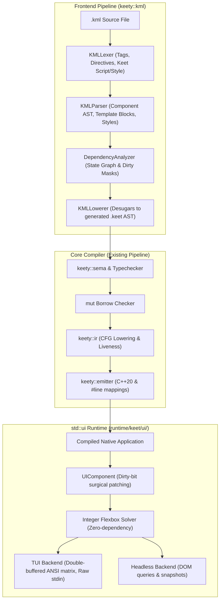

# Implementation Plan: B1_1 Svelte-Like Reactive UI Engine (`std::ui` & `*.kml`)

## 1. Goal Description

Implement milestone **B1_1** from `ROADMAP.md`: an ahead-of-time (AOT) compiled, compile-time reactive UI engine inspired by Svelte runes, authored in dedicated Single-File Components (`*.kml`, Keet Markup Language).

The system lowers declarative templates into surgical C++20 imperative updates with zero Virtual DOM overhead, integrates seamlessly with KeetScript's strict `mut` borrow-checker, provides a blazing-fast Terminal User Interface (TUI) runtime with a zero-dependency integer Flexbox layout solver and double-buffered ANSI grid, supplies a dual-layer headless test driver, and equips the Keet developer ecosystem (LSP, linter, formatter, VS Code) with first-class `.kml` support.

---

## 2. User Review Required

> [!NOTE]
> All foundational architecture decisions were established in the `/grill-me` session:
> - **File Format**: `*.kml` SFC with `<script>`, `<template>`, `<style>`.
> - **Props & Component Header**: `component Button(title: string, onClick: fn(): void) { ... }` in `<script>`.
> - **Directives**: Sigils `@` for events (`@click={...}`) and `$` for two-way bindings (`$bind.value={...}`), avoiding `:` due to KeetScript type annotations.
> - **Two-Way Binding Lowering**: Desugared into getter + setter callback to strictly satisfy value semantics and `mut` borrow-checking rules.
> - **Control Flow**: Native KeetScript expressions: `{#if (cond)} ... {:else} ... {/if}` and `{#for (item in items)} ... {/for}`.
> - **Styles**: Typed Keet property blocks inside `<style>`.
> - **Initial Backend**: TUI driver + headless test harness, with an abstract `std::ui::Backend` interface.
> - **Layout Engine**: Self-contained C++20 integer Flexbox constraint solver.

---

## 3. Architecture Overview



---

## 4. Work Breakdown & Implementation Phases

### Phase 1: `keety::kml` Frontend (Lexer, AST, Parser, Dependency Graph)
1. **Tokens & Lexer** (`include/keety/kml/kml_token.hpp`, `src/kml/kml_lexer.cpp`):
   - Tokenize `<script>`, `<template>`, `<style>` boundary tags.
   - Tokenize template elements: `<box>`, `<text>`, `<button>`, `<input>`, `<vstack>`, `<hstack>`, `<scroll>`, and custom `<Component>`.
   - Tokenize directives: `@event` (`@click`, `@keydown`, `@resize`), `$bind` (`$bind.value`, `$bind={val}`), and static/dynamic attributes.
   - Tokenize control blocks: `{#if (...)}`, `{:else if (...)}`, `{:else}`, `{/if}`, `{#for (... in ...)}`, `{/for}`, `{#await (...)}`, `{:then ...}`, `{:catch ...}`, `{/await}`.
   - Tokenize embedded Keet expressions within `{expr}`.
2. **KML AST** (`include/keety/kml/kml_ast.hpp`):
   - `KmlScriptBlock`: Component declaration signature, props list, body AST.
   - `KmlTemplateNode`: Element node, text interpolation node, control block node, slot node.
   - `KmlStyleBlock`: Selector declarations and typed Keet object property assignments.
   - `KmlDocument`: Complete component AST representation.
3. **Template Parser** (`src/kml/kml_parser.cpp`):
   - Parse SFC structure and delegate `<script>` / `<style>` bodies to KeetScript parser.
   - Parse nested XML template tree with exact `SourceSpan` tracking for every attribute, tag, and interpolation expression.
4. **Dependency Analyzer** (`include/keety/kml/dependency_analyzer.hpp`, `src/kml/dependency_analyzer.cpp`):
   - Detect `$state`, `$derived`, `$effect` runes.
   - Build state-to-expression dependency graph.
   - Assign deterministic dirty-bit masks (`DIRTY_PROP_A = 1 << 0`, `DIRTY_STATE_B = 1 << 1`, etc.).
5. **KML Lowerer** (`include/keety/kml/kml_lowerer.hpp`, `src/kml/kml_lowerer.cpp`):
   - Desugar `.kml` into a generated KeetScript AST class inheriting `std::ui::Component`.
   - Emit `mount()`, `update(dirtyMask)`, `destroy()` methods.
   - Desugar two-way `$bind.value={x}` into getter `value={x}` + callback `onValueChange={(v) => { x = v; }}`.
   - Attach `#line` source spans mapping generated Keet code back to the original `.kml` file lines.

### Phase 2: Compiler Pipeline & Toolchain Integration
1. **Module Path Resolver** (`src/resolver/module_path_resolver.cpp`):
   - Add `.kml` candidate probing when resolving imports (`import Counter from "./Counter.kml"` or `import "./Counter.kml"`).
2. **Toolchain Driver & CLI Driver** (`src/driver/toolchain_driver.cpp`, `src/driver/cli_driver.cpp`):
   - Detect `.kml` compilation units in build graph.
   - Run KML frontend lowering stage prior to module topological sorting and sema type checking.
   - Wire into `keety build`, `keety run`, and `keety test`.
3. **CMake Integration** (`src/CMakeLists.txt`):
   - Register new `src/kml/` compilation units in `keety_core`.

### Phase 3: `std::ui` Runtime Architecture (`runtime/keet/ui/`)
1. **Core Primitives & Geometry** (`runtime/keet/ui/geometry.hpp`, `types.hpp`):
   - `Point`, `Size`, `Rect`, `Edges` (padding/margin).
   - Enums: `BorderStyle` (`None`, `Single`, `Double`, `Rounded`, `Thick`), `Color`, `FontStyle` (`Normal`, `Bold`, `Dim`, `Italic`, `Underline`).
2. **Integer Flexbox Constraint Solver** (`runtime/keet/ui/flexbox.hpp`):
   - Lightweight C++20 flexbox solver computing layout in discrete character cell coordinates.
   - Supports `flex-direction` (`row`, `column`), `justify-content` (`flex-start`, `center`, `flex-end`, `space-between`, `space-around`, `space-evenly`), `align-items`, `flex-grow`, `flex-shrink`, fixed/auto/percentage sizing, borders, and clipping.
3. **UI Nodes & Component Base** (`runtime/keet/ui/node.hpp`, `component.hpp`):
   - Universal nodes: `BoxNode`, `TextNode`, `ButtonNode`, `InputNode`, `StackNode`, `ScrollNode`.
   - `Component` base class with lifecycle hooks (`onMount`, `onDestroy`, `beforeUpdate`, `afterUpdate`).
   - Dirty-bit dispatch and surgical node mutations.
4. **Microtask Scheduler & Event Loop** (`runtime/keet/ui/scheduler.hpp`):
   - Batched update queue coalescing mutations within an event loop turn.
   - Asynchronous `tick()` utility.
5. **Pluggable Backend Interface** (`runtime/keet/ui/backend.hpp`):
   - Abstract renderer interface: `drawBox()`, `drawText()`, `clear()`, `present()`, `pollEvents()`.
6. **TUI Driver** (`runtime/keet/ui/tui_backend.hpp`):
   - Terminal raw mode configuration (`termios` on POSIX, console API on Windows).
   - ANSI/VT100 parser mapping escape sequences into `KeyEvent`, `MouseEvent`, `ResizeEvent`.
   - Double-buffered character matrix: front and back cell buffers with minimal differential redrawing.
7. **Headless Test Backend** (`runtime/keet/ui/headless_backend.hpp`):
   - Virtual screen buffer, synthetic event dispatcher (`click()`, `type()`, `resize()`), and selector querying engine (`find()`, `findByText()`).
8. **Stdlib Headers** (`runtime/keet/ui.hpp`, `runtime/keet/std/ui.hpp`):
   - Export public `std::ui` and `std::ui::test` APIs.

### Phase 4: Developer Tooling Integration
1. **VS Code Extension** (`tools/vscode-keet/syntaxes/kml.tmLanguage.json`):
   - Syntax grammar highlighting `<script>`, `<template>`, `<style>`, runes, directives, and control blocks.
2. **`keet-lsp` Integration** (`src/lsp/`):
   - Multi-section document parser for `.kml`.
   - Forward `<script>` diagnostics, hovers, completions, and definition jumps.
3. **`keety fmt`** (`src/fmt/`):
   - Format `.kml` files: format scripts and styles using canonical KeetScript formatting rules, format templates with standardized XML indentation.
4. **`keety lint`** (`src/lint/`):
   - Run lint rules (`L001`-`L022`) against embedded `<script>` blocks in `.kml` files.

---

## 5. Verification Plan

### Automated Test Suites
1. **KML Lexer & Parser Unit Tests** (`tests/unit/test_kml_parser.cpp`):
   - Parse single-file component structures (`<script>`, `<template>`, `<style>`).
   - Test directive sigils (`@click`, `$bind.value`) and control blocks (`{#if}`, `{#for}`).
   - Verify syntax error diagnostics with accurate source spans.
2. **Dependency Graph & Lowerer Unit Tests** (`tests/unit/test_kml_lowerer.cpp`):
   - Verify `$state` tracking, dirty bitmask assignments, and derived expression updates.
   - Verify two-way binding desugaring into getters and setter callbacks.
3. **Flexbox Layout Unit Tests** (`tests/unit/test_ui_flexbox.cpp`):
   - Test integer cell layout for flex rows, columns, alignments, wrapping, borders, and margins.
4. **Double-Buffered TUI Diffing Unit Tests** (`tests/unit/test_ui_tui_backend.cpp`):
   - Verify minimal ANSI diff output between consecutive frames.
5. **Headless Component Test Harness** (`tests/unit/test_ui_headless.cpp`):
   - Mount components, simulate user clicks, await `tick()`, assert updated DOM state and screen grid.
6. **Conformance Test Suite** (`tests/conformance/test_conformance_ui.cpp`):
   - End-to-end compilation of `.kml` components and execution with the test driver.
7. **Run Full Test Suite**:
   ```bash
   ctest --test-dir build --output-on-failure
   ```

### Manual Verification
1. Build and run a sample interactive TUI application in `examples/tui_counter/`:
   ```bash
   ./build/bin/keety run examples/tui_counter/main.keet
   ```
   - Verify interactive keyboard navigation (tab / arrow keys) and click counter increments.
   - Verify zero-flicker terminal resizing.
2. Format and lint `.kml` files:
   ```bash
   ./build/bin/keety fmt --check examples/tui_counter/Counter.kml
   ./build/bin/keety lint examples/tui_counter/Counter.kml
   ```

