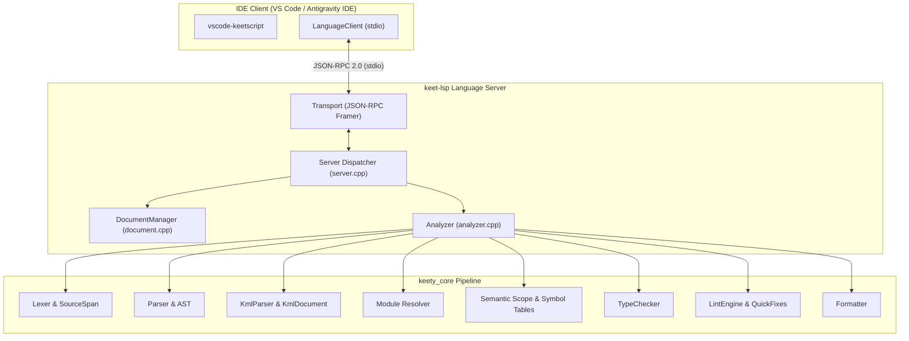
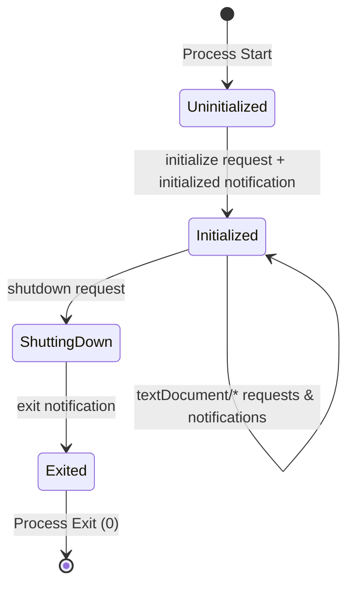
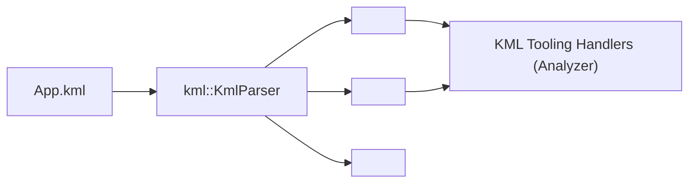
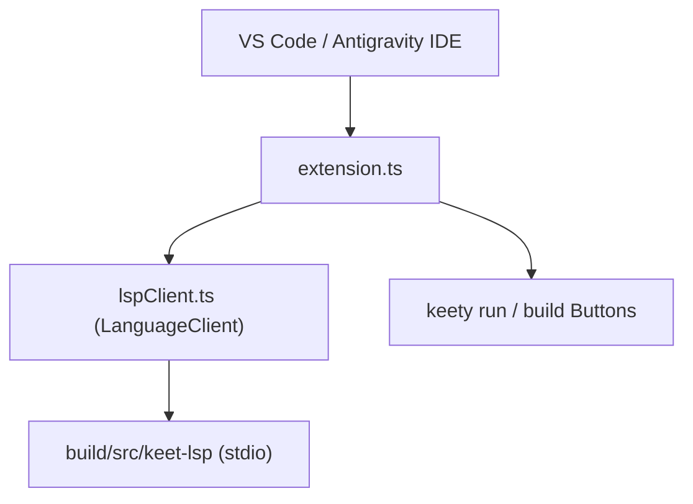

# KeetScript Language Server Protocol (LSP) Specification

The `keet-lsp` server is the official, high-performance Language Server Protocol implementation for the KeetScript ecosystem. Built directly on top of the `keety_core` compiler pipeline, `keet-lsp` provides sub-millisecond, in-memory language intelligence for both standard KeetScript (`.keet`) source files and Keet Markup Language (`.kml`) Single-File Components.

This document formally specifies the architecture, JSON-RPC communication model, document synchronization invariants, AST-backed analysis algorithms, and tooling services provided by `keet-lsp`.

---

## 1. Design Principles & Architecture Overview

`keet-lsp` operates as a standalone native binary communicating with IDE clients (such as Visual Studio Code, Antigravity IDE, Neovim, or Helix) over standard input/output using JSON-RPC 2.0.



### Core Architectural Goals:

1. **Direct Compiler Pipeline Reuse:** Rather than maintaining a divergent heuristic parser or regex grammar, `keet-lsp` invokes the identical lexer, parser, semantic analyzer, and typechecker classes that drive `keety`'s ahead-of-time (AOT) C++ emitter.
2. **Sub-Millisecond In-Memory Execution:** Diagnostics, completions, and hovers run purely on transient in-memory buffers stored in [`DocumentManager`](file:///Users/pawel/Documents/GitHub/keety/include/keety/lsp/document.hpp) without touching disk or spawning external subprocesses.
3. **Resilient & Fault-Tolerant Analysis:** Developer code in editors is frequently syntactically incomplete (e.g., dangling dots like `math.`, open blocks, or unclosed tags). The analyzer incorporates robust error recovery and syntactic line scans so that partial code never panics or hides valid declarations.
4. **First-Class Heterogeneous SFC Support (`.kml`):** Keet Markup Language combines KeetScript `<script>`, declarative reactive `<template>`, and scoped `<style>` in a single document. `keet-lsp` provides isolated, context-aware analysis across template tags and script runes without leaking non-KeetScript tokens into the pure KeetScript compiler pipeline.

---

## 2. Process Lifecycle & Transport Protocol

### 2.1 Transport Framing

Communication conforms to the standard LSP base protocol. Each message consists of ASCII header fields terminated by `\r\n\r\n`, followed by a UTF-8 encoded JSON-RPC 2.0 payload:

```http
Content-Length: 142\r\n
\r\n
{"jsonrpc":"2.0","id":1,"method":"initialize","params":{"processId":12345,"rootUri":"file:///workspace","capabilities":{}}}
```

The [`Transport`](file:///Users/pawel/Documents/GitHub/keety/include/keety/lsp/transport.hpp) layer reads and writes synchronously over standard I/O streams (`std::cin` and `std::cout`), while logging diagnostics to `std::cerr`.

### 2.2 Lifecycle State Machine



1. **`initialize` (Request):** The client passes `ClientCapabilities` and workspace root paths. The server responds with `ServerCapabilities` defining:
   - `textDocumentSync`: Full synchronization (kind = 1).
   - `hoverProvider`: `true`.
   - `definitionProvider`: `true`.
   - `referencesProvider`: `true`.
   - `renameProvider`: `{ "prepareProvider": true }`.
   - `signatureHelpProvider`: Trigger characters `("(", ",")`.
   - `completionProvider`: Trigger characters `(".", ":", "<", "$", "@", "{")`.
   - `documentSymbolProvider`: `true`.
   - `semanticTokensProvider`: Full document legend covering 12 token types and 5 token modifiers.
   - `documentFormattingProvider` & `documentRangeFormattingProvider`: `true`.
   - `codeActionProvider`: `true`.
2. **`initialized` (Notification):** Confirms handoff.
3. **`shutdown` (Request):** Halts active analysis and returns `null`.
4. **`exit` (Notification):** Server exits cleanly with exit code `0` (or `1` if exit occurred prior to shutdown).

---

## 3. Document Management & Synchronization

The [`DocumentManager`](file:///Users/pawel/Documents/GitHub/keety/include/keety/lsp/document.hpp) maintains the live text, versioning, and line-offset lookup tables for every file currently open in the client editor:

- **`textDocument/didOpen`:** Registers a new [`Document`](file:///Users/pawel/Documents/GitHub/keety/include/keety/lsp/document.hpp) keyed by its URI. Triggers background diagnostic publication.
- **`textDocument/didChange`:** Updates the full document text, increments the document version, and immediately pushes refreshed diagnostics.
- **`textDocument/didClose`:** Evicts the buffer from memory and clears diagnostic squiggles.

### Coordinate Conversion: Lines/Columns vs. Byte Offsets

LSP specifies positions using zero-based UTF-16 line numbers and character offsets (`Position{line, character}`). The compiler lexer operates on UTF-8 byte offsets. [`Document`](file:///Users/pawel/Documents/GitHub/keety/include/keety/lsp/document.hpp) computes and caches a monotonic byte-offset line index:

```cpp
std::optional<size_t> Document::positionToOffset(Position pos) const;
Position Document::offsetToPosition(size_t byteOffset) const;
```

---

## 4. KeetScript Language Intelligence Services (`.keet`)

### 4.1 Live Diagnostics (`textDocument/publishDiagnostics`)

On every open or change event, [`Analyzer::analyze`](file:///Users/pawel/Documents/GitHub/keety/include/keety/lsp/analyzer.hpp) runs in-memory lexical, syntactic, and semantic validation:
- Errors from the lexer and parser (e.g., unexpected tokens, unclosed literals, syntax violations) are mapped directly to `DiagnosticSeverity::Error`.
- Warnings and suggestions from [`LintEngine`](file:///Users/pawel/Documents/GitHub/keety/include/keety/lint/lint_engine.hpp) (unused imports, style violations, mutable variables never reassigned) are published as `DiagnosticSeverity::Warning`.
- Precise [`diag::SourceSpan`](file:///Users/pawel/Documents/GitHub/keety/include/keety/diag/source_manager.hpp) offsets are converted into LSP `Range` structures.

### 4.2 Hover Documentation (`textDocument/hover`)

[`Analyzer::getHover`](file:///Users/pawel/Documents/GitHub/keety/src/lsp/analyzer.cpp) inspects the token under the cursor and returns rich GitHub-flavored Markdown:

1. **Standard Library Modules:** Hovering over `math`, `io`, `fs`, `sys`, `time`, `json`, `net`, `crypto`, `test`, `http`, or `ui` displays module documentation and typical import patterns.
2. **Local Variables & Parameters:** Resolves the lexical scope via [`buildFnScopeTree`](file:///Users/pawel/Documents/GitHub/keety/src/lsp/analyzer.cpp), displaying signatures such as `let x: int` or `(parameter) mut buffer: string`.
3. **User Functions & Classes:** Displays parameter signatures, return types, field types, and doc comments extracted from preceding `///` or `/* ... */` comment blocks.
4. **Standard Library Members:** Dot-access expressions (`math.sin`, `fs.readFile`) display the exact type signature, parameter hints, and docstrings from [`analyzer_stdlib_docs.inc`](file:///Users/pawel/Documents/GitHub/keety/src/lsp/analyzer_stdlib_docs.inc).
5. **Syntactic Fallback:** If code preceding the cursor contains incomplete syntax (such as an uncompleted `math.` statement), a line-based syntactic scan extracts local variable bindings (`let`, `const`, `define`), ensuring hover remains responsive during typing.

### 4.3 Go-to-Definition (`textDocument/definition`)

[`Analyzer::findDefinition`](file:///Users/pawel/Documents/GitHub/keety/src/lsp/analyzer.cpp) navigates from an identifier usage to its source declaration:
- **Local Scope:** Jumps to the exact parameter (`mut` or read-only), `let`, `const`, or `define` definition line and column.
- **Top-Level Declarations:** Jumps to functions, classes, enums, or methods within the current file.
- **Import Statements:** Jumps to relative `.keet` modules or `.kml` component files.
- **Imported Symbols:** Resolves selective imports (`from "./utils" import compute;`) across the workspace and opens the destination file at the symbol declaration.

### 4.4 Find All References (`textDocument/references`)

[`Analyzer::findReferences`](file:///Users/pawel/Documents/GitHub/keety/src/lsp/analyzer.cpp) scans the AST and token stream for all usages of a symbol:
- **Lexical Scope Boundary:** Properly respects variable shadowing, ensuring local variables do not collide with identically named variables in other functions or top-level symbols.
- **Workspace-Wide Open Document Scan:** Iterates all open documents in [`DocumentManager`](file:///Users/pawel/Documents/GitHub/keety/include/keety/lsp/document.hpp) to find cross-module references. Files identified as `.kml` documents are safely routed through KML-specific inspectors to prevent cross-language parser crashes.

### 4.5 Symbol Renaming (`textDocument/prepareRename` & `textDocument/rename`)

- **`prepareRename`:** Verifies that the cursor is resting on a valid, user-defined identifier. Keywords, standard library namespaces, and literal values return `nullopt`.
- **`renameSymbol`:** Builds a [`WorkspaceEdit`](file:///Users/pawel/Documents/GitHub/keety/include/keety/lsp/protocol.hpp) containing non-overlapping `TextEdit` replacements for every occurrence of the symbol across the file or workspace.

### 4.6 Signature Help (`textDocument/signatureHelp`)

Triggered on `(` or `,`:
- Discovers the enclosing function, method, or constructor call.
- Computes the `activeParameter` index by counting comma delimiters outside nested parentheses or braces.
- Emits detailed parameter documentation, highlighting the current argument in bold.

### 4.7 Context-Aware Autocompletions (`textDocument/completion`)

[`Analyzer::getCompletions`](file:///Users/pawel/Documents/GitHub/keety/src/lsp/analyzer.cpp) provides context-sensitive completions:
1. **Import Path Completion:** Triggered inside quotes following `import` or `from`, listing neighbor `.keet` and `.kml` files.
2. **Member Dot-Completion:** Triggered after `.` (e.g. `math.`, `io.`, `myInstance.`):
   - Dynamically inspects module symbol tables (e.g., `math.sin`, `math.cos`, `math.PI`).
   - Inspects class fields and methods for typed object instances.
3. **Keyword & Snippet Completion:** KeetScript keywords (`fn`, `class`, `mut`, `zonk`, `return`, `switch`) and snippets.

### 4.8 Document Symbols & Semantic Tokens

- **Document Symbols (`textDocument/documentSymbol`):** Constructs a hierarchical tree of symbols for the editor Outline view and Breadcrumbs.
- **Semantic Tokens (`textDocument/semanticTokens/full`):** Tokenizes the file and emits LSP 5-integer delta tuples (`deltaLine`, `deltaStartChar`, `length`, `tokenType`, `tokenModifiers`) for fine-grained editor syntax coloring.

---

## 5. KML Single-File Component Tooling Subsystem (`.kml`)

Keet Markup Language (`.kml`) files combine KeetScript `<script>`, declarative reactive `<template>`, and scoped `<style>` blocks. `keet-lsp` provides specialized tooling handlers that understand KML's tripartite architecture:



### 5.1 Component Imports & Zero-Config Fallback

Inside `<script>`, components are imported via standard KeetScript syntax:

```html
<script>
    import "./components/Task.kml";
    import TaskCard from "./components/TaskCard.kml";
</script>
```

When evaluating a custom component tag `<Task />` inside `<template>`:
1. **Explicit `<script>` Imports:** The analyzer checks if a matching component was imported in `<script>` (e.g. `import "./components/Task.kml"`). If present, Go-to-Definition (`F12`) and hover jump directly to that exact target path.
2. **Zero-Config Fallback:** If no explicit import is declared in `<script>`, the analyzer automatically searches the same directory for `./<Tag>.kml` (e.g. `./Task.kml`).

### 5.2 Layout Primitives Documentation

Hovering over standard KML layout container tags in `<template>` displays tailored documentation and attribute hints:
- `<vstack>`: Vertical stack layout container with gap and padding.
- `<hstack>`: Horizontal stack layout container with flex alignment.
- `<scroll>`: Scrollable viewport container with vertical/horizontal scrollbars.
- `<box>`: Container box with customizable dimensions, borders, and background.
- `<button>`: Interactive button element supporting active states and keyboard focus.
- `<input>`: Text input field supporting two-way `$bind.value` binding.
- `<text>`: Text rendering element with typography and color styling.
- `<slot>`: Component projection slot for projected child content.

### 5.3 Reactive Runes & Directives

The KML analyzer provides documentation and autocompletion for reactive primitives:
- **Runes (`<script>`):** `$state(...)`, `$derived(...)`, `$props(...)`, `$effect(...)`.
- **Directives (`<template>`):** `$bind.value={...}`, `@click={...}`, `@keydown.enter={...}`, `@submit={...}`.
- **Control Blocks (`<template>`):** `{#if condition}...{/if}`, `{#for item in items}...{/for}`.

### 5.4 Cross-Block Identifier Resolution

When the cursor rests on an expression interpolation `{taskTitle}` or event handler `@click={addTask}` in `<template>`:
- **Hover:** Displays the variable signature and docstring from the component's `<script>` block.
- **Go-to-Definition (`F12`):** Jumps from the template usage directly to the `let`, `$state`, or `fn` declaration inside the `<script>` block.

---

## 6. Official VS Code Extension Architecture (`vscode-keetscript`)

The official extension located in [`tools/vscode-keetscript/`](file:///Users/pawel/Documents/GitHub/keety/tools/vscode-keetscript/README.md) integrates `keet-lsp` into Visual Studio Code and Antigravity IDE:



### 6.1 Configuration Options

| Setting Key | Default | Description |
| :--- | :--- | :--- |
| `keetscript.enableLsp` | `true` | Enables Language Server Protocol (`keet-lsp`) for live in-memory language intelligence. |
| `keetscript.lspServerPath` | `"keet-lsp"` | Path to the `keet-lsp` binary. Automatically falls back to `<workspace>/build/src/keet-lsp` or `tools/keet-lsp`. |
| `keetscript.compilerPath` | `"keety"` | Path to the `keety` compiler binary. Automatically falls back to `<workspace>/build/src/keety`. |
| `keetscript.checkOnType` | `true` | Enables live background typing checks. |
| `keetscript.checkDelayMs` | `300` | Debounce delay in milliseconds. |

### 6.2 Local Installation & Packaging

To compile and link the extension directly into your local IDE installation:

```bash
cd tools/vscode-keetscript
./scripts/install-local.sh
```

Then reload the editor window via **`Cmd+Shift+P`** (or `Ctrl+Shift+P`) -> **`Developer: Reload Window`**.

