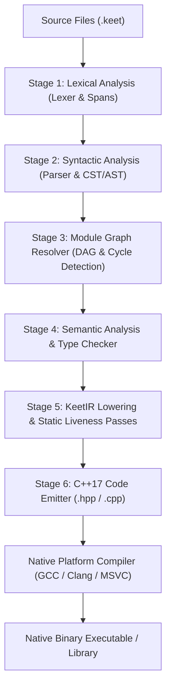

# Keety Compiler Architecture Specification

The `keety` compiler is the official ahead-of-time (AOT) compiler and toolchain driver for the KeetScript programming language. It transpiles KeetScript source code (`.keet`) into clean, idiomatic, and highly optimized standard C++17 source (`.cpp`) and header (`.hpp`) files, subsequently coordinating with native platform toolchains (GCC, Clang, MSVC) to produce native machine executables or shared libraries.

This document formally specifies the internal architecture, compiler pipeline stages, intermediate representation (KeetIR), diagnostic standards, and C++ code emission conventions of the `keety` compiler, acting as the implementation companion to [The KeetScript Language Specification.md](file:///Users/pawel/Documents/GitHub/keety/documentation/The%20KeetScript%20Language%20Specification.md) and [KeetScript Language Server Protocol Specification.md](file:///Users/pawel/Documents/GitHub/keety/documentation/KeetScript%20Language%20Server%20Protocol%20Specification.md).

---

## 1. Design Principles & Architectural Goals

1. **Strict Zero-Overhead Abstraction:** Features of KeetScript (value semantics, unions, error recovery via `zonk`, pattern matching via `switch`, and async tasks) must compile directly to equivalent native C++17 primitives (`std::variant`, `std::vector`, RAII stack values, zero-cost exception tables, and thread-pool futures) with zero unnecessary heap allocations and zero hidden virtual dispatch overhead.
2. **Deterministic, Independent Pipeline Separation:** Lexing, parsing, module DAG resolution, semantic type checking, IR optimization, and code emission must reside in isolated, single-responsibility compiler phases with well-defined data boundaries.
3. **Reproducible & Hermetic C++ Generation:** The emitted C++ code must be completely self-contained, human-readable, formatted according to modern C++17 standards, and compilable by any standard-compliant native C++ compiler without proprietary runtime dependencies.
4. **Rich & Actionable Diagnostics:** Compiler errors must provide exact source code spans, terminal visual context squiggles, human-readable explanations of why a rule was violated (e.g. `mut` aliasing, strict no-shadowing, or uninitialized variables), and automated "Did you mean?" fix-it hints.

---

## 2. End-to-End Compilation Pipeline Overview

The `keety` compilation process operates as a 6-stage feed-forward compiler pipeline:



---

## 3. Detailed Compiler Pipeline Stages

### Stage 1: Lexical Analysis (`keety::lexer`)

The Lexer transforms UTF-8 encoded source text into a stream of discrete lexical tokens while recording precise source location metadata (`SourceSpan`: start offset, end offset, line number, column number).

* **Maximal Munch & Context-Sensitive Rules:**
  * **Blank Identifier (`_`):** A single underscore character `_` not immediately followed by an alphanumeric character or underscore produces a distinct `Token::BlankIdent`. An underscore followed by letters or digits (such as `_count`) produces a standard `Token::Identifier`.
  * **Generic `<TypeArgs>` Disambiguation:** An angle bracket `<` immediately following an identifier with **zero intervening whitespace** initiates a generic type argument tokenization context. If preceded by whitespace, `<` is tokenized as `Token::Less`.
  * **Type Context Angle Brackets (`>` and `>>`):** Inside generic type parameters `<...>`, type arguments, or type annotations, a `>` character always emits a single `Token::Greater` to close the open bracket, preventing the lexer from eagerly consuming `>>` as a bitwise shift token or combining with `=` into `>=`.
* **Multi-Line Template Literals with Recursive Interpolation:**
  * The lexer maintains an interpolation state stack. Encountering `${` inside a backtick string literal pushes a `TemplateInterpolation` state, temporarily switching tokenization to normal expression lexing.
  * When balanced closing braces `}` return the stack to the template literal state, text scanning resumes until the closing backtick `` ` `` is consumed.

---

### Stage 2: Syntactic Analysis (`keety::parser`)

The Parser consumes the token stream and constructs a strongly typed Abstract Syntax Tree (AST) conforming to the formal KeetScript EBNF grammar.

* **Parser Architecture:** Deterministic top-down Recursive Descent with selective bounded lookahead (LL(k)):
  * **`IfHeaderInit` Disambiguation:** When parsing the header of an `if`, `while`, or `switch` statement, the parser performs a linear token scan within the balanced parentheses `(...)` for a top-level semicolon `;`. If present, the statement parses an initialization statement (`IfHeaderInit`); otherwise, it parses directly as the condition `Expression`.
  * **`ZonkSuffix` Disambiguation:** After consuming `Token::Zonk`, if the next token is `(`, the parser scans past the matching `)` to inspect the immediately following token. If `{` follows `)`, it parses as a scoped recovery block (`expr zonk (err) Block`); otherwise, it parses as a parenthesized fallback expression (`expr zonk (fallbackExpr)`).
* **AST Node Hierarchy:**
  * Every AST node stores its originating `SourceSpan` for compiler diagnostic reporting.
  * Statements, Declarations, and Expressions are represented as algebraic sum types (tagged variants) ensuring complete type safety during traversal passes.

---

### Stage 3: Module Graph Resolver & Dependency DAG (`keety::resolver`)

KeetScript treats every source file as an autonomous module. Before type checking begins, `keety` resolves project-wide module relationships:

* **Path Resolution:**
  * Standard library imports (`import io;`, `import math;`) resolve against the built-in compiler module registry.
  * Third-party package imports (`import vendor.json;`) resolve against the project root `keet_modules/` directory.
  * Local relative imports (`import "./utils/helper";`) resolve against the file system relative to the importing file's directory.
* **Strict Acyclic Dependency Graph (DAG) Enforcement:**
  * The resolver constructs a directed dependency graph $G = (V, E)$, where each vertex $v \in V$ is a `.keet` module and each directed edge $(u, v) \in E$ denotes that module $u$ imports module $v$.
  * Tarjan’s Strongly Connected Components (SCC) algorithm evaluates the graph. Any component with $|V_{SCC}| > 1$ or any self-loop triggers an immediate compiler diagnostic detailing the exact circular dependency cycle path:
    ```
    error[E1001]: Circular module dependency detected:
       --> src/auth.keet:3:1
        |
      3 | import "./user";
        | ^^^^^^^^^^^^^^^ cycle: src/auth.keet -> src/user.keet -> src/auth.keet
    ```
* **Topological Sort for Deterministic Initialization:**
  * Post-order Depth-First Search (DFS) yields the exact topological initialization order. Modules at the leaves (having no downstream project dependencies) are scheduled for initialization before the modules that depend upon them.
* **Module Deduplication (Single-Instantiation):**
  * When a module is imported across multiple independent compilation units (diamond dependency), `keety` caches the parsed module AST, ensuring that symbol resolution and code generation instantiate the module's state and types exactly once.
* **Upward Project-Root Discovery (`keety::driver::findProjectRoot`):**
  * To seamlessly locate packages installed by the `kattery` package manager, `keety` dynamically resolves the project root by walking upward from the entry file:
    1. The nearest ancestor containing `keet_modules/` (enabling monorepo workspace members to import hoisted root packages).
    2. The nearest ancestor containing `pedigree.json`.
    3. The entry file's parent directory (fallback for isolated standalone scripts).

---

### Stage 4: Semantic Analysis & Type Checker (`keety::typechecker`)

The Semantic Analyzer validates static semantics, program soundness, and type constraints across 5 distinct passes:

1. **Symbol Resolution & Environment Scoping:**
   * Resolves identifiers across Universe scope, Module scope, Block scopes, and Parameter scopes.
   * **Strict No-Shadowing Enforcement:** Verifies that no local variable or parameter shadows an identifier already declared in any enclosing lexical scope.
2. **Type Checking & Expression Inference:**
   * Enforces mandatory explicit type annotations on declarations (`let`, `const`, `define`, parameters, returns).
   * Contextually types empty collection literals (`[]` as `array<T>` and `{}` as `map<K, V>`).
   * Validates the strict zero-coercion rule (disallowing implicit numeric widening, narrowing, or truthy evaluation).
3. **Union Algebra Canonical Normalization:**
   * Canonically normalizes union types:
     $$\text{Normalize}(A \mid (B \mid C)) \implies A \mid B \mid C \quad (\text{Flattening})$$
     $$\text{Normalize}(A \mid B \mid A) \implies A \mid B \quad (\text{Deduplication / Commutativity})$$
     $$\text{Normalize}(200 \mid 404 \mid \text{int}) \implies \text{int} \quad (\text{Subtype Absorption})$$
4. **Control-Flow Analysis (CFA) & Narrowing Invalidation:**
   * Tracks flow-based type narrowing inside `if (typeof(x) == "T")`, `if (x != null)`, and `switch (typeof(x))`.
   * **Mutation Watcher:** Maintains a dirty bit on local variables. Any reassignment, compound assignment, passing to a `mut` parameter, or mutation inside a closure immediately invalidates the narrowed type and resets the variable to its declared union type for subsequent instructions.
5. **Memory Safety & `mut` Borrow Checker:**
   * Enforces the 5 strict rules of mutable references:
     1. Prohibits non-l-value arguments to `mut` parameters.
     2. Disallows map element indexing `m[k]` as a `mut` argument.
     3. Forbids duplicate aliasing: $f(\text{mut } x, \text{mut } x)$ is rejected.
     4. Disallows simultaneous passing of a container and its element: $f(\text{mut } arr[i], \text{mut } arr)$ is rejected.
     5. Disallows `mut` parameters in `async` functions or default argument initializers.
6. **Exhaustiveness & Reachability Analysis:**
   * Verifies that all execution paths through non-void functions, methods, and non-diverging `zonk` recovery blocks end in terminating statements (`return`, `yield`, or `zonk`). Unreachable statements following a terminating statement are flagged as compile-time errors.

---

### Stage 5: KeetIR Lowering & Static Liveness Passes (`keety::ir`)

Rather than transpiling directly from AST to C++ text, `keety` lowers the validated AST into a high-level Intermediate Representation (**KeetIR**) structured as a Control Flow Graph (CFG) of Basic Blocks.

```mermaid
flowchart LR
    AST["Typed AST"] --> Lower["KeetIR Lowering"]
    Lower --> Pass1["Pass 1: Static Liveness Analysis"]
    Pass1 --> Pass2["Pass 2: Last-Use Move Insertion (std::move)"]
    Pass2 --> Pass3["Pass 3: Const-Reference Parameter Promotion"]
    Pass3 --> Pass4["Pass 4: Pipeline Capacity Pre-Allocation (.reserve)"]
    Pass4 --> Pass5["Pass 5: Recursive Smart-Pointer Boxing"]
    Pass5 --> Emitter["C++17 Code Emitter"]
```



#### KeetIR Optimization Passes:
1. **Static Liveness Analysis & Last-Use `std::move` Insertion:**
   * Tracks the lexical lifetime and live ranges of all local variables within each function.
   * If a local variable `x` is passed by value, pushed to a collection (`arr.push(x)`), or returned (`return x;`), and static liveness proves that `x` is never subsequently read before leaving its scope, KeetIR marks the operand as an rvalue move target (`std::move(x)` in generated C++).
2. **Const-Reference Parameter Promotion:**
   * Scans function and method bodies for value parameters that are never mutated.
   * In generated C++ function signatures, promotes unmutated composite parameters (`string`, `array<T>`, `map<K, V>`, `class`) to `const T&`, eliminating deep copies while maintaining KeetScript's language-level value semantics.
3. **Pipeline Capacity Pre-Allocation (`.reserve`):**
   * Recognizes array functional chains such as `arr.map<U>(...).filter(...)`.
   * Emits pre-allocation directives (`result.reserve(src.size())`) in the emitted C++ code to prevent memory reallocation and vector geometric resizing during functional transformations.
4. **Recursive Variant & Self-Referential Class Boxing:**
   * Identifies self-referential class fields (e.g., `class Node { let next: Node | null; }`) that would cause infinite-size compilation errors in C++ value types and `std::variant`.
   * Automatically inserts transparent, value-copying smart pointer wrappers (`keet::deep_copy_ptr<T>`) at the KeetIR level.

---

### Stage 6: C++17 Code Emitter (`keety::emitter`)

The Code Emitter transforms optimized KeetIR into deterministic, compilable C++17 translation units formatted to standard style guidelines.

#### 1. Header File Architecture (`<module>.hpp`)
Every module `<name>.keet` compiles to a corresponding `<name>.hpp` header containing:
* `#pragma once` header guard.
* Standard library `#include` directives (`<cstdint>`, `<string>`, `<vector>`, `<unordered_map>`, `<variant>`, `<utility>`, `<functional>`, `<algorithm>`).
* `#include` directives for imported local module headers.
* Namespace encapsulation: `namespace keet_module_<name> { ... }`.
* Forward declarations for all classes, structs, enums, error types, and standalone functions declared in the module.
* `constexpr` definitions for compile-time constants (`define`).
* Class and error type definitions (fields, constructors, `const fn` method prototypes).
* Generic template definitions (templates must reside in headers for C++ instantiation).
* Export declarations: public functions, types, and `inline const T&` accessor references for `export let` variables.

#### 2. Implementation File Architecture (`<module>.cpp`)
Contains the non-generic executable logic:
* `#include "<name>.hpp"`
* Storage allocation for module-level mutable variables (`int64_t count = 0;`).
* Concrete method and function bodies.
* Top-level process entry-point wrapper `main(int argc, char* argv[])` (emitted only for the root module containing `fn main`).

---

## 4. Canonical Generated C++17 Templates

### 4.1. Header Template (`<module>.hpp`)

```cpp
// Generated ahead-of-time by the KeetScript Compiler (keety). DO NOT EDIT.
#pragma once

#include <cstdint>
#include <string>
#include <vector>
#include <unordered_map>
#include <variant>
#include <memory>
#include <utility>
#include <exception>
#include <algorithm>
#include <cmath>

namespace keet {
    // Core runtime definitions
    struct error : public std::exception {
        std::string name;
        std::string message;

        error(std::string n = "Error", std::string m = "[Error]")
            : name(std::move(n)), message(std::move(m)) {}

        std::string toString() const { return "[" + name + "]: " + message; }
        const char* what() const noexcept override { return message.c_str(); }
    };

    struct BoolByte {
        bool val;
        BoolByte(bool b = false) : val(b) {}
        operator bool() const { return val; }
        BoolByte& operator=(bool b) { val = b; return *this; }
    };
}

namespace keet_module_metrics {
    // --- Exported Types ---
    enum class Status : int64_t {
        OK = 200,
        NotFound = 404
    };

    // --- Exported Variable Const-View Accessor ---
    extern int64_t _internal_activeRequests;
    inline const int64_t& activeRequests = _internal_activeRequests;

    // --- Exported Function Prototypes ---
    void recordHit(const std::string& path);
    int64_t computeRatio(int64_t hits, int64_t total);
}
```

### 4.2. Implementation Template (`<module>.cpp`)

```cpp
// Generated ahead-of-time by the KeetScript Compiler (keety). DO NOT EDIT.
#include "metrics.hpp"
#include <iostream>

namespace keet_module_metrics {
    // Storage definition for module-level variable
    int64_t _internal_activeRequests = 0;

    void recordHit(const std::string& path) {
        _internal_activeRequests += 1;
    }

    int64_t computeRatio(int64_t hits, int64_t total) {
        if (total == 0) {
            throw keet::error("DivisionByZero", "Cannot divide by zero in computeRatio");
        }
        return hits / total;
    }
}

// Emitted only if this file is the application root entry point:
int main(int argc, char* argv[]) {
    try {
        std::vector<std::string> args;
        args.reserve(argc);
        for (int i = 0; i < argc; ++i) {
            args.emplace_back(argv[i]);
        }
        // Invokes root module KeetScript main
        // keet_module_main::_keet_main(std::move(args));
        return 0;
    } catch (const keet::error& err) {
        std::cerr << "Uncaught error: " << err.toString() << "\n";
        return 1;
    } catch (const std::exception& ex) {
        std::cerr << "Uncaught native C++ exception: " << ex.what() << "\n";
        return 1;
    }
}
```

---

## 5. Diagnostic Reporting Standards

Diagnostics produced by `keety` follow the modern compiler standard (similar to Clang, Rustc, and GCC 10+):

1. **Structured Diagnostic Format:**
   ```
   <severity>[<error_code>]: <message>
     --> <file_path>:<line>:<column>
      |
   <line_num> | <source_text>
      |   <visual_indicator> <inline_label>
      |
      = help: <actionable_suggestion>
   ```

2. **Visual Example:**
   ```
   error[E4001]: cannot pass multiple mutable references to the same storage path
      --> src/network/router.keet:42:15
       |
    42 |     swapBuffers(mut bufferPool, mut bufferPool);
       |                 ^^^^^^^^^^^^^^      ^^^^^^^^^^^^^^ duplicate mutable borrow
       |                 |
       |                 first mutable borrow occurs here
       |
       = note: KeetScript enforces exclusive mutable borrowing to prevent reference aliasing bugs
       = help: ensure each 'mut' argument references a distinct, disjoint storage location
   ```

3. **Error Categories & Ranges:**
   * `E0001`–`E0999`: Lexical and Syntactic Grammar Errors (unterminated strings, unexpected tokens, missing semicolons).
   * `E1000`–`E1999`: Module Resolution and Cyclic Dependency Errors.
   * `E2000`–`E2999`: Semantic, Scoping, and Shadowing Errors.
   * `E3000`–`E3999`: Type Checking, Union Narrowing, and Assignment Soundness.
   * `E4000`–`E4999`: Memory Safety, Aliasing, and `mut` Borrow Checker Violations.
   * `E5000`–`E5999`: Control Flow, Termination, and Reachability Errors.
   * `E6000`–`E6999`: Foreign Function Interface (FFI) and C++ Linkage Errors (`E6001` unresolved external symbols, `E6002` missing native library).
   * `E7000`–`E7999`: Backend Code Generation & Remapped Host Toolchain Errors (`E7001` backend compilation failure).

4. **Backend Diagnostic Translation & Error Remapping Engine:**
   Because `keety` lowers KeetScript AST and KeetIR to native C++20 before compiling with host toolchains (Clang, GCC, MSVC), any compilation or linker issue occurring in the native stage could potentially expose hundreds of lines of template substitution backtraces, internal runtime symbols (`_keet_fn_`, `_keet_var_`, `keet::rt::*`), and reference ephemeral `.keety_build/*.cpp` files. To deliver a pristine language experience, `keety` includes a strict translation pipeline:

   * **Line Directives & Source Map Fallback (`LineDirectiveTracker` & `SourceMap`):**
     * During C++ emission, `LineDirectiveTracker` emits standard `#line <line> "<orig.keet>"` directives ahead of functions and statements.
     * To defend against aggressive toolchain optimization passes or preprocessors stripping `#line` directives, `CppEmitter` also injects compact source map annotations `/*__KSM:<file>:<sline>:<scol>-<eline>:<ecol>*/`.
     * `SourceMap` indexes these ranges, providing accurate KeetScript file, line, and column coordinates even if host toolchains report lines relative to intermediate C++ files.
   * **Host Toolchain Dialect Parsing (`DiagnosticTranslator`):**
     * **Clang / Apple Clang:** Regex-based extraction of `file:line:col: error/warning/note` with sub-notes and "did you mean" fix-it suggestions.
     * **GCC:** Handles warning flags (`[-W...]`), notes, and macro expansions.
     * **MSVC (`cl.exe`):** Parses `file(line,col): error/fatal error/warning Cxxxx: message` across standard Windows path and drive formats.
   * **Type & Symbol Demangling:**
     * Translates standard library C++ types into idiomatic KeetScript types:
       * `std::vector<T>` $\to$ `[T]`
       * `std::unordered_map<K, V>` $\to$ `[K: V]`
       * `std::variant<Ts...>` $\to$ `T1 | T2`
       * `std::optional<T>` $\to$ `T?`
       * `std::string` / `std::string_view` $\to$ `string`
       * `int64_t` / `long long` $\to$ `int`, `double` / `float` $\to$ `float`
       * `std::shared_ptr<T>` $\to$ `T`
     * Reverses internal compiler mangling (`_keet_fn_foo` $\to$ `foo`, `_keet_var_bar` $\to$ `bar`).
     * Filters out standard library internal headers (`<vector>`, `<type_traits>`, `xutility`, `stl_vector.h`).
   * **Linker Error Remapping (`translate_linker_output`):**
     * Detects unresolved external symbols across `ld64` (macOS), `GNU ld` (Linux), and `link.exe` (Windows).
     * Maps missing symbols to actionable package dependency suggestions (e.g. `sqlite3_open` $\to$ suggests `sqlite`, `SSL_connect` $\to$ suggests `openssl`, `curl_easy_init` $\to$ suggests `libcurl`).
   * **Strict ICE Confinement & CLI Flags:**
     * `error[ICE]` is strictly reserved for unhandled compiler host crashes (e.g. SIGSEGV, SIGABRT) or unmappable empty outputs. Standard compilation and linker failures are translated into structured `error[E...]` diagnostics.
     * The `--verbose-cpp` flag is reserved for compiler development to display raw untranslated C++ toolchain outputs alongside translated diagnostics.
     * `--diagnostic-format=json` (or `--json`) outputs valid JSON diagnostic payloads compliant with IDE and LSP tooling.

---

## 6. Compiler CLI & Toolchain Driver Architecture

The `keety` binary acts as an integrated language driver:

### Commands:
* `keety build [entry_file] [options]` — Compiles KeetScript sources to C++ and invokes the native toolchain to produce an executable or library.
* `keety run [entry_file] [-- args]` — Compiles and immediately executes the target program.
* `keety check [entry_file]` — Runs lexing, parsing, module DAG resolution, and type checking without invoking the native C++ compiler (instant IDE validation).
* `keety emit [entry_file] (--cpp | --hpp | --ast | --ir)` — Dumps intermediate representations or generated C++ sources directly to standard output or a designated directory.

### Key Flags:
* `--output-dir, -o <dir>`: Sets the target directory for generated C++ headers and binaries.
* `--cxx <compiler>`: Specifies the underlying native C++ compiler binary (`g++`, `clang++`, `cl.exe`).
* `--opt, -O <0|1|2|3|s>`: Sets the optimization tier for both `keety` IR lowering and the native C++ compiler.
* `--wrapv`: Enforces 64-bit signed integer two's-complement overflow semantics on GCC/Clang.
* `--verbose, -v`: Prints detailed stage timings and intermediate invocation commands.

---

## 7. Package Manager Architecture: `kattery`

To keep the AOT compiler focused exclusively on deterministic compilation, code generation, and language semantics, package and dependency management is handled by **`kattery`** (`keety::pkg`):

### Separation of Concerns:
* **`keety`** (Compiler): Compiles `.keet` sources to C++20 and builds native executables; resolves packages from `keet_modules/` found via `findProjectRoot`. Never reads or modifies `pedigree.json` or `pedigree.lock`.
* **`kattery`** (Package Manager): Scaffolds projects, manages `pedigree.json`, fetches remote Git mirrors or local path packages, calculates dependency graphs, hoists shared packages, writes deterministic `pedigree.lock` files, and manages workspace links in `keet_modules/`.

### Core Subsystems (`keety::pkg`):
* **`SourceSpec`**: Parses and round-trips `git+<url>[#<ref>]` and `path:<dir>` specifications with package name validation.
* **`Manifest` (`pedigree.json`)**: Validates and serializes package configuration, dependency maps, devDependencies, and custom scripts.
* **`Lockfile` (`pedigree.lock`)**: Stores canonical, lexicographically-ordered records of resolved Git commit SHAs, Git tree integrity hashes, and dependency lists.
* **`Workspace`**: Discovers monorepo roots and member packages via glob patterns (`packages/*`), ensuring duplicate-free member names.
* **`DependencyGraph` & `Installer`**: Walks transitive dependencies, detects dependency cycles and conflicting versions, stages checkouts, and performs atomic installations into `keet_modules/` with `.kattery.json` state tracking.
* **`ScriptRunner`**: Cross-platform shell execution (`/bin/sh -c` on POSIX, `cmd /C` on Windows) with automatic `keety` `PATH` injection and exit-code propagation.

---

## 8. Language Server Architecture: `keet-lsp`

The **`keet-lsp`** binary (`keety::lsp`) provides sub-millisecond, editor-agnostic Language Server Protocol support for KeetScript (`.keet`) and Keet Markup Language (`.kml`) Single-File Components.

### Key Architectural Characteristics:
* **Zero-Spawning In-Memory Analysis:** Avoids invoking CLI sub-processes by linking directly against `keet_lsp_core` and `keety_core`. Reuses the production lexer, recursive descent parser, AST structures, symbol tables, and typechecker directly in memory.
* **Transient Document Management:** The [`DocumentManager`](file:///Users/pawel/Documents/GitHub/keety/include/keety/lsp/document.hpp) manages open editor buffers (`didOpen`, `didChange`, `didClose`) with monotonic byte-offset line index caches, ensuring efficient conversion between zero-based UTF-16 LSP positions and UTF-8 lexer byte offsets.
* **Heterogeneous SFC Isolation (`.kml`):** Keet Markup Language files combine KeetScript `<script>`, reactive `<template>`, and scoped `<style>`. To prevent template markup from causing syntax errors in the KeetScript parser, `keet-lsp` intercepts `.kml` documents and routes them to specialized KML tooling handlers (`getKmlHover`, `findKmlDefinition`, `getKmlCompletions`, `getKmlDocumentSymbols`, `getKmlSemanticTokens`).
* **Fault-Tolerant Syntactic Fallbacks:** During active typing (such as dangling dots `math.` or unclosed blocks), the AST parser may report syntax errors. `keet-lsp` couples AST queries with resilient line-based syntactic heuristics to guarantee that local variables, parameters, and documentation remain available in completions and hovers.

For full protocol message specifications, transport framing, capability negotiation, and KML tooling mechanics, see [KeetScript Language Server Protocol Specification.md](file:///Users/pawel/Documents/GitHub/keety/documentation/KeetScript%20Language%20Server%20Protocol%20Specification.md).


