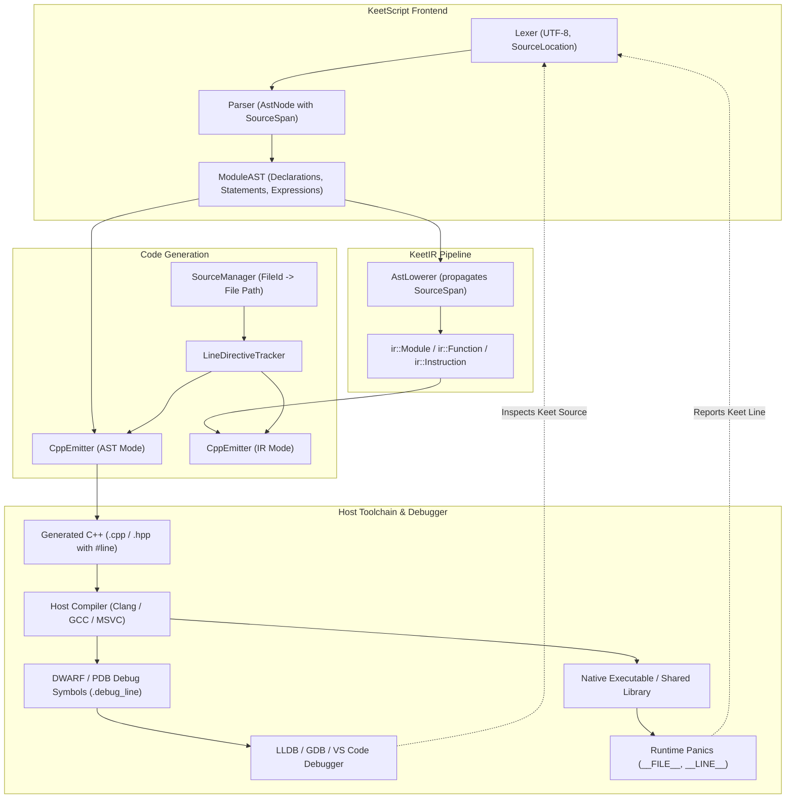

# KeetScript Source-to-Source Line Mapping Implementation Plan

This document establishes the architectural design, preprocessor directive specification, and phased engineering roadmap for **Source-to-Source Line Mapping** (Category B1.2 in [`ROADMAP.md`](../ROADMAP.md)).

---

## 1. Executive Summary & Design Principles

Because `keety` is an ahead-of-time (AOT) compiler targeting native binaries via intermediate standard C++20 emission (`.hpp` and `.cpp`), compilation diagnostics, native debugger sessions (LLDB, GDB, MSVC Debugger), and runtime panics currently report intermediate C++ file paths and line offsets (e.g. `build/main.cpp:247`) rather than the developer's original KeetScript source lines (e.g. `src/main.keet:38`).

This implementation plan introduces first-class source-to-source mapping using standard preprocessor line control directives (`#line <line> "<file>"`), delivering the following guarantees:

1. **Host Compiler Diagnostic Transparency:**
   If a host C++ toolchain (Clang, GCC, MSVC) raises a diagnostic, warning, or static assertion during compilation, the reported file and line point directly to the originating `.keet` source line.
2. **Native Debugger Line Table Synchronization:**
   Clang, GCC, and MSVC respect `#line` directives when generating DWARF `.debug_line` tables and CodeView PDB symbols. Breakpoints set at `.keet` files and line numbers in LLDB, GDB, or VS Code will bind accurately, and stack traces will display KeetScript filenames and lines.
3. **Runtime Panic & Assertion Fidelity:**
   Runtime checks and assertion panics relying on `__FILE__`, `__LINE__`, or C++20 `std::source_location::current()` automatically reflect KeetScript source locations.
4. **Minimalist & Hermetic Emission:**
   Line directives are emitted idempotently only when the source line or source file actually changes, avoiding noise and keeping intermediate files clean.
5. **Boilerplate Isolation:**
   Compiler preambles (`#include <keet/runtime.hpp>`), standard library includes, synthetic namespaces, and generated entrypoint `main(int argc, char* argv[])` wrappers are strictly excluded from user `#line` mappings so internal errors never misattribute faults to user code.
6. **Developer Ergonomics:**
   A dedicated `--no-line-directives` CLI flag allows developers inspecting generated C++ code to view clean, unadorned C++ or human-readable comments (e.g. `// [keet: line 42]`).

---

## 2. Architecture Overview



---

## 3. Technical Specification

### 3.1 Preprocessor Directive Format
C++ standard preprocessor line control (ISO/IEC 14882 §19.4) conforms to:
```cpp
#line <line-number> "<source-file-path>"
```
- `<line-number>`: A positive 1-indexed decimal integer representing the start line of the construct.
- `"<source-file-path>"`: The normalized relative or canonical path to the `.keet` source file enclosed in double quotes.

#### Path Normalization Rules
- **Forward Slash Normalization:** On Windows, backslashes (`\`) are normalized to forward slashes (`/`) to avoid accidental escape sequence evaluation in host preprocessors.
- **Project Root Relative:** File paths are formatted relative to the compilation root (or project directory containing `pedigree.json`), keeping build outputs deterministic and portable.

### 3.2 Emission Rules & Boundaries

| AST / IR Construct | `#line` Directive Emitted? | Target Line |
| :--- | :--- | :--- |
| **File Preamble** (`#include ...`, banner) | **NO** | Kept clean to preserve C++ standard library diagnostics. |
| **Module Namespace Opening / Closing** | **NO** | Structural C++ scoping only. |
| **Global / Module Storage Allocations** | **YES** | Originating `VarDecl` or `ConstDecl` line. |
| **Function / Method Signatures** | **YES** | Originating `FnDecl` declaration line. |
| **Statements (`let`, `const`, `return`, `if`, etc.)** | **YES** | First line of `ast::Stmt` span (deduplicated). |
| **Loop Headers (`while`, `for`, `for..in`)** | **YES** | Statement start line. |
| **Error Recovery (`zonk`, catch blocks)** | **YES** | Expression / block start line. |
| **Process Entry Wrapper (`int main()`)** | **NO** | Synthetic runtime coordination wrapper. |
| **Sequential Statements on Same Line** | **NO** | Skipped if `current_line == last_emitted_line`. |

### 3.3 State Machine: `LineDirectiveTracker`

To prevent emitting redundant `#line` directives before consecutive statements originating from the same source line, an internal state machine tracks:
```cpp
class LineDirectiveTracker {
public:
    explicit LineDirectiveTracker(bool enabled = true);

    /// Formats a #line directive if the file or line has changed since the last emission.
    /// Returns an empty string if enabled == false or if (file_path == last_file && line == last_line).
    [[nodiscard]] std::string get_line_directive(const diag::SourceSpan& span, 
                                                const diag::SourceManager* source_mgr,
                                                std::string_view fallback_file = "");

    void reset();
    void set_enabled(bool enabled) noexcept;
    [[nodiscard]] bool is_enabled() const noexcept;

private:
    bool enabled_{true};
    std::string last_file_{};
    uint32_t last_line_{0};
};
```

---

## 4. Phased Implementation Roadmap

### Phase 1: `LineDirectiveTracker` & Configuration Options
- **Goal:** Create the standalone line directive tracker and configuration structs.
- **Files to create/modify:**
  - `include/keety/emitter/line_directive_tracker.hpp`
  - `src/emitter/line_directive_tracker.cpp`
  - `include/keety/emitter/cpp_emitter.hpp`: Add `emit_line_directives` and `source_manager` to `CppEmitterOptions`.
  - `include/keety/emitter/header_emitter.hpp`: Add `emit_line_directives` to `HeaderEmitterOptions`.
- **Deliverables:**
  - Unit tests in `tests/unit/test_line_directive_tracker.cpp` verifying deduplication, Windows path slash normalization, and disable flags.

### Phase 2: AST-Level C++ and Header Emission Integration
- **Goal:** Emit `#line` directives during AST translation in `CppEmitter` and `HeaderEmitter`.
- **Files to modify:**
  - `src/emitter/cpp_emitter.cpp`:
    - Insert `#line` directives before function declarations in `translate_function` and `translate_method`.
    - Insert `#line` directives in `translate_statement` before each statement type (`DeclStmt`, `ExprStmt`, `ReturnStmt`, `IfStmt`, `WhileStmt`, `ForStmt`, `ForInStmt`, `SwitchStmt`, `ZonkStmt`).
    - Guard against emitting `#line` inside the synthetic `emit_main_wrapper()`.
  - `src/emitter/header_emitter.cpp`:
    - Insert `#line` directives before exported function declarations and global definitions.
- **Deliverables:**
  - Unit tests verifying emitted C++ contains `#line <line> "<file>"` matching original AST spans.

### Phase 3: IR Span Preservation & IR Emitter Support
- **Goal:** Ensure the intermediate representation (KeetIR) preserves exact source spans through lowering and optimization.
- **Files to modify:**
  - `src/ir/ast_lowerer.cpp`:
    - Pass `ast_node.getSpan()` into all `Instruction` constructors (`AllocaInst`, `StoreInst`, `LoadInst`, `BinaryInst`, `CallInst`, `ReturnInst`, `BranchInst`, `CondBranchInst`, etc.).
  - `src/emitter/cpp_emitter.cpp`:
    - Update `translate_ir_function` to emit `#line` directives when transitioning between instructions with different source lines.
- **Deliverables:**
  - Unit tests verifying IR instructions retain non-empty `SourceSpan` and that IR-based emission produces correct `#line` directives.

### Phase 4: CLI Driver & Toolchain Coordination
- **Goal:** Connect line directive settings to CLI arguments and ensure native debug flags are passed.
- **Files to modify:**
  - `include/keety/driver/cli_driver.hpp`: Add `--no-line-directives` flag option.
  - `src/driver/cli_driver.cpp`:
    - Parse `--no-line-directives` flag and configure `CppEmitterOptions::emit_line_directives`.
    - Pass `SourceManager` reference to `CppEmitter` for accurate relative file path resolution.
    - Ensure `ToolchainDriver` passes `-g` (or `/Z7` on MSVC) when compiling debug builds.
- **Deliverables:**
  - CLI tests verifying `keety build --no-line-directives` suppresses `#line` directives in emitted C++.

### Phase 5: Verification, LLDB Conformance & Documentation
- **Goal:** Validate end-to-end debugger and diagnostic behavior.
- **Test Scenarios:**
  - **Toolchain Diagnostic Verification:** Compile code triggering a C++ static assertion or error, verifying the compiler output prints the `.keet` path and line.
  - **LLDB Breakpoint Verification:** Run `lldb` in batch mode against a compiled KeetScript binary, setting a breakpoint by `.keet` filename and line number, ensuring the breakpoint resolves.
  - **Runtime Panic Verification:** Verify runtime bounds check failures or unhandled `zonk` errors report `.keet` source line locations.
- **Documentation Updates:**
  - Update `ROADMAP.md` Category B1.2 to mark progress.
  - Document debugging with LLDB/GDB and VS Code in `documentation/`.

---

## 5. Verification & Testing Matrix

| Test Suite | Target | Verification Method |
| :--- | :--- | :--- |
| `tests/unit/test_line_directive_tracker.cpp` | `LineDirectiveTracker` | Unit tests for line deduplication, path normalization, enable/disable switches. |
| `tests/unit/test_cpp_emitter_lines.cpp` | `CppEmitter` | Verify emitted `.cpp` strings match expected `#line` sequences for AST constructs. |
| `tests/unit/test_ir_span_preservation.cpp` | `AstLowerer` & `KeetIR` | Verify all lowered instructions have valid non-empty `SourceSpan`. |
| `tests/integration/test_toolchain_line_mapping.cpp` | End-to-End Toolchain | Verify host compiler diagnostics reference `.keet` files. |
| LLDB Batch Smoke Test | Debugger line table | Verify `breakpoint set -f app.keet -l 10` binds to address. |

---

## 6. Success Criteria

- [ ] Every emitted function and statement in generated `.cpp` files has an originating `#line <N> "<file>.keet"` directive.
- [ ] No `#line` directives are emitted for standard header inclusions or generated `main` wrapper code.
- [ ] Compiling with `keety build --no-line-directives` generates clean C++ code without `#line` directives.
- [ ] 100% test pass rate across existing unit and conformance test suites (`ctest`).
- [ ] Native debuggers (LLDB / GDB) can hit breakpoints set on `.keet` files.
