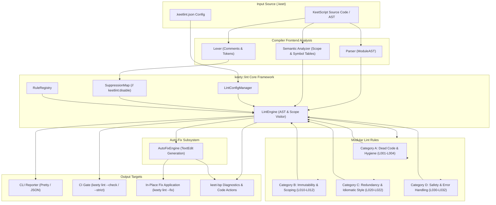

# Static Linter (`keety lint`) Implementation Plan

This document specifies the technical architecture, linting rule categories, component design, suppression mechanism, auto-fix engine, and staged execution plan for the **KeetScript Static Linter (`keety lint`)** (Near-Term Backlog item **B1.2** in [`ROADMAP.md`](file:///Users/pawel/CLionProjects/keety/ROADMAP.md#L167-L174)).

---

## 1. Executive Summary & Design Goals

The primary goal of `keety lint` is to provide **high-performance, IDE-grade static analysis, code hygiene verification, and dead-code detection** for the KeetScript programming language:

1. **Zero-Overhead Static Analysis:** Built directly upon the compiler frontend (`lexer`, `parser`, `sema`, `diag`). Leverages existing symbol tables, lexical scopes, and type metadata rather than maintaining a separate compiler replica.
2. **Actionable & Precise Diagnostics:** Every lint violation reports a deterministic rule code (e.g. `L001`, `L010`), a human-readable explanation, source location span, and severity (`warning`, `error`, `info`).
3. **Automated Safe Quick-Fixes (`--fix`):** Mechanical issues (e.g., stripping unused imports, prefixing unused identifiers with `_`, converting unnecessary `mut` to immutable `let`) can be fixed automatically without semantic risk.
4. **Flexible Configuration & Granular In-Code Suppression:**
   - Workspace-level `.keetlint.json` configuration file with per-rule severity toggles.
   - Inline comment annotations: `// keetlint:disable-next-line <rule>` and `// keetlint:disable <rule>`.
5. **Toolchain & IDE Integration:**
   - **CLI:** `keety lint [paths...]` with recursion, `--check`, `--fix`, `--strict` (warnings treated as errors for CI gates), and `--format=pretty|json`.
   - **LSP:** Live background diagnostics in `keet-lsp` with squiggles and 1-click Quick Fixes (`textDocument/codeAction`).

---

## 2. End-to-End Architecture



---

## 3. Lint Rule Catalog

Rules are organized into four distinct categories with unambiguous rule codes:

| Code | Rule Name | Default Severity | Fixable | Description |
| :--- | :--- | :--- | :---: | :--- |
| **L001** | `unused-import` | `warning` | Yes | Imported module or symbol is never referenced in the file. |
| **L002** | `unused-variable` | `warning` | Yes | Local `let`/`const` variable is declared but never read. |
| **L003** | `unused-parameter` | `warning` | Yes | Function or closure parameter is never used in the body (suggests `_` prefix). |
| **L004** | `unreachable-code` | `warning` | No | Statements situated after a terminal `return`, `break`, `continue`, or `panic`/error raising. |
| **L010** | `unnecessary-mut` | `warning` | Yes | Variable or parameter marked `mut` that is never mutated or mutably borrowed. |
| **L011** | `variable-shadowing` | `info` | No | Inner local variable shadows a symbol in an outer enclosing scope. |
| **L012** | `pointless-reassignment` | `warning` | Yes | Variable reassigned the exact same value or assigned right before falling out of scope. |
| **L020** | `redundant-type-annotation` | `info` | Yes | Explicit type annotation that is trivially evident from the literal initializer (e.g. `let x: int = 10;`). |
| **L021** | `redundant-parentheses` | `info` | Yes | Redundant double parentheses in expressions (e.g., `((x + 1))`). |
| **L022** | `empty-block` | `warning` | No | Empty statement block `{}` in control flow or function bodies (excluding empty types/interfaces). |
| **L030** | `unhandled-zonk-error` | `warning` | No | Function call that can raise an error invoked without `zonk` or error propagation. |
| **L031** | `todo-comment` | `info` | No | Flags leftover `TODO`, `FIXME`, or `HACK` comments in code. |

---

## 4. Configuration & Suppression Specification

### 4.1 Configuration File (`.keetlint.json`)

Projects can define a `.keetlint.json` file in their root directory (or configure a `"lint"` key in `pedigree.json`):

```json
{
  "$schema": "https://keetscript.org/schema/keetlint.json",
  "strict": false,
  "rules": {
    "unused-import": "error",
    "unused-variable": "warn",
    "unused-parameter": "warn",
    "unnecessary-mut": "warn",
    "unreachable-code": "error",
    "redundant-type-annotation": "off",
    "variable-shadowing": "warn",
    "empty-block": "warn",
    "todo-comment": "info"
  },
  "ignore": [
    "vendor/**",
    "build/**",
    ".keety_build/**"
  ]
}
```

Allowed severity values: `"off"`, `"info"`, `"warn"` / `"warning"`, `"error"`.

### 4.2 In-Code Comment Suppression

Developers can suppress warnings inline using standardized comments:

1. **Disable next line:**
   ```keet
   // keetlint:disable-next-line unused-variable
   let temporaryBuffer: string = loadBuffer();
   ```
2. **Disable multiple rules on next line:**
   ```keet
   // keetlint:disable-next-line unused-variable, unnecessary-mut
   let mut temp: int = 42;
   ```
3. **Region-based suppression:**
   ```keet
   // keetlint:disable unused-import
   import debug_tools;
   import legacy_compat;
   // keetlint:enable unused-import
   ```

---

## 5. Auto-Fix Engine Design (`--fix`)

The `AutoFixEngine` produces non-destructive `FixEdit` records (character range replacements) that can be applied to the file:

```cpp
struct FixEdit {
    diag::SourceSpan span;
    std::string replacement;
};

struct LintDiagnostic {
    std::string ruleCode;
    std::string ruleName;
    diag::Severity severity;
    std::string message;
    diag::SourceSpan span;
    std::optional<FixEdit> quickFix;
};
```

Examples of automated transformations:
1. **`unused-import`**: Deletes the unused import statement line cleanly.
2. **`unused-variable`**: Renames `let foo = ...` to `let _foo = ...` (or `let _ = ...`).
3. **`unnecessary-mut`**: Removes the `mut` keyword token span (`let mut x` $\to$ `let x`, `fn f(mut x: int)` $\to$ `fn f(x: int)`).
4. **`redundant-type-annotation`**: Strips the `: <Type>` span from `let x: int = 1;` $\to$ `let x = 1;`.

---

## 6. Detailed 5-Phase Implementation Roadmap

```mermaid
gantt
    title Keety Static Linter (keety lint) Implementation Phases
    dateFormat  X
    axisFormat %d

    section Phase 1: Core Framework
    LintRule, LintEngine, LintConfig & Suppression Parser :p1, 0, 1

    section Phase 2: Dead-Code & Hygiene
    L001 unused-import, L002 unused-var, L003 unused-param, L004 unreachable :p2, 1, 2

    section Phase 3: Mutability & Redundancy
    L010 unnecessary-mut, L011 shadowing, L020 redundant-type, L022 empty-block :p3, 2, 3

    section Phase 4: CLI Subcommand & Auto-Fix
    keety lint CLI, --check, --fix, --strict, reporters :p4, 3, 4

    section Phase 5: LSP Integration & Verification
    keet-lsp diagnostics & codeAction, full repo verification :p5, 4, 5
```



### Phase 1: Core Framework, Rule Infrastructure, and Config Loader
- **Deliverables:**
  - `src/lint/lint_rule.hpp` & `src/lint/lint_rule.cpp`: Base class `LintRule` with visitor hooks for declarations, statements, and expressions.
  - `src/lint/lint_diagnostic.hpp`: `LintDiagnostic`, `FixEdit`, severity levels, and JSON serialization.
  - `src/lint/lint_config.hpp` & `src/lint/lint_config.cpp`: JSON config parser for `.keetlint.json` / `pedigree.json`.
  - `src/lint/suppression_map.hpp` & `src/lint/suppression_map.cpp`: Comment scanner for `// keetlint:disable` and `// keetlint:disable-next-line`.
  - `src/lint/lint_engine.hpp` & `src/lint/lint_engine.cpp`: Central runner executing active rules on parsed AST + Semantics and filtering suppressed diagnostics.
  - Unit tests: `tests/unit/test_lint_framework.cpp` verifying rule registration, config precedence, and suppression logic.
- **Verification Gate:** Framework compiles and registers mock rules; suppression comments cancel matching diagnostics.

### Phase 2: Category A Rules — Dead Code & Code Hygiene
- **Deliverables:**
  - **`L001` (`unused-import`)**: Traverses file AST symbols; flags top-level imports whose namespace or imported identifiers are unreferenced.
  - **`L002` (`unused-variable`)**: Scopes local variables; flags variables never read after declaration (ignoring identifiers starting with `_`).
  - **`L003` (`unused-parameter`)**: Inspects function/closure signatures; flags parameters not referenced in the body (ignoring `_`).
  - **`L004` (`unreachable-code`)**: Analyzes basic control flow blocks; flags statements positioned after `return`, `break`, `continue`, or `panic`/error raising.
  - Unit tests: `tests/unit/test_lint_dead_code.cpp` covering positive and negative cases for each rule.
- **Verification Gate:** 100% test pass rate across all Category A dead-code rules with exact span coordinates.

### Phase 3: Category B & C Rules — Immutability, Scoping, and Redundancy
- **Deliverables:**
  - **`L010` (`unnecessary-mut`)**: Tracks write usages; flags `let mut` or `mut` parameters never reassigned or mutably borrowed.
  - **`L011` (`variable-shadowing`)**: Flags variables that shadow another variable in an outer lexical scope.
  - **`L020` (`redundant-type-annotation`)**: Flags redundant types when initialized with identical primitive literals (e.g. `let x: int = 10;`).
  - **`L022` (`empty-block`)**: Detects empty statement blocks `{}` in control flow or function bodies.
  - Unit tests: `tests/unit/test_lint_mutability_style.cpp`.
- **Verification Gate:** All immutability and redundancy tests pass with accurate diagnostic generation.

### Phase 4: CLI Subcommand (`keety lint`) & Auto-Fix Engine
- **Deliverables:**
  - `src/driver/cli_driver.cpp`: Implement `execute_lint`:
    - File and recursive directory discovery (reusing `discover_keet_files`).
    - Stdin support (`keety lint -`).
    - `--check` flag: Returns exit code `1` if any unsuppressed warnings/errors exist.
    - `--strict` flag: Elevates warnings to errors.
    - `--fix` flag: Applies `FixEdit` records in-place (re-running until clean or fixed).
    - `--format=pretty|json` reporters.
  - Unit tests: `tests/unit/test_cli_lint.cpp` covering CLI arguments, recursive directory linting, `--check`, and `--fix` transformations.
- **Verification Gate:** `keety lint` executable handles single files, directories, stdin, `--fix`, and returns proper exit codes.

### Phase 5: LSP Integration, Conformance Verification & Documentation
- **Deliverables:**
  - Wire linter into `keet-lsp`:
    - `src/lsp/analyzer.cpp`: Run `LintEngine` during document analysis and merge lint diagnostics into `textDocument/publishDiagnostics`.
    - `src/lsp/server.cpp`: Implement `textDocument/codeAction` to return Quick Fix `WorkspaceEdit` objects from `LintDiagnostic::quickFix`.
  - Update `ROADMAP.md` marking `2. Static Linter (keety lint)` as completed.
  - Create interactive demo showing linting and auto-fix capabilities.
  - Full test suite verification across all existing tests (499/499) + new lint test suites.
- **Verification Gate:** Clean build, 100% test pass rate, live LSP diagnostic squiggles and Quick Fix verification.

---

## 7. Definition of Done (DoD)

- [ ] All 12 specified lint rules implemented with comprehensive unit tests.
- [ ] In-code suppression comments (`// keetlint:disable`) fully functional.
- [ ] `.keetlint.json` configuration parsing tested.
- [ ] `keety lint` CLI subcommand fully operational with `--check`, `--fix`, `--strict`, and `--format`.
- [ ] Safe auto-fix engine tested on unused imports, variables, and unnecessary `mut`.
- [ ] `keet-lsp` publishes lint diagnostics and provides `codeAction` Quick Fixes.
- [ ] 100% pass rate across all existing unit, conformance, and benchmark tests with zero regressions.
- [ ] `ROADMAP.md` updated.
