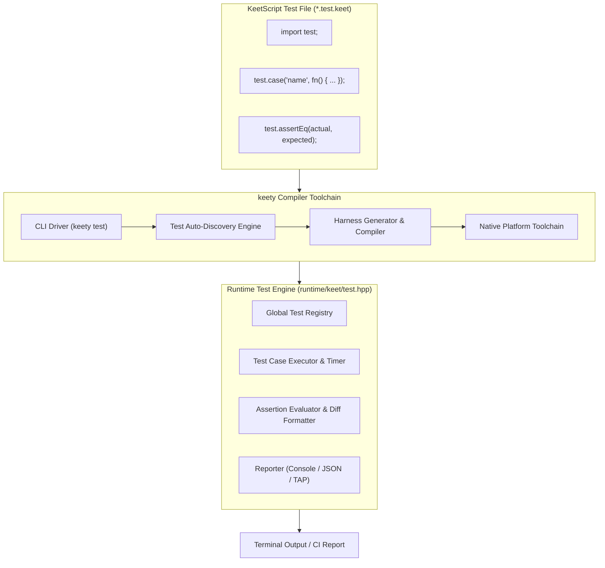
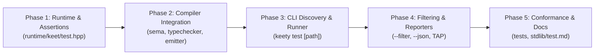

# Keety Testing Framework Implementation Plan

This document establishes the architecture, specification, standard library API, and phased roadmap for the official **KeetScript Testing Framework** (`keety test` and `import test;`).

---

## 1. Executive Summary & Design Goals

KeetScript requires a first-class, built-in unit and integration testing experience inspired by modern languages such as Rust (`cargo test`), Go (`go test`), and TypeScript/Vitest:

1. **Zero External Dependencies:** Testing is built directly into the language runtime and toolchain (`keety test`). Developers do not need third-party harnesses.
2. **First-Class Value Assertions:** Rich, type-safe assertions with colorful visual diffs for scalars, strings, arrays, maps, and classes.
3. **Deterministic Error Recovery Testing:** Dedicated assertion primitives (`assertZonks`) to verify that operations raise expected runtime errors.
4. **Autonomous Test Auto-Discovery:** Seamless discovery of test files matching `**/*.test.keet` and `**/test_*.keet`.
5. **Modern CLI & Machine Reporting:** Human-readable colored output with per-test millisecond timings, alongside structured JSON (`--json`) and TAP output for CI pipelines and package manager tasks (`kattery test`).
6. **IDE-Ready Architecture:** Designed to integrate with language server symbols, code lenses, and VS Code test explorers.

---

## 2. Architecture Overview



---

## 3. Standard Library API: `import test;`

The `test` module provides test registration, test suite grouping, and assertion functions:

```keet
import test;

test.suite("Math Operations", fn(): void {
    test.case("integer addition preserves sign", fn(): void {
        let sum: int = 10 + 25;
        test.assertEq(sum, 35, "sum should equal 35");
    });

    test.case("division by zero raises error", fn(): void {
        test.assertZonks(fn(): void {
            let zero: int = 0;
            let result: int = 10 / zero;
        }, "DivisionByZero");
    });
});
```

### 3.1. Test Registration APIs

| Function | Signature | Description |
| :--- | :--- | :--- |
| `test.case` | `fn(name: string, callback: fn(): void): void` | Registers an individual test case with the global runner. |
| `test.suite` | `fn(name: string, callback: fn(): void): void` | Groups related test cases under a common suite namespace. |
| `test.run` | `fn(): int` | Executes all registered tests and returns exit code (0 on success, 1 on failure). |

### 3.2. Assertion Library

| Function | Signature | Description |
| :--- | :--- | :--- |
| `test.assertEq<T>` | `fn(actual: T, expected: T, msg?: string): void` | Asserts deep value equality ($actual == expected$). Fails with colored visual diff. |
| `test.assertNe<T>` | `fn(actual: T, expected: T, msg?: string): void` | Asserts value inequality ($actual \ne expected$). |
| `test.assertTrue` | `fn(condition: bool, msg?: string): void` | Asserts that `condition` evaluates to `true`. |
| `test.assertFalse`| `fn(condition: bool, msg?: string): void` | Asserts that `condition` evaluates to `false`. |
| `test.assertZonks` | `fn(callback: fn(): void, expectedErrorName?: string, msg?: string): void` | Asserts that executing `callback` raises a runtime error (matching `expectedErrorName` if specified). |
| `test.fail` | `fn(message: string): void` | Unconditionally fails the current test case with `message`. |

---

## 4. Runtime Architecture (`runtime/keet/test.hpp`)

### 4.1. Core Runtime Structures

```cpp
namespace keet::test {
    struct TestFailure {
        std::string message;
        std::string expected;
        std::string actual;
        std::string file;
        int line = 0;
    };

    struct TestCaseResult {
        std::string name;
        std::string suite;
        bool passed = true;
        int64_t durationNs = 0;
        std::optional<TestFailure> failure;
    };

    struct TestSummary {
        int total = 0;
        int passed = 0;
        int failed = 0;
        int64_t totalDurationNs = 0;
        std::vector<TestCaseResult> results;
    };

    class Registry {
    public:
        static Registry& instance();
        void registerCase(std::string name, std::string suite, std::function<void()> fn);
        TestSummary runAll(const std::string& filter = "");
    };
}
```

### 4.2. Assertion Implementation & Diff Generation
- When `assertEq` fails on scalar values, arrays, maps, or strings, it constructs an `AssertionError` storing formatted representations of `actual` and `expected`.
- For multi-line strings or collections, it produces an inline diff showing insertions (`+`) and deletions (`-`).

---

## 5. Compiler Integration Pipeline

### 5.1. Module Resolution (`keety::resolver`)
- `"test"`, `"std.test"`, and `"keet.test"` are recognized as built-in standard library module imports.
- Resolves without requiring filesystem lookups in `keet_modules/`.

### 5.2. Semantic Scoping & Typechecker (`keety::sema`, `keety::typechecker`)
- `sema::createStdlibModuleScope("test")` populates:
  - `case(string, fn(): void): void`
  - `suite(string, fn(): void): void`
  - Generic template functions `assertEq<T>(T, T, string): void` and `assertNe<T>(T, T, string): void`.
  - `assertTrue(bool, string): void` and `assertFalse(bool, string): void`.
  - `assertZonks(fn(): void, string, string): void`.
  - `fail(string): void`.
- The Typechecker verifies callback signatures, ensures that generic arguments to `assertEq` match in type, and validates string messages.

### 5.3. Code Emitter (`keety::emitter`)
- Emits `#include <keet/test.hpp>` whenever `test` is imported.
- Emits calls to `keet::test::case_impl(...)` and `keet::test::assert_eq(...)`.
- When compiling in test mode (`keety test`), the emitter automatically wraps or generates the test harness `main()` function if the file does not define one.

---

## 6. CLI Driver & Discovery (`keety test`)

### 6.1. Command Syntax

```bash
keety test [path] [options]
```

- If `path` points to a single `.keet` file: Compiles and runs that specific test file.
- If `path` is a directory (or omitted, defaulting to current directory): Auto-discovers test files.
- Backwards compatibility: `keety test --benchmarks` and `keety test --conformance` continue to invoke compiler benchmarks and the conformance suite.

### 6.2. Auto-Discovery Heuristics
Recursively scans the target path for:
1. `*.test.keet` (e.g. `math.test.keet`, `auth.test.keet`)
2. `test_*.keet` (e.g. `test_lexer.keet`, `test_api.keet`)
3. Any files inside a `tests/` directory if they contain `import test;`.

### 6.3. CLI Options

| Flag | Argument | Description |
| :--- | :--- | :--- |
| `-f, --filter` | `<pattern>` | Only run tests whose name or suite matches the regex/substring pattern. |
| `--json` | None | Emit structured JSON test summary to standard output. |
| `--tap` | None | Emit Test Anything Protocol (TAP) formatted output. |
| `--fail-fast` | None | Immediately abort the test run upon the first failed assertion. |
| `-v, --verbose` | None | Print detailed diagnostic logs and execution timings per test assertion. |

### 6.4. Terminal Output Visual Design

```text
 PASS  tests/math.test.keet (3 tests, 4ms)
   ✓ integer addition preserves sign (1ms)
   ✓ safe division zero fallback (1ms)
   ✓ trigonometry clamping (2ms)

 FAIL  tests/auth.test.keet (1 failed, 2 passed, 8ms)
   ✓ password hashing (3ms)
   ✕ token validation with expired timestamp (2ms)
     AssertionError: assertEq failed
       Expected: "expired"
       Actual:   "valid"
       --> tests/auth.test.keet:42:5

Test Files  1 passed, 1 failed (2 total)
Tests       5 passed, 1 failed (6 total)
Duration    12.4ms
```

---

## 7. Phased Implementation Roadmap



### Phase 1: Runtime Engine & Assertions (`runtime/keet/test.hpp`)
- Create `runtime/keet/test.hpp` and `runtime/keet/std/test.hpp`.
- Implement `TestRegistry`, `TestCase`, `TestFailure`, and result structures.
- Implement assertion primitives: `assertEq`, `assertNe`, `assertTrue`, `assertFalse`, `assertZonks`, `fail`.
- Add unit test suite in `tests/unit/test_runtime_test.cpp`.

### Phase 2: Compiler Semantic Scoping & Typechecker Integration
- Register standard library scope in `sema::createStdlibModuleScope("test")`.
- Wire `import test;` and selective imports (`from test import assertEq, case;`) in `typechecker.cpp`.
- Wire `#include <keet/test.hpp>` in `cpp_emitter.cpp`.
- Add compiler unit tests verifying semantics and type diagnostics for `test` module.

### Phase 3: Test Discovery & CLI Driver (`keety test [path]`)
- Enhance `src/driver/cli_driver.cpp` to parse `keety test [path]`.
- Implement directory scanner discovering `*.test.keet` and `test_*.keet`.
- Generate test runner compilation harness.
- Implement ANSI colorized console reporter with test pass/fail indicators and execution timings.

### Phase 4: CLI Options, Filtering & Reporting (`--filter`, `--json`, TAP)
- Implement `--filter <pattern>` matching against test names and suites.
- Implement `--json` output format for CI and editor integrations.
- Implement `--fail-fast` mode.
- Verify `kattery test` integration.

### Phase 5: Conformance Test Suite & Documentation
- Author end-to-end conformance tests in `tests/conformance/positive/13_test/`.
- Author documentation in `documentation/stdlib/test.md`.
- Update VS Code extension completion data and snippets for `test` module.

---

## 8. Acceptance Criteria

1. **Test Coverage:** All runtime assertions, compiler passes, and CLI commands must achieve 100% test pass rate with zero warnings.
2. **Deterministic Output:** Formatted test reports and diffs must produce predictable, colorized output across macOS, Linux, and Windows.
3. **Seamless Integration:** `keety test` and `kattery test` must work out of the box with zero external configuration.
